# The UMI no one wants

Open hardware for collecting robot-manipulation data with your own hands. You hold a printed gripper, or wear a camera
on your wrist, and do the task. Each robot twin carries the same jaws and the same camera in the same place, so a
policy trained on your demonstrations sees the same thing on the robot.

Every device here is printable: STEP for every part (and STL for the older devices), full assemblies, URDFs, bills of
materials, wiring and renders.

<p align="center">
  <a href="pg-chopstick/docs/media/pg_chopstick.mp4">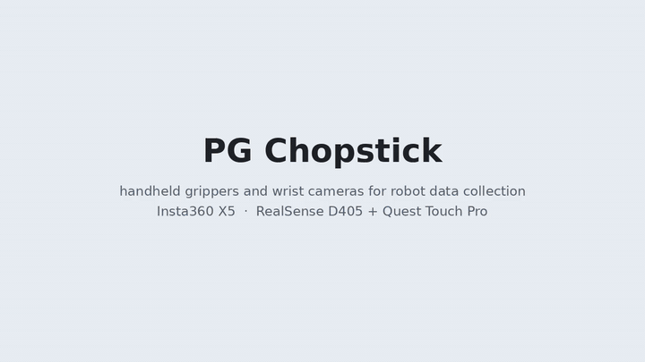</a>
  <br><em>Overview. Click for the full-quality video.</em>
</p>

## The devices

<table>
<tr>
<td align="center" width="33%"><a href="handumi/README.md">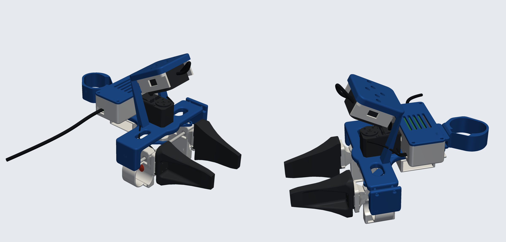</a><br><b><a href="handumi/README.md">HandUMI</a></b><br>The original: a hand-worn parallel gripper with a fixed D405, finger flanges that take the real fingers of the Piper, Hand-E, YAM and OpenArm, a record button and one USB cable.</td>
<td align="center" width="33%"><a href="pg-chopstick/insta360_x5/chop-umi/README.md">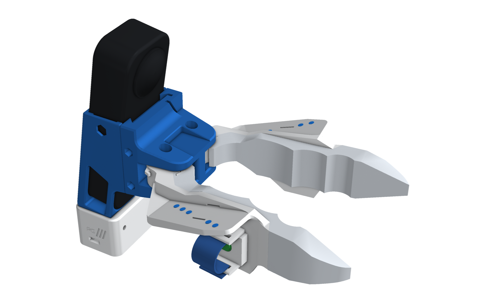</a><br><b><a href="pg-chopstick/insta360_x5/chop-umi/README.md">Chop-UMI</a></b><br>Geared chopstick jaws you pinch, with an elastic finger sleeve and a record button. Robot twins for OpenArm and any ISO 50 flange.</td>
<td align="center" width="33%"><a href="pg-chopstick/insta360_x5/para-umi/README.md">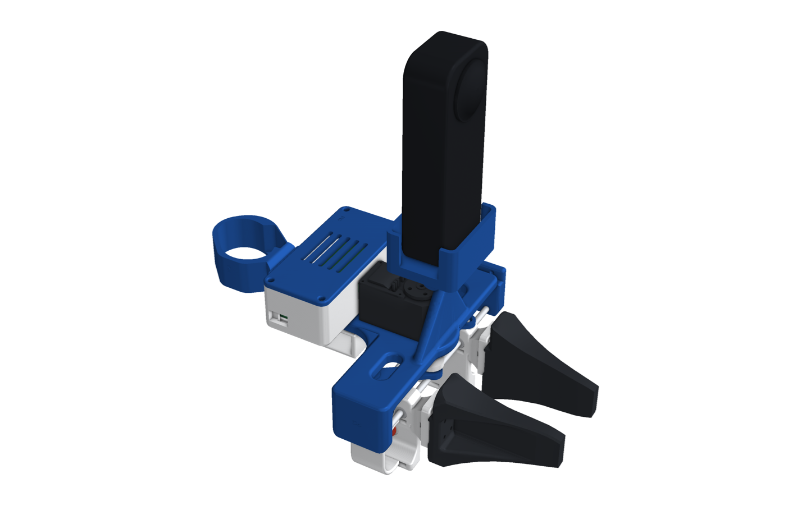</a><br><b><a href="pg-chopstick/insta360_x5/para-umi/README.md">Para-UMI</a></b><br>HandUMI's parallel gripper with the camera of your choice, swappable tips, and a camera post for each robot.</td>
</tr>
<tr>
<td align="center"><a href="pg-chopstick/insta360_x5/hand/README.md">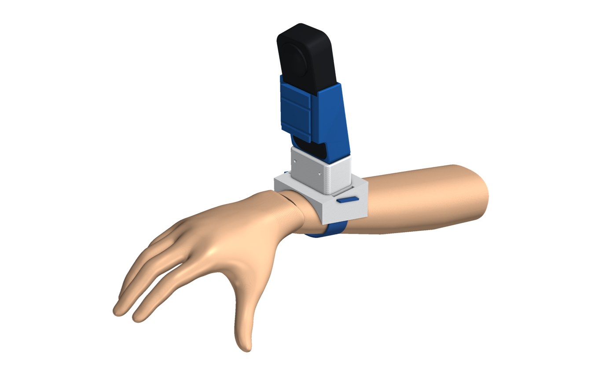</a><br><b><a href="pg-chopstick/insta360_x5/hand/README.md">Hand</a></b><br>No gripper: the camera rides on your wrist and your hand is the end effector.</td>
<td align="center"><a href="pg-chopstick/insta360_x5/hand/README.md">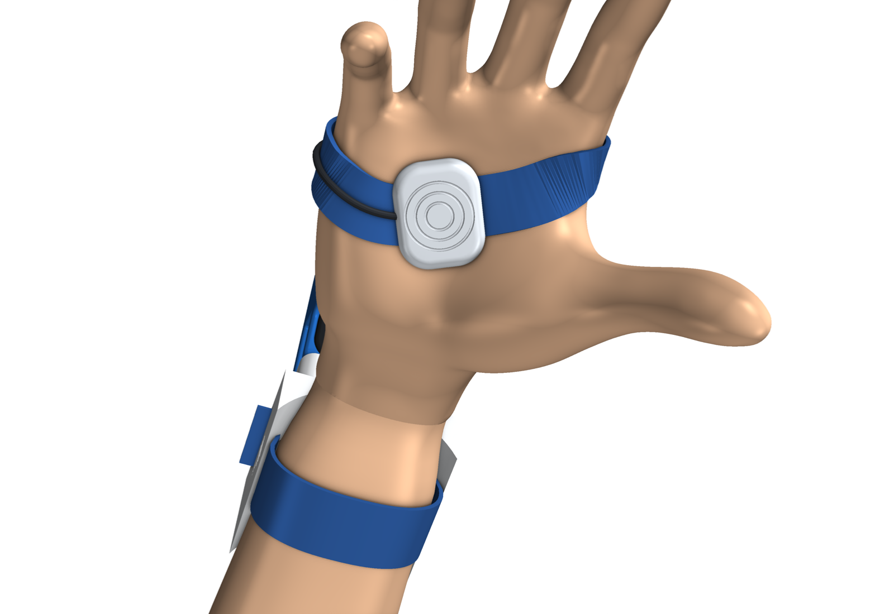</a><br><b>Palm button</b><br>A thumb strap holds the camera steady and carries a soft button: curl your middle and ring fingers in to start and stop recording.</td>
<td align="center"><a href="pg-chopstick/d405/chop-umi/README.md">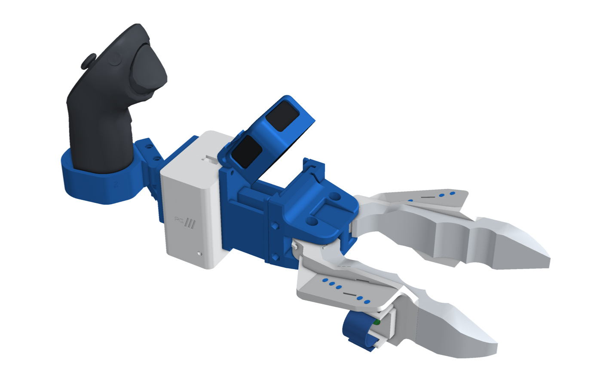</a><br><b><a href="pg-chopstick/d405/chop-umi/README.md">D405 + Quest</a></b><br>Every PG Chopstick device also comes with a D405 depth camera and a Quest Touch Pro controller for live pose.</td>
</tr>
<tr>
<td align="center"><a href="scissor-umi/README.md">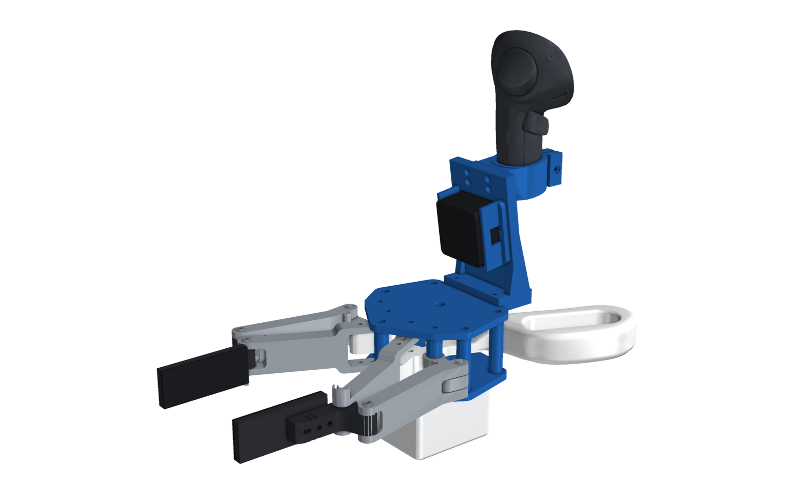</a><br><b><a href="scissor-umi/README.md">Scissor-UMI · 2F-140</a></b><br>Garden-scissor handles drive printed copies of the Robotiq 2F-140's jaws. The D405 sits exactly where our camera plate puts it on the robot.</td>
<td align="center"><a href="scissor-umi/2f-140/README.md">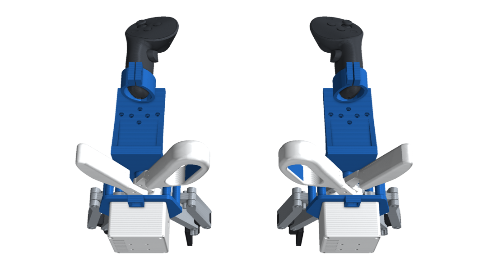</a><br><b>Left and right hand</b><br>Mirrored grips and the matching Quest controller for each hand. The mechanism, camera and electronics are shared.</td>
<td align="center"><a href="scissor-umi/2f-140/electronics.md">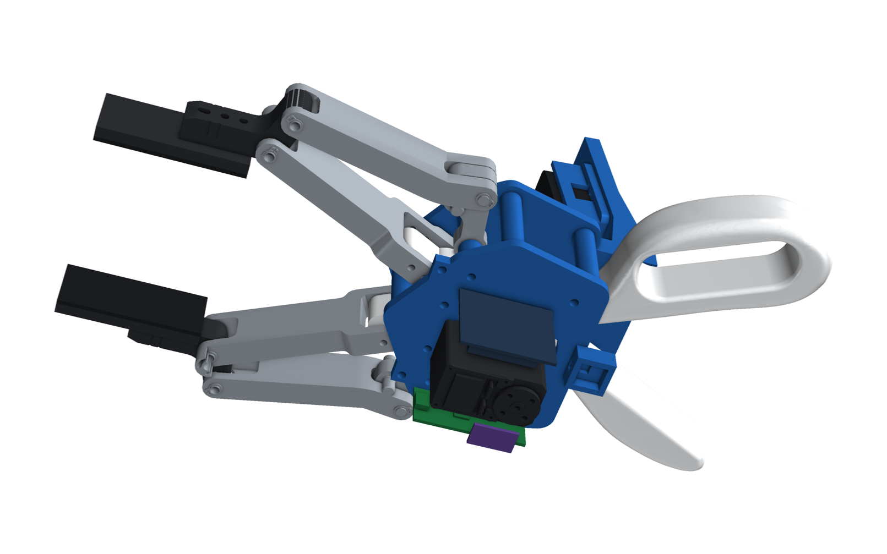</a><br><b>Jaw encoder</b><br>A Feetech STS3215 on the scissor axle reads the opening, and a Pico 2 streams the jaw angle and width at 100 Hz.</td>
</tr>
</table>

## On the robot

<table>
<tr>
<td align="center" width="50%">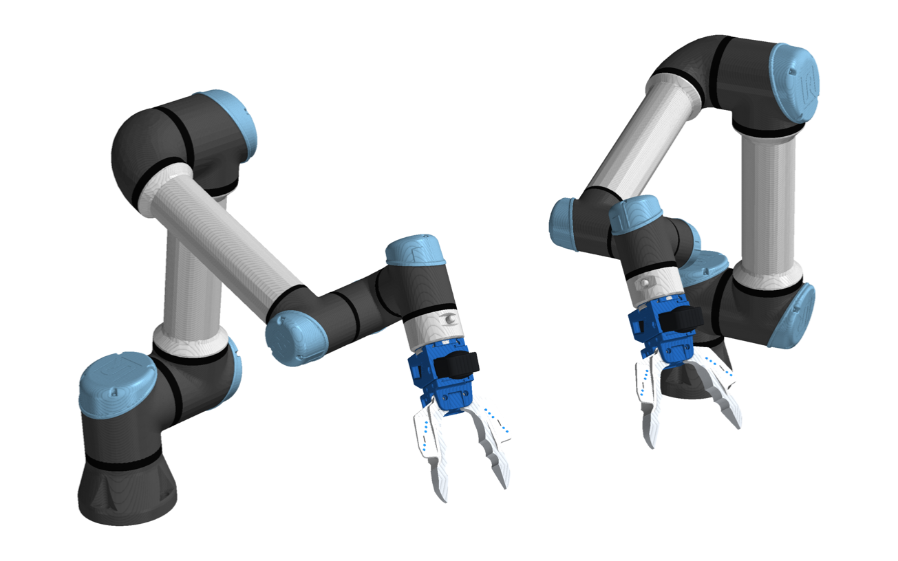<br>Chop-UMI twins on a bimanual UR5</td>
<td align="center" width="50%">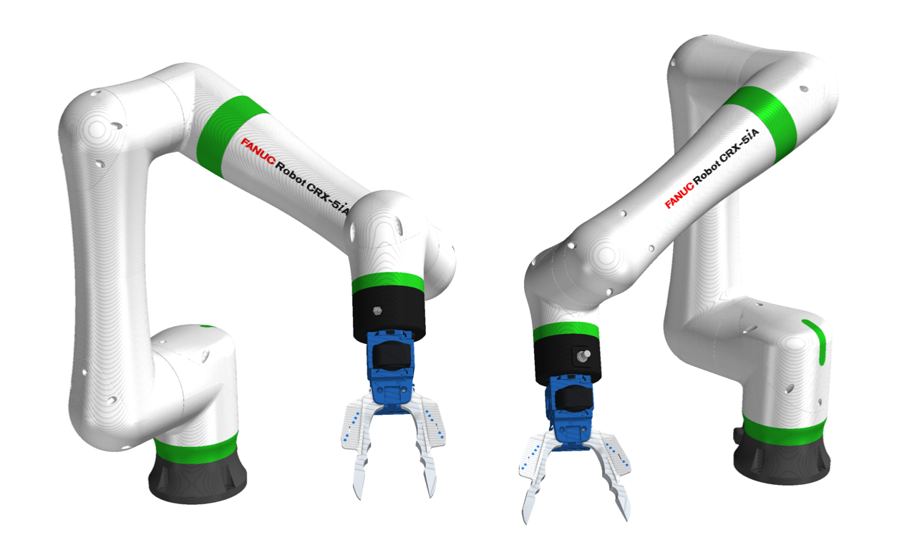<br>Chop-UMI twins on two FANUC CRX-5iA</td>
</tr>
<tr>
<td align="center">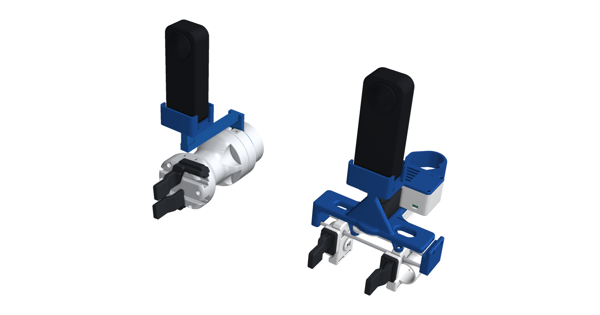<br>Para-UMI: the same camera on the robot's own Hand-E</td>
<td align="center">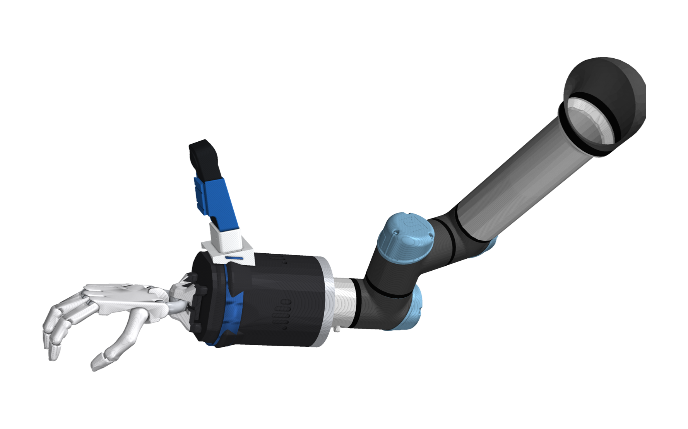<br>Hand: the same wrist mount on a robot hand</td>
</tr>
<tr>
<td align="center" colspan="2">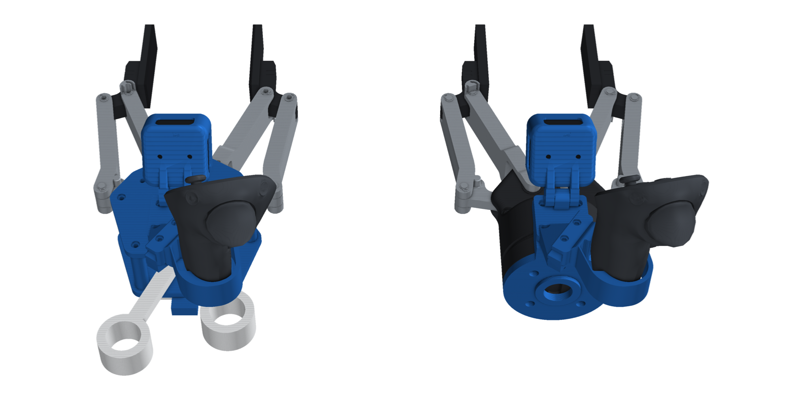<br>Scissor-UMI beside the real Robotiq 2F-140 on our camera plate: the same jaws, pads and D405 pose</td>
</tr>
</table>

## Pick a device

| Device | Camera | Gripper | Folder |
|---|---|---|---|
| HandUMI | RealSense D405, fixed | Parallel, T-plate; bolts on Piper, Hand-E, YAM or OpenArm fingers | [`handumi/`](handumi/) |
| Chop-UMI · X5 | Insta360 X5 | Geared chopsticks | [`pg-chopstick/insta360_x5/chop-umi/`](pg-chopstick/insta360_x5/chop-umi/) |
| Para-UMI · X5 | Insta360 X5 | HandUMI, X5 cradle on its hinge | [`pg-chopstick/insta360_x5/para-umi/`](pg-chopstick/insta360_x5/para-umi/) |
| Hand · X5 | Insta360 X5 | Your hand (wrist mount, palm button) | [`pg-chopstick/insta360_x5/hand/`](pg-chopstick/insta360_x5/hand/) |
| Chop-UMI · D405 | D405 + Quest Touch Pro | Geared chopsticks | [`pg-chopstick/d405/chop-umi/`](pg-chopstick/d405/chop-umi/) |
| Para-UMI · D405 | D405 + Quest Touch Pro | HandUMI as-is | [`pg-chopstick/d405/para-umi/`](pg-chopstick/d405/para-umi/) |
| Hand · D405 | D405 + Quest Touch Pro | Your hand (wrist mount, palm button) | [`pg-chopstick/d405/hand/`](pg-chopstick/d405/hand/) |
| Scissor-UMI · 2F-140 | D405 + Quest Touch Pro | Scissor handles, printed Robotiq 2F-140 jaws (left- and right-hand builds); robot twin = the real 2F-140 | [`scissor-umi/2f-140/`](scissor-umi/2f-140/) |
| Scissor-UMI · 2F-85 | D405 + Quest Touch Pro | The same, with printed Robotiq 2F-85 jaws; robot twin = the real 2F-85 | [`scissor-umi/2f-85/`](scissor-umi/2f-85/) |

Each folder has a README with renders and build steps, a bill of materials (`bom.md`), the wiring
(`electronics.md`), every part as STEP (and STL for HandUMI and PG Chopstick), and the URDFs.

## Assembly guides

IKEA-style, step by step, drawn from the CAD: each step shows the new parts pulled out along the way they go in and the
hardware for it, to scale.

| Device | Guide |
|---|---|
| HandUMI | [`handumi/docs/assembly_guide/`](handumi/docs/assembly_guide/ASSEMBLY.md) ([PDF](handumi/docs/assembly_guide/assembly.pdf)) |
| Chop-UMI · D405 + Quest | [`pg-chopstick/d405/chop-umi/assembly_guide/`](pg-chopstick/d405/chop-umi/assembly_guide/ASSEMBLY.md) ([PDF](pg-chopstick/d405/chop-umi/assembly_guide/assembly.pdf)) |
| Scissor-UMI · 2F-140 | [`scissor-umi/2f-140/assembly/`](scissor-umi/2f-140/assembly/ASSEMBLY.md) ([PDF](scissor-umi/2f-140/assembly/assembly.pdf)) |
| Scissor-UMI · 2F-85 | [`scissor-umi/2f-85/assembly/`](scissor-umi/2f-85/assembly/ASSEMBLY.md) ([PDF](scissor-umi/2f-85/assembly/assembly.pdf)) |

<p align="center">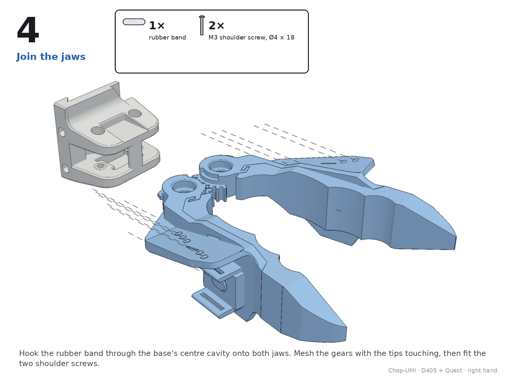 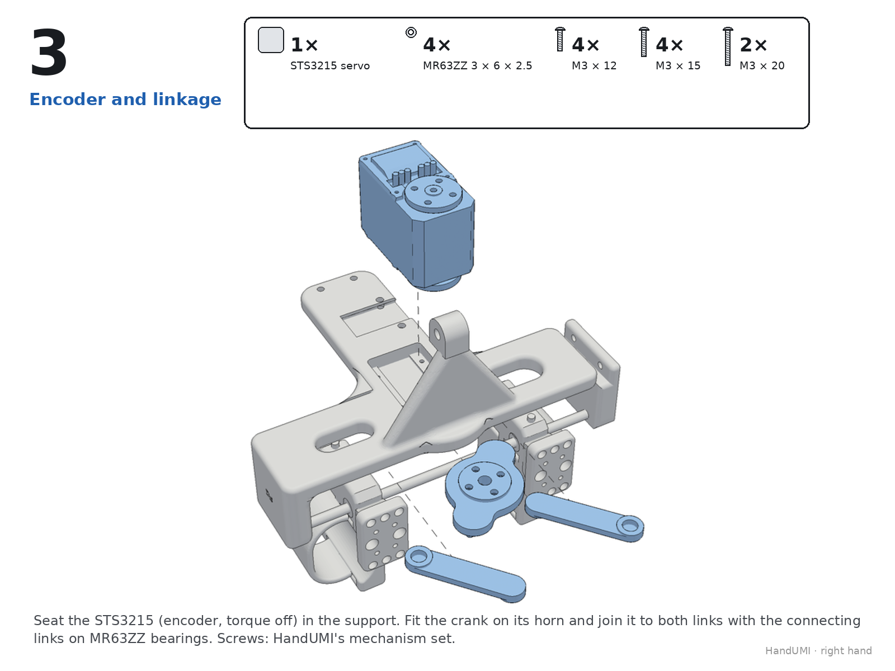</p>

The generators are in [`tools/assembly_guides/`](tools/assembly_guides/) (HandUMI and Chop-UMI, from their published
GLB assemblies) and [`scissor-umi/cad/instructions.py`](scissor-umi/cad/instructions.py).

## Repository layout

```
handumi/              HandUMI: hardware/ (STEP, STL, tips, NOTICE), assembly/, docs/ (BOM, wiring, renders)
pg-chopstick/         PG Chopstick: insta360_x5/ and d405/ (chop-umi, para-umi, hand), tags/, docs/media/ (video),
                      NOTICE, LICENSE
tools/                assembly_guides/: the IKEA-style guide generators for HandUMI and Chop-UMI
scissor-umi/          Scissor-UMI: 2f-140/ (STEP, img, urdf, BOM, wiring, NOTICE), cad/ (build code), firmware/ (Pico),
                      tools/ (PC reader)
```

## Branches

| Branch | What's on it |
|---|---|
| `main` | Everything above: the files you print and build from |
| [`cad`](../../tree/cad) | The build code (Python, build123d) for both projects |
| [`pg-chopstick-x5`](../../tree/pg-chopstick-x5), [`pg-chopstick-d405`](../../tree/pg-chopstick-d405) | One PG Chopstick camera kit each, with its code |
| [`2f-140`](../../tree/2f-140) | Everything on `main` plus Scissor-UMI for the Robotiq 2F-140, with its code and firmware |
| [`2f-85`](../../tree/2f-85) | `2f-140` plus Scissor-UMI for the Robotiq 2F-85 (same code, `SCISSOR_GRIPPER=2f-85`) |

## Licences

Apache-2.0. Third-party sources and modifications: [`handumi/hardware/NOTICE.md`](handumi/hardware/NOTICE.md) and
[`pg-chopstick/NOTICE.md`](pg-chopstick/NOTICE.md) and [`scissor-umi/2f-140/NOTICE.md`](scissor-umi/2f-140/NOTICE.md).
