# OpenArm hard-shell fingers

Printed fingers for **OpenArm v1's parallel gripper**, in place of its stock fingers. Each finger is one hard part and
one soft part sharing one outer surface, so it reads as one seamless form.

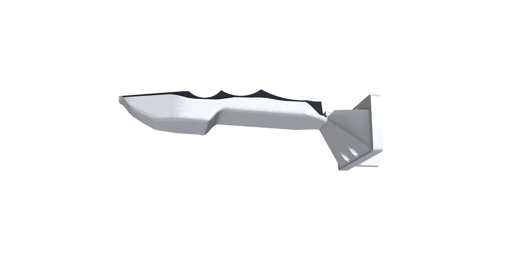

## What you print

| File | Material | Per gripper |
|---|---|---|
| `hardware/STL/hardshell_finger_left.stl`, `hardshell_finger_right.stl` | PETG (or PLA) | 1 + 1 |
| `hardware/STL/hardshell_tpu_left.stl`, `hardshell_tpu_right.stl` | TPU 95A | 1 + 1 |

The STEP files are in `hardware/STEP/`. The right parts are the mirror images of the left ones, as OpenArm's own
fingers are.

## How it's made

- **Base: OpenArm's own printed finger base.** It's re-modelled from OpenArm v1's finger: the mounting plate with its
  four M2.5 holes, plus the rib behind it.
  - OpenArm's model also draws a 20 × 30 × 11 mm block behind the plate. That block is the gripper's carriage, a
    separate metal part, so it isn't part of these prints.
  - Both fingers are checked to clear it.
- **Flow:** near the base the finger follows the stock finger's own sections, thickening sooner from x = 17 mm for
  strength. A smooth loft then carries it into the jaw.
- **Jaw, in the PG Chopstick's design language:**
  - flat facets and lightly rounded long edges;
  - in plan, straight sides that chamfer to a point;
  - in side view, a flat gripping edge and a straight back that breaks into a **chisel nose**;
  - **three big scallops** along the gripping edge, as on the chopstick's TPU tip.
- **Soft part (TPU 95A):** the jaw's lower body below a flat parting line, flush with the hard part's faces, so the
  finger reads as one form: soft below, hard spine above, as on the chopstick.
  - The parting line steps down along the chisel, so the hard spine stays whole into the tip.
  - A tongue on the soft part's back keys into a slot in the hard part. Glue it in.
- **Hard part (PETG):** the base, the flow, the spine and a 1.5 mm **hard tip** at the end of the chisel. Its gripping
  face sits 0.6 mm behind the soft face, so the soft part touches first.
- **Closing:** fully closed, the soft faces are about 0.2 mm apart, and the hard faces 1.4 mm. Fully open, the soft
  faces are about 88 mm apart.

## Strength and weight

`cad/check_strength.py` slices the hard part every 5 mm and checks its bending strength against **a 200 N load at the
fingertip**, with a 1.5 safety factor on PETG's ~45 MPa. Every section passes, with at least **1.9×** what's needed.

The stock finger is only about 12 mm deep partway along. It is 77 mm long; this one is longer, and sized for that tip
load. So past x = 17 mm the finger thickens towards the gripping side sooner than the stock one.

The hard part is 58.5 cm³ (about 73 g in PETG) and the soft part 8 cm³.

## The screws

The four M2.5 screws are the stock finger's, put in from the finger side:
- **Upper two:** each has a straight access bore that comes out on the finger's sloping back, so you reach them
  straight on, also with the soft part glued in.
- **Lower two:** these sit just under the base's gripping face, in open channels. Reach them with a ball-end hex key
  from the gripping side.

## Checked

On OpenArm v1's description, closed, half open and fully open:
- The fingers never touch each other: neither the hard parts, nor the soft parts, nor one finger's hard part with the
  other's soft part.
- The hard and soft parts don't overlap, and each prints as one solid.
- The STL files are watertight.

## Print and fit

1. **Hard part:** print it standing on the base. Use 4 walls and 30% infill, with supports under the base's keying
   features.
2. **Soft part:** print in TPU 95A, lying on its back, with the tongue up.
3. **Fit:**
   1. Take off the stock finger.
   2. Screw the new hard part on with the same four screws.
   3. Glue the soft part in with flexible CA, or a TPU-rated contact adhesive.

## Spoon fingers

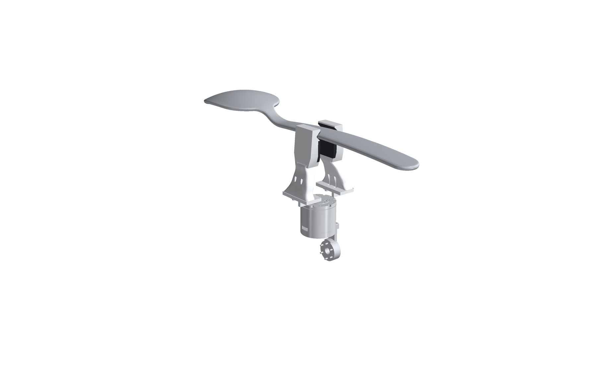

A second pair, `hardware/spoon/`, made for holding a **spoon or fork by its flat handle** without it slipping or
turning. It is designed around a 50 cm spoon (handle 7.7 mm thick, 22–43 mm wide, rounded edges), and works for flat
handles from about 3 to 10 mm thick.

**Why flat pads aren't enough:** picked from above, the fingers close across the handle's width. The spoon's weight,
about 100 mm out from the grasp, then tries to turn it about the closing axis. Flat pads resist that only by friction.
At a 20 N grip that's about 0.04 N·m, far below what a heavy spoon needs, so it tips.

**What these fingers do instead:** they hold it by **form closure**. Each fingertip has a TPU-lined **V-groove**
that takes the handle's edge. When the spoon tries to tip, the handle bears on the groove's flanks across the whole
40 mm width of the jaw. The flanks carry the moment, not friction.

- **Self-centring:** the groove is 90°, 7 mm deep and 14 mm tall at its mouth. As the fingers close, a handle that
  arrives off-centre slides down the flanks into place:

  | Handle | Off-centre it still catches | Seats this deep |
  |---|---|---|
  | 7.7 mm (this spoon) | ±3.1 mm | 5.4 mm |
  | 3 mm (a fork) | ±5.5 mm | 6.4 mm |
  | 10 mm | ±2.0 mm | 4.9 mm |

- **One groove for many handles:** a rounded edge of any thickness seats where it touches both flanks.
- **Lining:** 1.2 mm of TPU 95A in the groove, one piece with the soft gripping face above it. Fine ribs across its
  face stop the handle sliding along its length.
- **Spatula lip:** below the groove the tip is 3.7 mm at the face, liner included, with a chamfered leading corner,
  and it thickens towards its root. So it slides under a handle that's raised off the table.

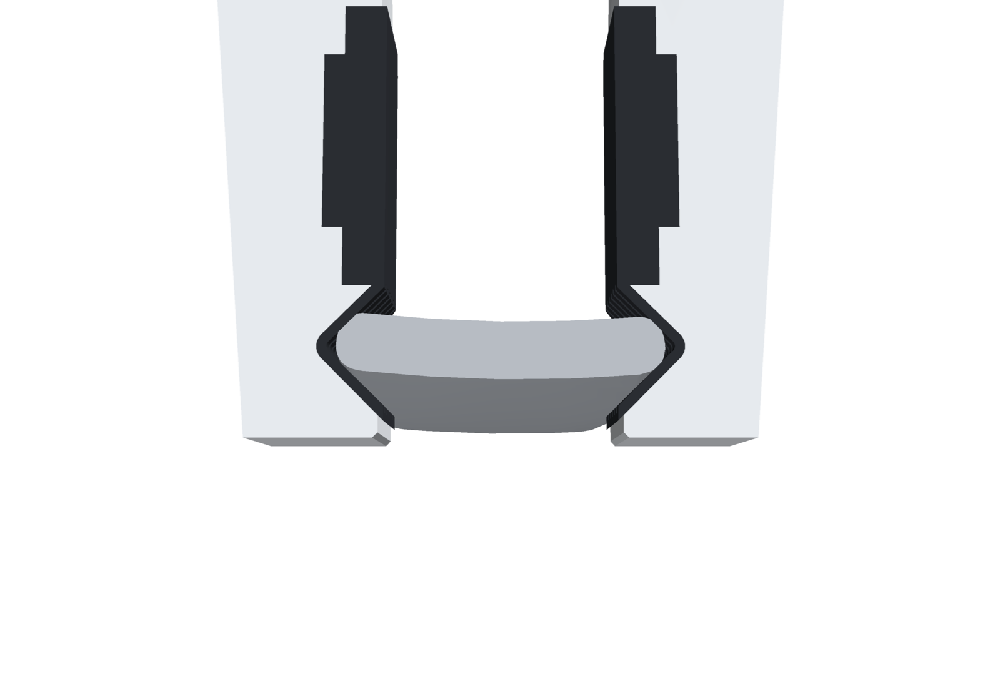

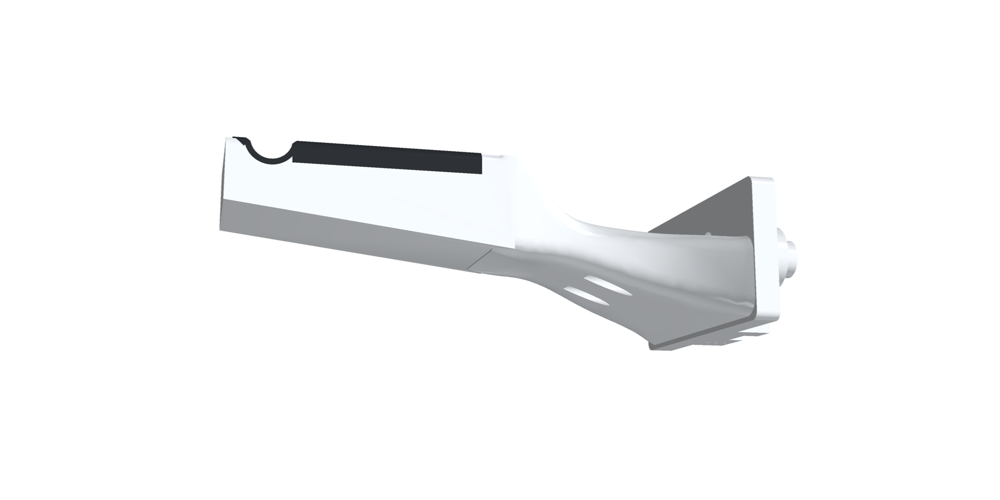

**Checked with the spoon's own model** (`cad/openarm_spoon.py --spoon <stl>`), held 200 mm along the handle, where it is
38.5 mm wide (13.6 mm of the 44 mm finger stroke):
- **Fit:** the handle seats in both grooves, touching only the TPU liners. No hard part touches it.
- **Form closure:** tilting it 3° either way about the closing axis drives it into the flanks, so it can't turn.
- **Load:** a 0.5 kg spoon, with its centre of mass 108 mm from the grasp, puts 0.53 N·m on the grasp. The flanks
  carry that as ±13 N across the 40 mm width.
- **A 3 mm × 25 mm fork handle:** it seats the same way, at 5.9 mm of stroke, touching only the liners, and a 3° tilt
  is blocked too.
- **Picking it up:** a spoon lying on a table rests on its bowl and the end of its handle, so near the neck the handle
  is 10–18 mm clear of the table and the lip slides under it.
- **Strength and clearance:** every section of the hard part has at least 2.1× what a 200 N load at the tip needs.
  Over the whole stroke the fingers never touch each other, and fully closed the soft faces are 0.2 mm apart.

| File | Material | Per gripper |
|---|---|---|
| `hardware/spoon/STL/spoon_finger_left.stl`, `spoon_finger_right.stl` | PETG | 1 + 1 |
| `hardware/spoon/STL/spoon_tpu_left.stl`, `spoon_tpu_right.stl` | TPU 95A | 1 + 1 |

They fit OpenArm the same way as the fingers above, with the same base and screws. Still to prove on hardware: the
real grip force of OpenArm's gripper, the spoon's real mass, and the grasp wet as well as dry.

## V2: flat fingers

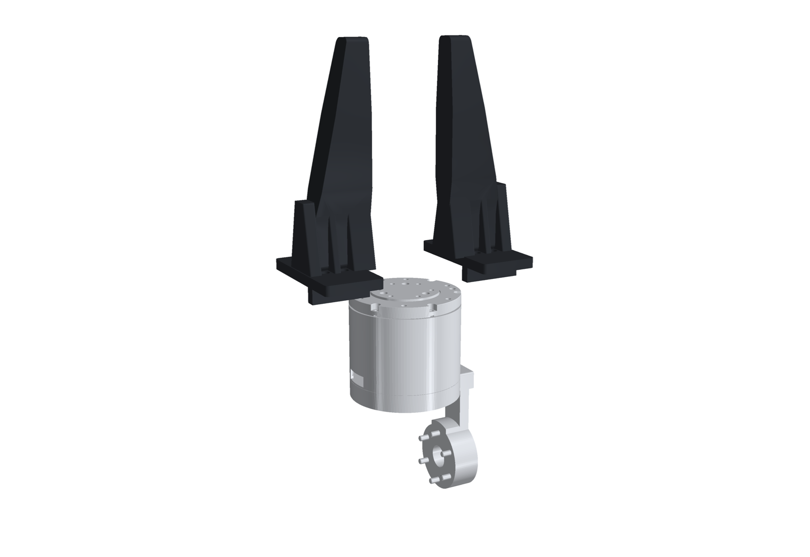

A flat version, `hardware/v2/`, in the style of the triangular fingers on handheld data-collection grippers, but
**solid** rather than a truss, and **one plain printed part**, with no soft part.

- **Plate:** a flat triangle, as tall as the mounting plate where it leaves it and tapering to an 11 mm tip.
- **Gripping edge:** straight, so the two fingers close flat on each other. Fully closed they are 0.2 mm apart;
  fully open, about 88 mm.
- **Thickness:** 10 mm for the first 26 mm, so all four screw heads stay open from the front for an L-key. It then
  thickens to 16 mm over the middle, where the bending is largest, and thins to 11 mm at the tip.
- **Root ribs:** three gussets at the root, 24 mm wide at the mounting plate and tapering into the plate. They sit in
  the bands between the screw heads and stiffen it sideways.
- **Base:** the same OpenArm printed base and screws as the other fingers.
- **Strength and weight:** every section has at least **1.7×** what a 200 N tip load needs, in both directions. Each
  finger is 49 cm³ (about 61 g in PETG).

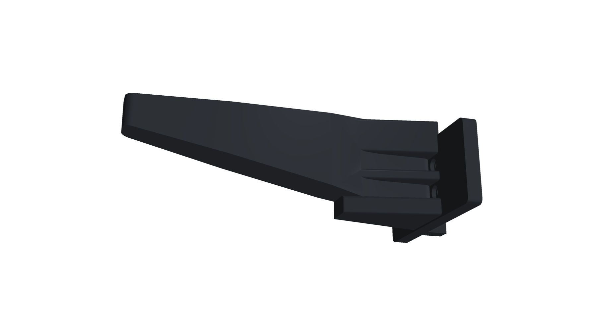

| File | Material | Per gripper |
|---|---|---|
| `hardware/v2/STL/v2_finger_left.stl`, `v2_finger_right.stl` | PETG (or PLA) | 1 + 1 |

Print the plates lying flat on their side: no supports, and the layers run along the finger.

## V3: V1 in one material

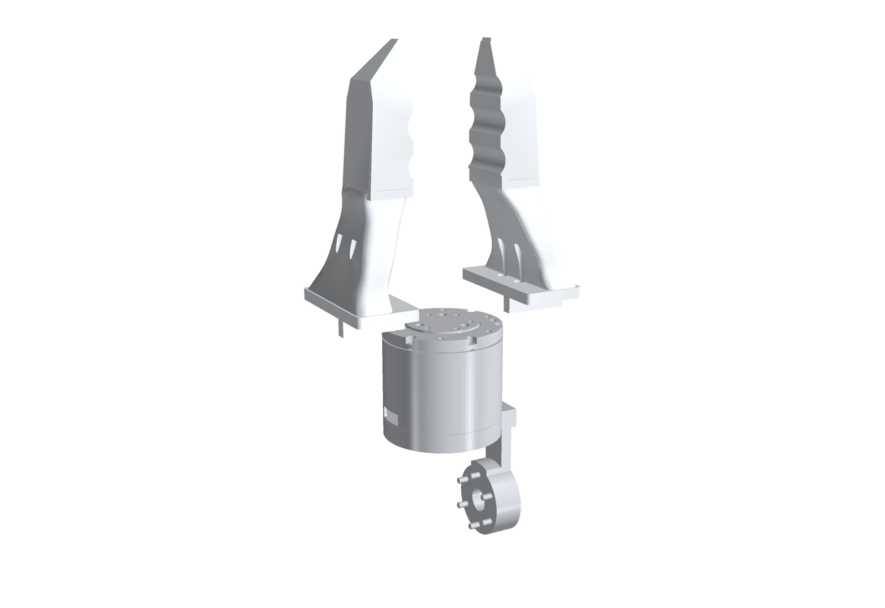

`hardware/v3/` is **V1 printed as one part**, with no TPU.
- **Shape:** the same outer shape: OpenArm's printed base, the stock flow, and the chopstick-style jaw with its
  chisel nose and three scallops.
- **Material:** what was the TPU soft part is solid plastic, so each finger is one print with nothing to glue.
- **Closing and strength:** it closes like V1, to 0.2 mm apart, and every section has at least **1.9×** what a 200 N
  tip load needs.
- **Weight:** each finger is 66 cm³ (about 83 g in PETG).

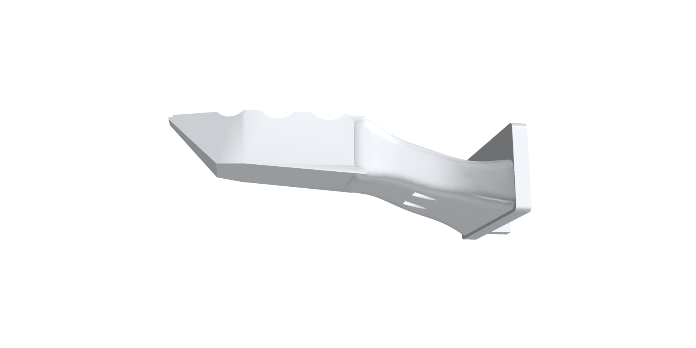

| File | Material | Per gripper |
|---|---|---|
| `hardware/v3/STL/v3_finger_left.stl`, `v3_finger_right.stl` | PLA or PETG | 1 + 1 |

## V4: a flat blade after the ARX-X5 finger, on OpenArm's base

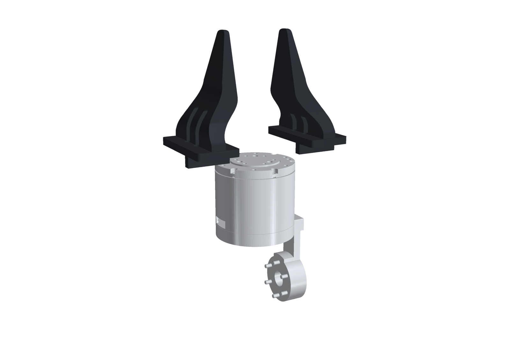

`hardware/v4/` is a solid, flat, triangular blade on OpenArm's printed finger base, as one plain part per finger,
left and right. Its outline is **HandUMI's ARX-X5 gripper finger** (murobotics-ai/handumi-hw,
`gripper_tips/ARX-X5-2023`, Apache-2.0): 61 mm wide at the root, tapering to an 11 mm tip, with its broad flat face
as the gripping face.

- **Solid and centred:** the original ARX finger is a pocketed tray, hollow under its top skin, and sits off to one
  side. V4 has no pockets or ridges, and it's symmetric about the middle of the mounting plate.
- **Centred, like OpenArm's own finger:** the root runs across the middle of the mounting plate, between the two
  rows of screws (z 40.2–50.2). It then sweeps down in a smooth S into the flat gripping face, which runs from 38 mm
  out to the tip.
- **Screw cutouts:** as on OpenArm's finger, a rounded 5.6 mm slot is cut through the root over each column of
  screws, so all four heads are open and a ball-end hex key reaches them. The screws only pass through the 5 mm plate.
- **Closing:** the fingers close flat on each other, 0.2 mm apart fully closed.
- **Strength:** it carries 200 N at the tip with a 1.5 safety factor, the same target as the other fingers.
- **Weight:** each finger is 32.9 cm³ (about 42 g in PETG).

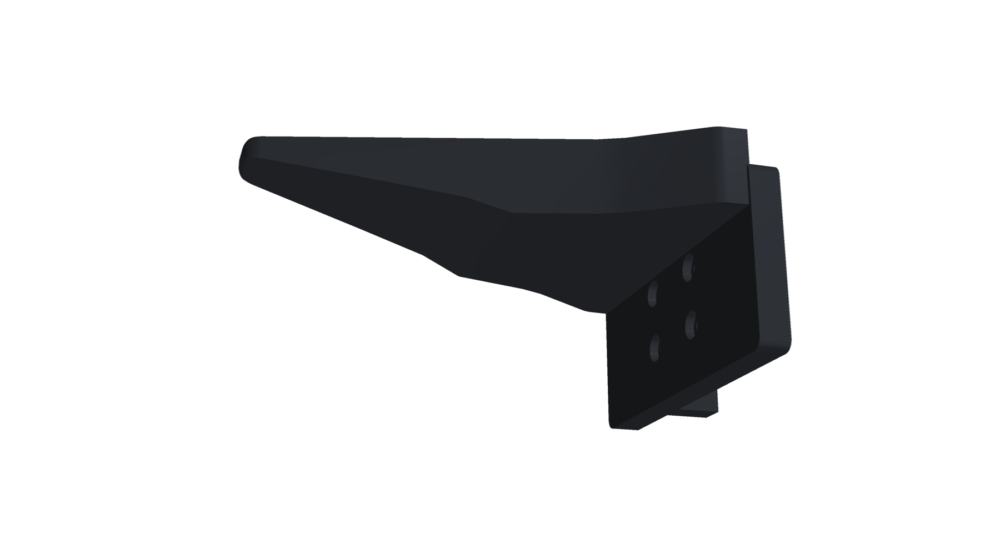

| File | Material | Per gripper |
|---|---|---|
| `hardware/v4/STL/v4_finger_left.stl`, `v4_finger_right.stl` | PETG (or PLA) | 1 + 1 |

## V5: flat triangular fingers with a ribbed back

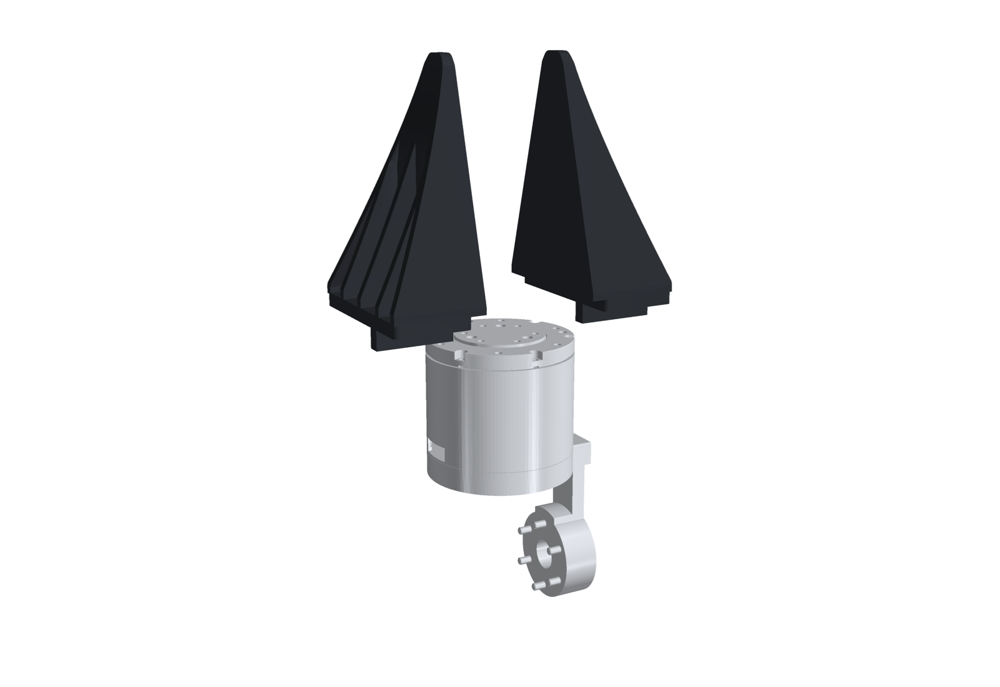

`hardware/v5/` is in the style of the flat black fingers on compact parallel grippers. It's one plain printed part
per finger, left and right, on OpenArm's printed finger base.

- **Gripping face:** one flat triangle, 61 mm wide at the mounting plate and tapering over 95 mm to a rounded tip.
  The fingers close flat on each other, 0.2 mm apart. You can stick a friction pad (1 mm rubber or grip tape) on it.
- **Back:** a wedge, the full height of the mounting plate at the root, sloping down to 4 mm thick at the tip.
- **Cells:** at the root, the back is opened into four cells separated by 3 mm ribs, with side walls along the
  outline. They're open to the back and run out through its slope. The two middle cells sit over the screw columns,
  with their floor just under the lower screw heads, so all four heads are open at the bottom of the cells and a hex
  key reaches them along the cell.
- **Strength:** 1.7× what's needed for 200 N at the tip with a 1.5 safety factor.
- **Weight:** each finger is 60.1 cm³ (about 76 g in PETG).

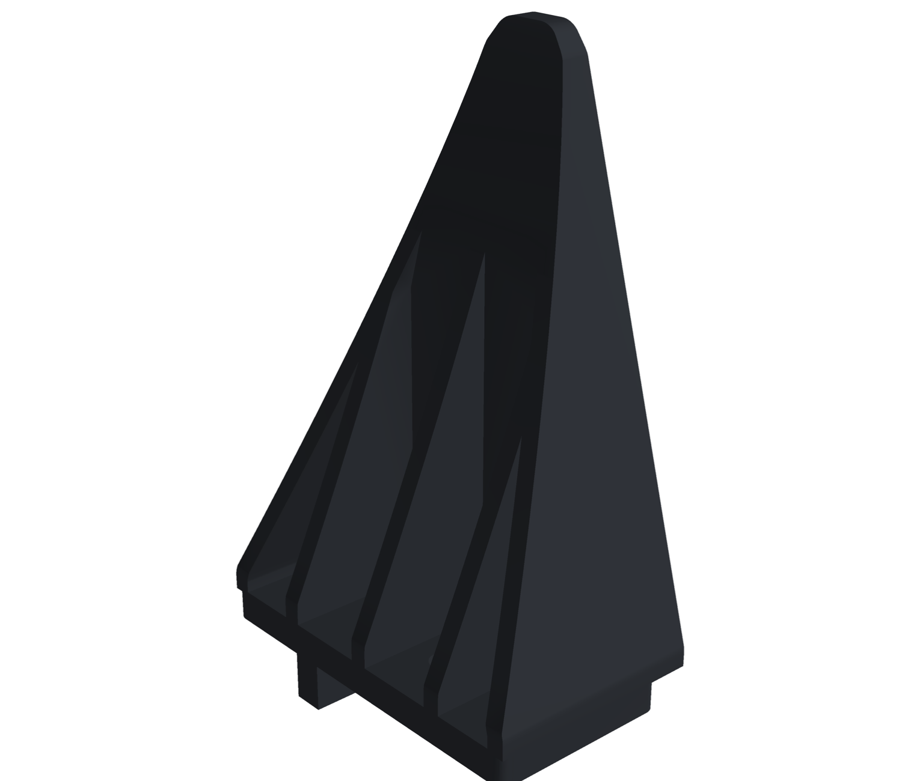

| File | Material | Per gripper |
|---|---|---|
| `hardware/v5/STL/v5_finger_left.stl`, `v5_finger_right.stl` | PETG (or PLA) | 1 + 1 |

## Files

| Path | What |
|---|---|
| `hardware/STEP/`, `hardware/STL/` | The four printable parts |
| `cad/openarm_hardshell.py` | The generator (build123d). `python openarm_hardshell.py --openarm <handumi-sw assets>` also renders and checks on OpenArm |
| `cad/check_strength.py` | The bending check along the hard part |
| `cad/openarm_spoon.py` | The spoon fingers' generator, with the fit, form-closure and load check against a spoon's STL |
| `hardware/spoon/` | The spoon fingers' STEP and STL |
| `cad/openarm_v2.py`, `hardware/v2/` | V2, the flat fingers: generator, STEP and STL |
| `cad/openarm_v3.py`, `hardware/v3/` | V3, V1 in one material: generator, STEP and STL |
| `cad/openarm_v4.py`, `hardware/v4/`, `cad/source/arx_x5/` | V4, the flat ARX-X5-style blade on OpenArm's base: generator, STEP, STL, and the HandUMI tip its outline is measured from |
| `cad/openarm_v5.py`, `hardware/v5/` | V5, flat triangular fingers with a ribbed back: generator, STEP, STL |
| `cad/openarm_base.py`, `hardware/base/` | The base on its own (mounting plate, four M2.5 holes with counterbores, rib), left and right, as a starting block for your own fingers |
| `docs/img/` | Renders |

Licences and sources: [NOTICE.md](NOTICE.md).
