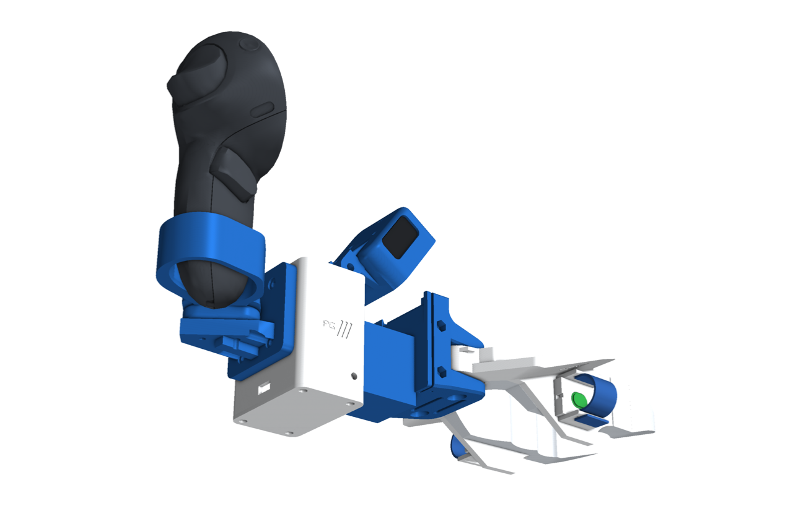

# PG Chopstick · D405 + Quest

**Collect robot-manipulation data with your own hands, then replay it on a robot with the same gripper.**

<p align="center">
  <a href="docs/media/pg_chopstick.mp4"></a>
  <br><em>Overview. Click for the full-quality video.</em>
</p>

This is the **D405 + Meta Quest kit**:

- **The camera:** an Intel RealSense D405 depth camera looks at the jaws from the HandUMI tilting mount. You set the
  angle (15° to 65°) with one M4 bolt, and the cable leaves through the top.
- **Pose:** a Meta Quest Touch Pro controller clamped upright behind the head gives the device's pose live. It tracks
  itself with its own cameras, paired to a Quest 3S or 3 headset. It is used for tracking only; its buttons do nothing.
- **One cable:** a small box with a Raspberry Pi Pico 2, an IMU and a USB 3 hub. One USB-C cable carries the camera,
  the IMU and the record button to the laptop.
- **Robot twins:** each carries the same jaws and the same D405 at the same tilt.

The Insta360 X5 version is on the [`pg-chopstick-x5`](../../tree/pg-chopstick-x5) branch, and both kits together are
on [`pg-chopstick`](../../tree/pg-chopstick).

<p align="center">
  
</p>

## Three ways to grasp

| | Handheld | Robot twin | Folder |
|---|---|---|---|
| **Chop-UMI**: geared jaws you pinch | right / left hand | OpenArm, ISO 50 (UR, ABB, FANUC) | [assembly/d405/chop-umi](assembly/d405/chop-umi/README.md) |
| **Para-UMI**: the HandUMI T-plate gripper as-is, swappable tips | right / left hand | the robot's own gripper with matching tips (Piper, Hand-E, Open-ENPIRE) and a camera post carrying the same D405 | [assembly/d405/para-umi](assembly/d405/para-umi/README.md) |
| **Hand**: the D405 head on your wrist, bare hand, thumb strap with a palm button | either arm | the same head on a robot hand's forearm | [assembly/d405/hand](assembly/d405/hand/README.md) |

One button per gripper, under your index finger, wired to the Pico: **green** on the right hand records (start /
stop), **red** on the left hand cancels the take. On the wrist, a soft **palm button** on the thumb strap starts and
stops recording: curl your middle and ring fingers into your palm to press it.

The Quest Touch Pro controller sits in **HandUMI's own controller support**, face forward, on a small arm on the box;
the left hand uses the mirror-image parts and the left controller.

<table>
<tr>
<td align="center"><br><b>The head</b>: D405 tilt mount, box, Quest controller in HandUMI's support</td>
<td align="center"><br><b>Para-UMI</b>: HandUMI</td>
</tr>
<tr>
<td align="center"><br><b>Hand</b></td>
<td align="center"><br>UR5 ×2, ISO 50 plates</td>
</tr>
<tr>
<td align="center"><br>The same head on a robot hand</td>
<td align="center"><br>Para-UMI's D405 on the robot's own gripper</td>
</tr>
</table>

## What the Chop-UMIs share

- **One interface:** the chopsticks clip to `d405_frame` with a tongue and two M3 × 55 screws. The box and both
  robot plates bolt to the frame's back plate with the same four M3 inserts.
- **Elastic finger sleeves:** a pad between two slotted fins, with a soft hook-and-loop strap that fits any finger.
- **Blue tracking dots:** on the jaws, seen up close by the D405.
- **Checked in CAD:** every build is clash-checked closed, half open and fully open, and the camera is checked over
  its whole tilt range. Every build has a URDF.
- **Para-UMI:** HandUMI exactly as it is (finger sleeves, record button, universal tip flange, its D405 cup), checked
  with HandUMI's own interference check at every opening with every tip set. Each robot gets a camera post that
  carries the same hinge in the same place relative to its fingers.
- **PG look:** blue structure, white moving parts and box, an engraved PG badge.

<p align="center">
  
  
</p>

## Repository layout

```
assembly/d405/{chop-umi,para-umi,hand}/   README · bom.md · electronics.md · STEP/ · STL/ · assembly/ · urdf/ · img/
assembly/tags/                             ArUco tag sheet
cad/d405/                                  generators (Python, build123d); package.py fills assembly/
cad/make_video.py                          the overview video and GIF (docs/media/)
```

## Status

- **Designed and checked in CAD:** the chopstick and hand builds, plus HandUMI's parallel gripper.
- **Not yet printed or tested on hardware:**
  - the new parts;
  - the Quest controller cradle on a real Touch Pro (it is an adjustable V-cradle with foam and straps, about 30–42 mm
    handles);
  - the Pico firmware.
- **Software (tracking, retargeting):** not in this branch yet.

Licences: [NOTICE.md](NOTICE.md) (Apache-2.0).
