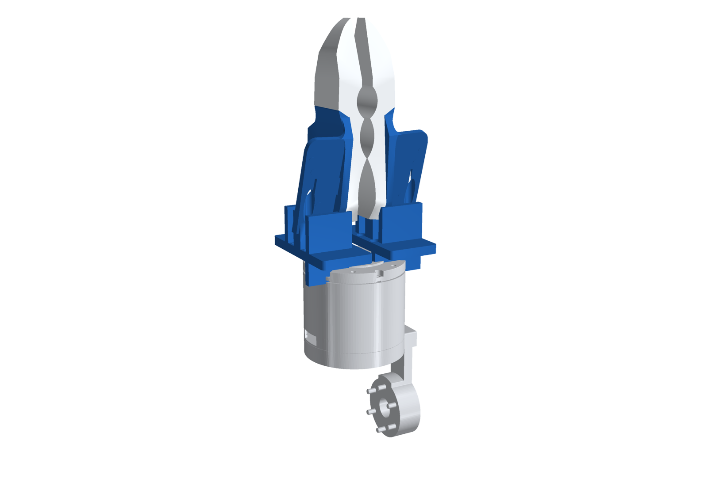
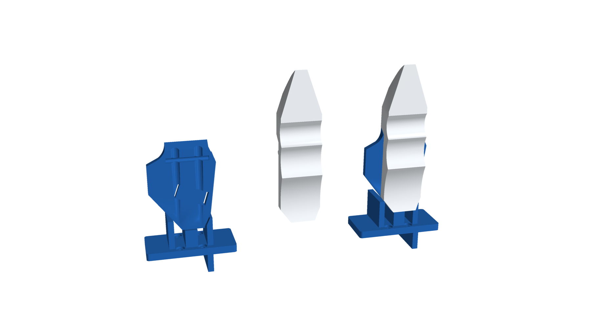
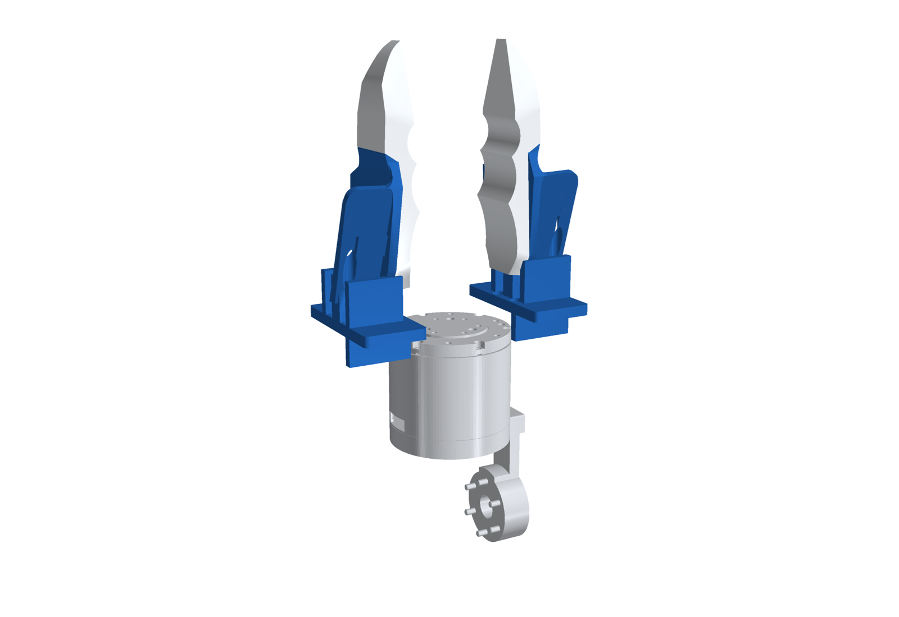

# OpenArm hard-shell fingers

Printed fingers for **OpenArm v1's parallel gripper**, in place of its stock fingers. Like Open-ENPIRE, each finger is a
hard shell with a soft TPU part, but the soft part is the **PG Chopstick's TPU pad**: the same grooved pad and soft
fingertip as on the chopstick grippers.

## What you print

| File | Material | Per gripper |
|---|---|---|
| `hardware/STL/hardshell_finger_left.stl`, `hardshell_finger_right.stl` | PETG (or PLA) | 1 + 1 |
| `hardware/STL/hardshell_tpu_left.stl`, `hardshell_tpu_right.stl` | TPU 95A | 1 + 1 |

The STEP files are in `hardware/STEP/`. The right parts are the mirror images of the left ones, as OpenArm's own
fingers are.

## How it fits

- **Mount:** Open-ENPIRE's OpenArm mount: a 5 mm plate with four M3 holes and the key rib behind it. It goes where
  the stock finger's base goes, with the same screws. The screw heads sit in bores along the finger, so you reach
  them with a long 2.5 mm hex key. **Screw the shell on before you fit the pad.**
- **Hard shell:** the plate, a three-rib neck, and the back of the chopstick jaw, whose inner face carries the pad.
  Its back is flat, cut level with the back of Open-ENPIRE's finger.
- **Soft pad:** the chopstick's TPU tip, from the jaw's straight part to the fingertip. It sits in a seat that is the
  exact shape of the pad and wraps the shell's inner face, then runs on past the shell as the soft fingertip.
  - The chopstick closes on a pivot, so on the chopstick the pad is angled 9°. Here it's turned straight, so the two
    pads close flat on each other.
  - Its contact face sits 3 mm further in than Open-ENPIRE's, so fully closed the two pads are **0.6 mm apart** and
    can hold thin things. Fully open, they are about 89 mm apart.

## Checked

On OpenArm v1's description, over the whole stroke:
- The shells never touch each other, and neither do the pads.
- The shell and the pad don't overlap.
- Fully closed, the mount's key rib sits in link7's slot the same way Open-ENPIRE's does.

## Print and fit

1. **Shell:** print it lying on its flat back, with no supports. Use 4 walls and 30% infill.
2. **Pad:** print in TPU 95A, as for the chopstick tips.
3. **Fit:**
   1. Take off the stock finger.
   2. Screw the shell on with its four M3 screws, through the bores.
   3. Press the pad into its seat. A few drops of flexible glue (or CA on the hard side) keep it put.

## Files

| Path | What |
|---|---|
| `hardware/STEP/`, `hardware/STL/` | The four printable parts |
| `cad/openarm_hardshell.py` | The generator (build123d). `python openarm_hardshell.py --openarm <handumi-sw assets>` also renders and checks on OpenArm |
| `cad/source/` | The chopstick jaw and TPU tip it starts from |
| `docs/img/` | Renders |

Licences and sources: [NOTICE.md](NOTICE.md) (Apache-2.0).
