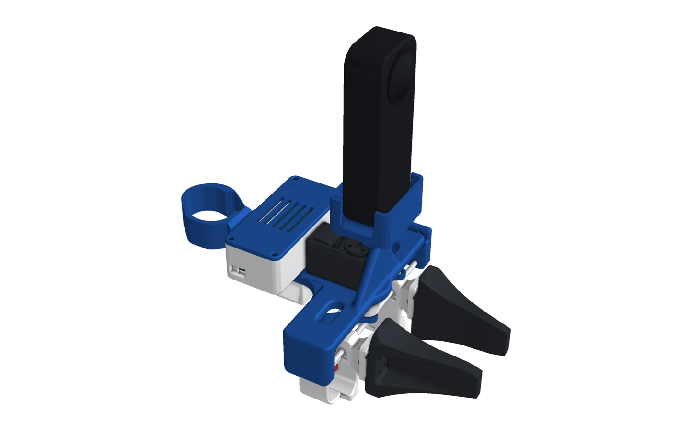
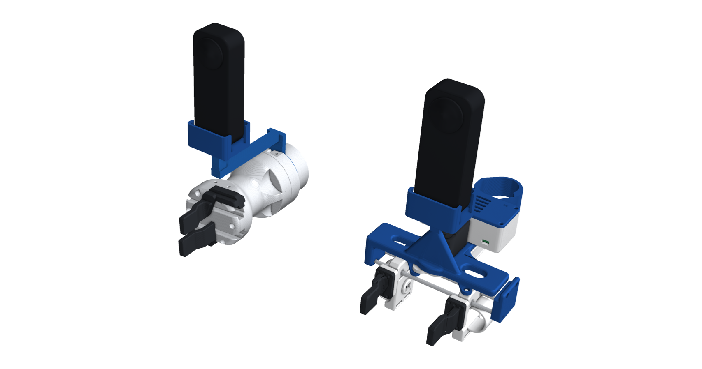

# PG Chopstick · Insta360 X5

**Collect robot-manipulation data with your own hands, then replay it on a robot with the same gripper.**

<p align="center">
  <a href="docs/media/pg_chopstick.mp4"></a>
  <br><em>Overview. Click for the full-quality video.</em>
</p>

This is the **Insta360 X5 kit**:

- **The camera:** a 360° camera rides on a printed gripper (or on your wrist). It records the scene and its own IMU,
  and the device's pose comes from mapping that video.
- **Wireless:** the PG pod (ESP32-S3, IMU, battery) adds a record button and a camera-rigid IMU.
- **Robot twins:** each carries the same jaws and the same camera at the same spot, so a policy trained on your
  demonstrations sees the same thing on the robot.

The D405 + Meta Quest version is on the
[`pg-chopstick-d405`](../../tree/pg-chopstick-d405) branch, and both kits together are on
[`pg-chopstick`](../../tree/pg-chopstick).

<p align="center">
  
</p>

## Three ways to grasp

| | Handheld | Robot twin | Folder |
|---|---|---|---|
| **Chop-UMI**: geared jaws you pinch | right / left hand | OpenArm, ISO 50 (UR, ABB, FANUC) | [assembly/insta360_x5/chop-umi](assembly/insta360_x5/chop-umi/README.md) |
| **Para-UMI**: the HandUMI T-plate gripper, X5 on its post, swappable tips | right / left hand | the robot's own gripper with matching tips (Piper, Hand-E, Open-ENPIRE) and a camera post carrying the same X5 | [assembly/insta360_x5/para-umi](assembly/insta360_x5/para-umi/README.md) |
| **Hand**: the X5 on your wrist, bare hand, thumb strap with a palm button | either arm | the same head on a robot hand's forearm | [assembly/insta360_x5/hand](assembly/insta360_x5/hand/README.md) |

One button per gripper, under your index finger: **green** on the right hand records (start / stop), **red** on the
left hand cancels the take. On the wrist, a soft **palm button** on the thumb strap starts and stops recording: curl
your middle and ring fingers into your palm to press it.

<table>
<tr>
<td align="center"><br><b>Chop-UMI</b></td>
<td align="center"><br><b>Para-UMI</b>: HandUMI with the X5</td>
</tr>
<tr>
<td align="center"><br><b>Hand</b></td>
<td align="center"><br>The same wrist mount on a robot hand</td>
</tr>
<tr>
<td align="center"><br>Para-UMI's X5 on the robot's own gripper</td>
<td align="center"><br>The palm button, on the thumb strap</td>
</tr>
</table>

## What the Chop-UMIs share

- **One interface:** the chopsticks clip to the X5 frame with a tongue and two M3 × 55 screws, and every robot
  plate bolts to the frame's back with four M3 inserts.
- **Elastic finger sleeves:** a pad between two slotted fins, with a soft hook-and-loop strap that fits any finger.
- **Blue tracking dots:** on the jaws, so the video shows how far they are open.
- **Checked in CAD:** every build is clash-checked closed, half open and fully open, and every build has a URDF.
- **PG look:** blue structure, white moving parts, an engraved PG badge.
- **Para-UMI:** HandUMI's own design (finger sleeves, record button, universal tip flange); the only new part on the
  device is `x5_wrist_mount`, the X5 cradle on HandUMI's camera hinge. Each robot gets a camera post that carries the
  same hinge in the same place relative to its fingers.

<p align="center">
  
  
</p>

## Repository layout

```
assembly/insta360_x5/{chop-umi,para-umi,hand}/   README · bom.md · electronics.md · STEP/ · STL/ · assembly/ · urdf/ · img/
assembly/tags/                                     ArUco tag sheet
cad/insta360_x5/                                   generators (Python, build123d); package.py fills assembly/
cad/make_video.py                                  the overview video and GIF (docs/media/)
```

## Status

- **Designed and checked in CAD:** the chopstick and hand builds, and the X5 cradle on HandUMI (clash-free at every
  opening with every tip set).
- **Not yet printed or tested on hardware:** the new parts, and the pod firmware.
- **Software (tracking, retargeting):** not in this branch yet.

Licences: [NOTICE.md](NOTICE.md) (Apache-2.0).
