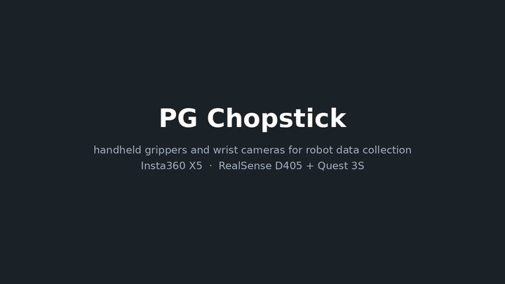
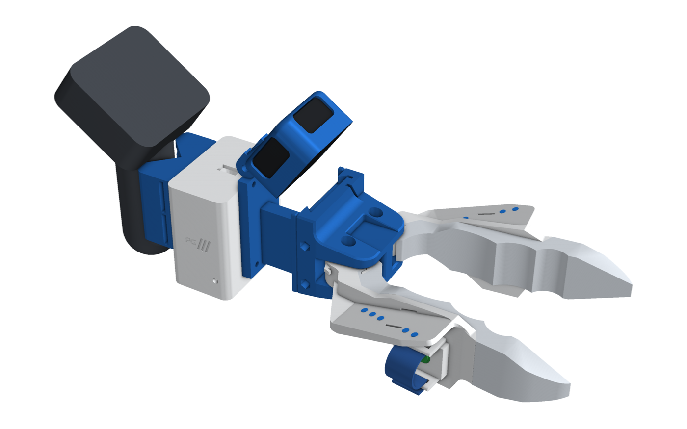
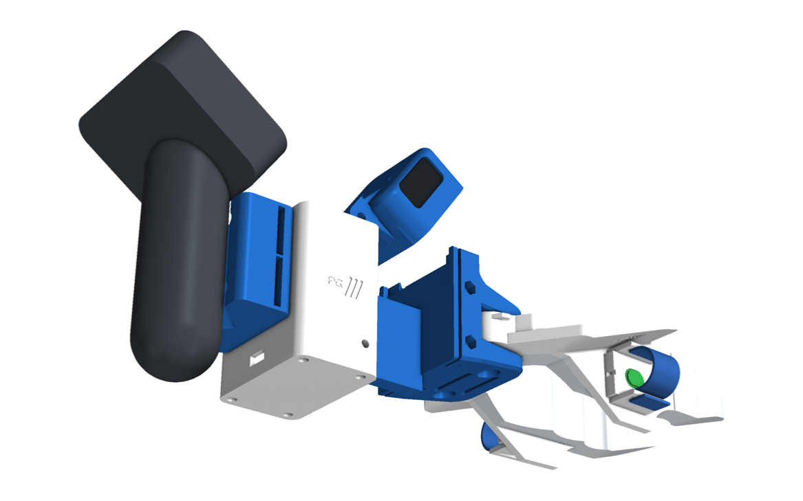
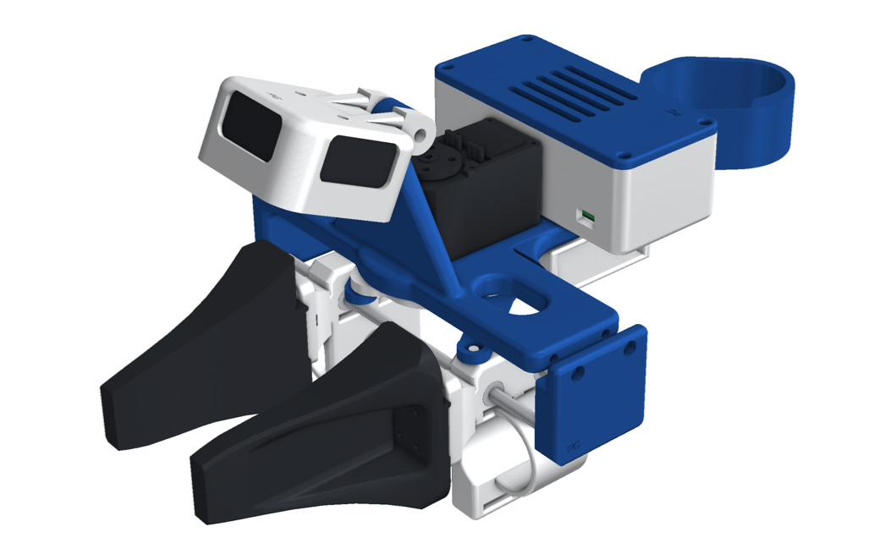
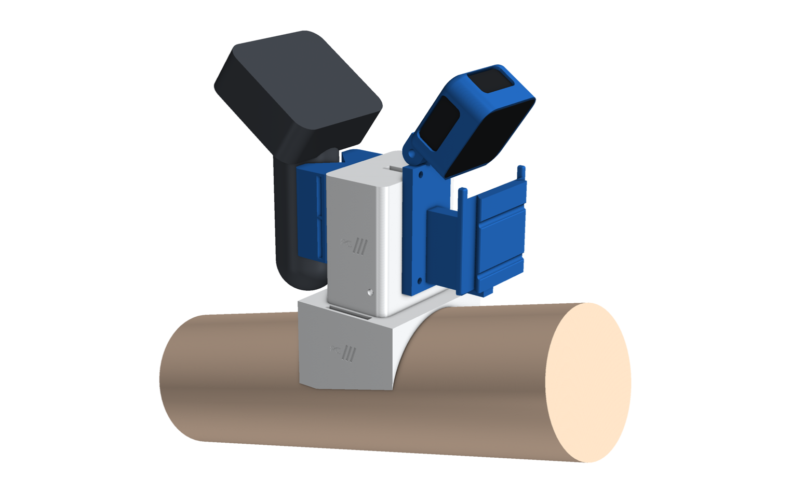
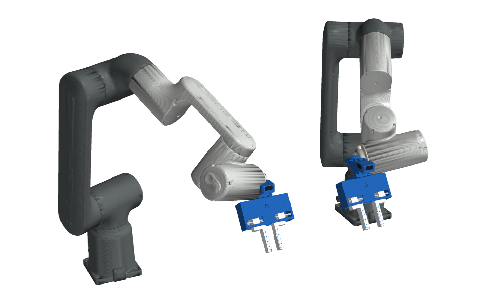
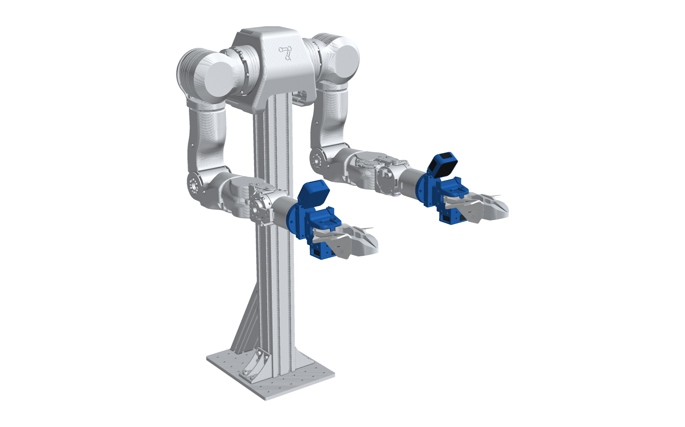

# PG Chopstick · D405 + Quest

**Collect robot-manipulation data with your own hands, then replay it on a robot with the same gripper.**

<p align="center">
  <a href="docs/media/pg_chopstick.mp4"></a>
  <br><em>Overview. Click for the full-quality video.</em>
</p>

This is the **D405 + Meta Quest kit**:

- **The camera:** an Intel RealSense D405 depth camera looks at the jaws from the HandUMI tilting mount. You set the
  angle (15° to 65°) with one M4 bolt, and the cable leaves through the top.
- **Pose:** a Meta Quest 3S controller clamped upright behind the head gives the device's pose live, tracked by the
  headset. It is used for tracking only; its buttons do nothing.
- **One cable:** a small box with a Raspberry Pi Pico 2, an IMU and a USB 3 hub. One USB-C cable carries the camera,
  the IMU and the record button to the laptop.
- **Robot twins:** each carries the same jaws and the same D405 at the same tilt.

The Insta360 X5 version is on the [`pg-chopstick-x5`](../../tree/pg-chopstick-x5) branch, and both kits together are
on [`pg-chopstick`](../../tree/pg-chopstick).

<p align="center">
  
</p>

## Three ways to grasp

| | Handheld | Robot twin | Folder |
|---|---|---|---|
| **Chopstick**: geared jaws you pinch | right / left hand | OpenArm, ISO 50 (UR, ABB, FANUC) | [assembly/d405/chopstick](assembly/d405/chopstick/README.md) |
| **Parallel**: rack-and-pinion fingers, 0 to 60 mm | right / left hand | OpenArm, ISO 50 | [assembly/d405/parallel](assembly/d405/parallel/README.md) |
| **Hand**: the D405 head on your wrist, bare hand | either arm | (the robot's own hand) | [assembly/d405/hand](assembly/d405/hand/README.md) |

One button per gripper, under your index finger, wired to the Pico: **green** on the right hand records (start /
stop), **red** on the left hand cancels the take.

<table>
<tr>
<td align="center"><br><b>The head</b>: D405 tilt mount, box, Quest 3S cradle</td>
<td align="center"><br><b>Parallel</b></td>
</tr>
<tr>
<td align="center"><br><b>Hand</b></td>
<td align="center"><br>UR5 ×2, ISO 50 plates</td>
</tr>
<tr>
<td align="center"><br>ABB GoFa ×2, parallel jaws</td>
<td align="center"><br>OpenArm, link7 adapter</td>
</tr>
</table>

## What every gripper shares

- **One interface:** every end effector clips to `d405_frame` with a tongue and two M3 × 55 screws. The box and both
  robot plates bolt to the frame's back plate with the same four M3 inserts.
- **Elastic finger sleeves:** a pad between two slotted fins, with a soft hook-and-loop strap that fits any finger.
- **Blue tracking dots:** on the jaws and fingers, seen up close by the D405.
- **Checked in CAD:** every build is clash-checked closed, half open and fully open, and the camera is checked over
  its whole tilt range. Every build has a URDF.
- **PG look:** blue structure, white moving parts and box, an engraved PG badge.

<p align="center">
  
  
</p>

## Repository layout

```
assembly/d405/{chopstick,parallel,hand}/   README · bom.md · electronics.md · STEP/ · STL/ · assembly/ · urdf/ · img/
assembly/tags/                             ArUco tag sheet
cad/d405/                                  generators (Python, build123d); package.py fills assembly/
cad/make_video.py                          the overview video and GIF (docs/media/)
```

## Status

- **Designed and checked in CAD:** all nine builds.
- **Not yet printed or tested on hardware:**
  - the new parts;
  - the Quest 3S cradle on a real controller (it is an adjustable V-cradle with foam and straps, about 30–42 mm
    handles);
  - the Pico firmware.
- **Software (tracking, retargeting):** not in this branch yet.

Licences: [NOTICE.md](NOTICE.md) (Apache-2.0).
