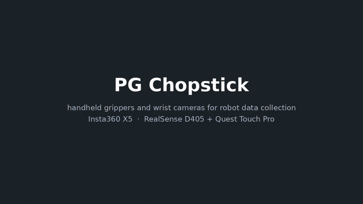
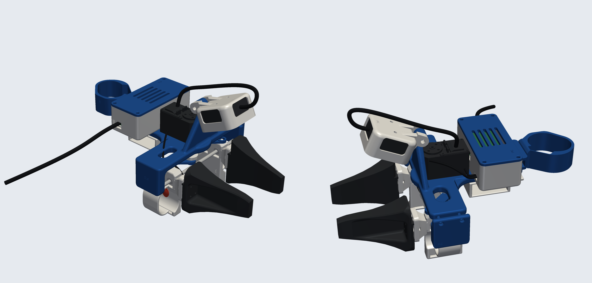
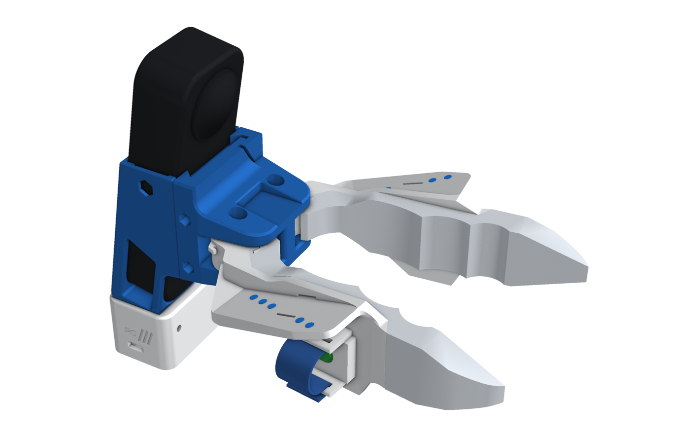
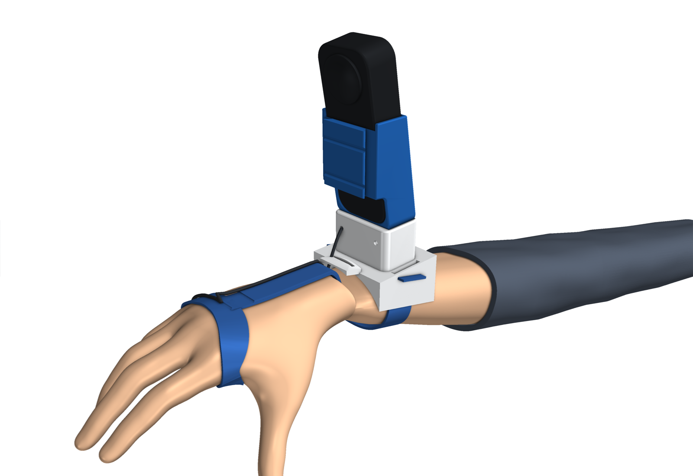
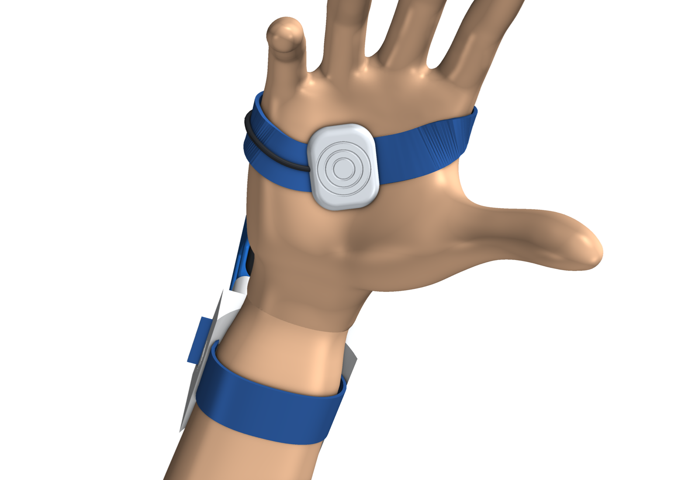
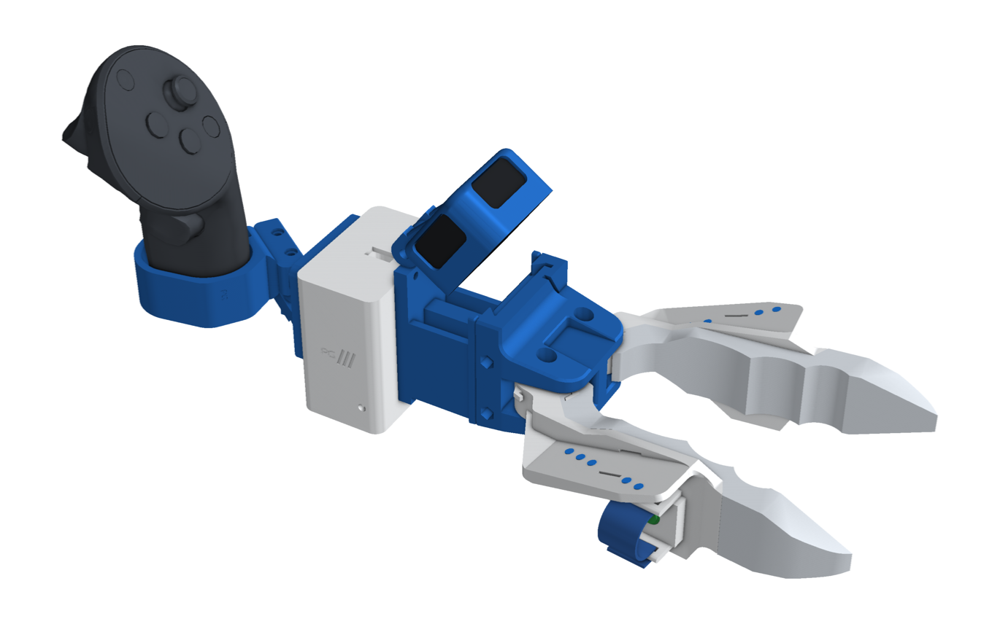
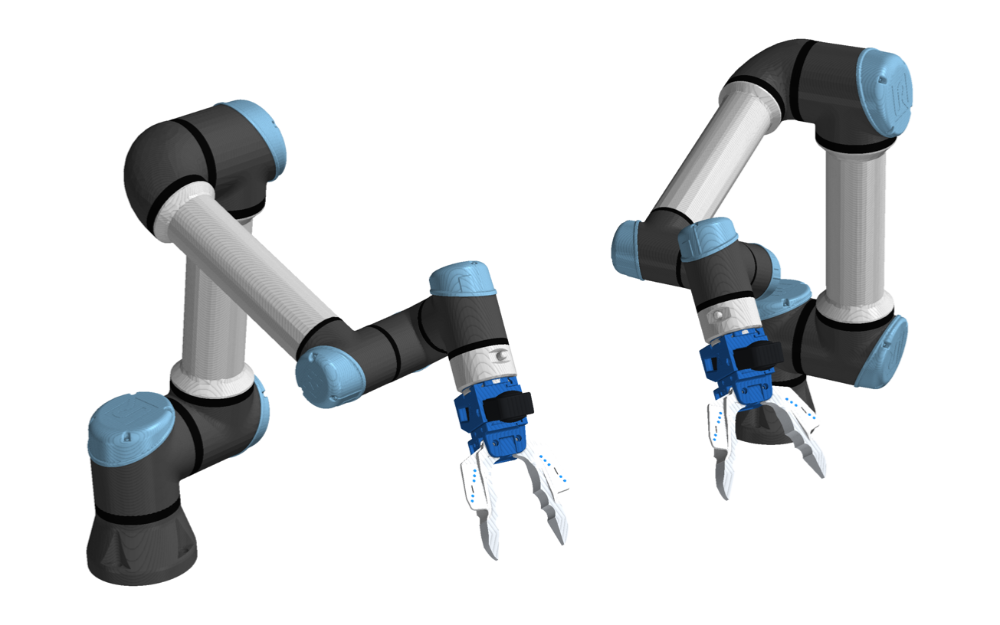
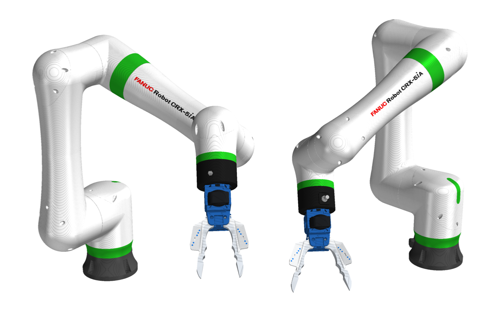
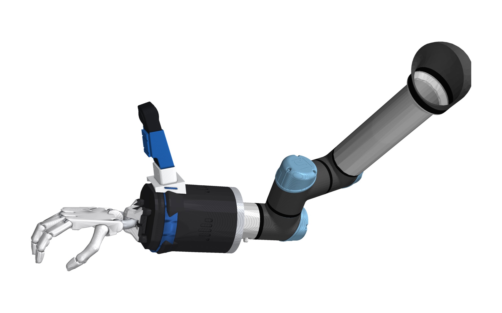

# The UMI no one wants

Open hardware for collecting robot-manipulation data with your own hands. You hold a printed gripper, or wear a camera
on your wrist, and do the task. Each robot twin carries the same jaws and the same camera in the same place, so a
policy trained on your demonstrations sees the same thing on the robot.

Every device here is printable: STEP and STL for every part, full assemblies (GLB / STL), URDFs, bills of materials,
wiring and renders.

<p align="center">
  <a href="pg-chopstick/docs/media/pg_chopstick.mp4"></a>
  <br><em>Overview. Click for the full-quality video.</em>
</p>

## The devices

<table>
<tr>
<td align="center" width="33%"><a href="handumi/README.md"></a><br><b><a href="handumi/README.md">HandUMI</a></b><br>The original: a hand-worn parallel gripper with a D405 on a tilting hinge, a record button under your index finger and one USB cable.</td>
<td align="center" width="33%"><a href="pg-chopstick/insta360_x5/chop-umi/README.md"></a><br><b><a href="pg-chopstick/insta360_x5/chop-umi/README.md">Chop-UMI</a></b><br>Geared chopstick jaws you pinch, with an elastic finger sleeve and a record button. Robot twins for OpenArm and any ISO 50 flange.</td>
<td align="center" width="33%"><a href="pg-chopstick/insta360_x5/para-umi/README.md"></a><br><b><a href="pg-chopstick/insta360_x5/para-umi/README.md">Para-UMI</a></b><br>HandUMI's parallel gripper with the camera of your choice, swappable tips, and a camera post for each robot.</td>
</tr>
<tr>
<td align="center"><a href="pg-chopstick/insta360_x5/hand/README.md"></a><br><b><a href="pg-chopstick/insta360_x5/hand/README.md">Hand</a></b><br>No gripper: the camera rides on your wrist and your hand is the end effector.</td>
<td align="center"><a href="pg-chopstick/insta360_x5/hand/README.md"></a><br><b>Palm button</b><br>A thumb strap holds the camera steady and carries a soft button: curl your middle and ring fingers in to start and stop recording.</td>
<td align="center"><a href="pg-chopstick/d405/chop-umi/README.md"></a><br><b><a href="pg-chopstick/d405/chop-umi/README.md">D405 + Quest</a></b><br>Every PG Chopstick device also comes with a D405 depth camera and a Quest Touch Pro controller for live pose.</td>
</tr>
</table>

## On the robot

<table>
<tr>
<td align="center" width="50%"><br>Chop-UMI twins on a bimanual UR5</td>
<td align="center" width="50%"><br>Chop-UMI twins on two FANUC CRX-5iA</td>
</tr>
<tr>
<td align="center"><br>Para-UMI: the same camera on the robot's own Hand-E</td>
<td align="center"><br>Hand: the same wrist mount on a robot hand</td>
</tr>
</table>

## Pick a device

| Device | Camera | Gripper | Folder |
|---|---|---|---|
| HandUMI | RealSense D405 | Parallel, T-plate | [`handumi/`](handumi/) |
| Chop-UMI · X5 | Insta360 X5 | Geared chopsticks | [`pg-chopstick/insta360_x5/chop-umi/`](pg-chopstick/insta360_x5/chop-umi/) |
| Para-UMI · X5 | Insta360 X5 | HandUMI, X5 cradle on its hinge | [`pg-chopstick/insta360_x5/para-umi/`](pg-chopstick/insta360_x5/para-umi/) |
| Hand · X5 | Insta360 X5 | Your hand (wrist mount, palm button) | [`pg-chopstick/insta360_x5/hand/`](pg-chopstick/insta360_x5/hand/) |
| Chop-UMI · D405 | D405 + Quest Touch Pro | Geared chopsticks | [`pg-chopstick/d405/chop-umi/`](pg-chopstick/d405/chop-umi/) |
| Para-UMI · D405 | D405 + Quest Touch Pro | HandUMI as-is | [`pg-chopstick/d405/para-umi/`](pg-chopstick/d405/para-umi/) |
| Hand · D405 | D405 + Quest Touch Pro | Your hand (wrist mount, palm button) | [`pg-chopstick/d405/hand/`](pg-chopstick/d405/hand/) |

Each folder has a README with renders and build steps, a bill of materials (`bom.md`), the wiring
(`electronics.md`), every part as STEP and STL, the assemblies and the URDFs.

## Repository layout

```
handumi/              HandUMI: hardware/ (STEP, STL, tips, NOTICE), assembly/, docs/ (BOM, wiring, renders)
pg-chopstick/         PG Chopstick: insta360_x5/ and d405/ (chop-umi, para-umi, hand), tags/, docs/media/ (video),
                      NOTICE, LICENSE
```

## Branches

| Branch | What's on it |
|---|---|
| `main` | Everything above: the files you print and build from |
| [`cad`](../../tree/cad) | The build code (Python, build123d) for both projects |
| [`pg-chopstick-x5`](../../tree/pg-chopstick-x5), [`pg-chopstick-d405`](../../tree/pg-chopstick-d405) | One PG Chopstick camera kit each, with its code |

## Licences

Apache-2.0. Third-party sources and modifications: [`handumi/hardware/NOTICE.md`](handumi/hardware/NOTICE.md) and
[`pg-chopstick/NOTICE.md`](pg-chopstick/NOTICE.md).
