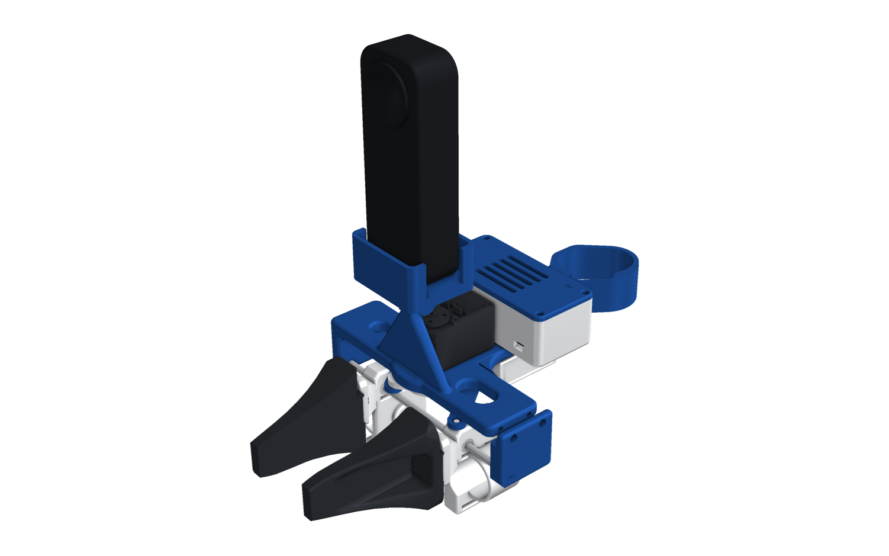
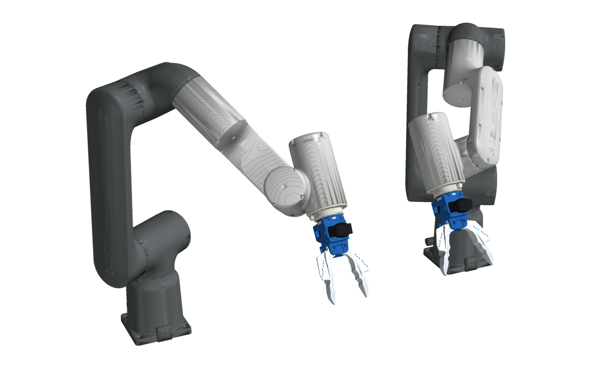

# PG Chopstick

**Collect robot-manipulation data with your own hands, then replay it on a robot with the same gripper.**

<p align="center">
  <a href="docs/media/pg_chopstick.mp4"></a>
  <br><em>Overview (46 s). Click for the full-quality video.</em>
</p>

<p align="center">
  
  
</p>

> Each kit also has its own branch: [`pg-chopstick-x5`](../../tree/pg-chopstick-x5) (Insta360 X5) and
> [`pg-chopstick-d405`](../../tree/pg-chopstick-d405) (D405 + Quest).

PG Chopstick is open hardware for handheld data collection. You hold a printed gripper, or wear a camera on your
wrist, and do the task. A camera on the device records what you see. Its robot twin carries the same jaws and the same
camera at the same spot, so a policy trained on your demonstrations sees the same thing on the robot.

<p align="center">
  
</p>

## Two camera kits × three ways to grasp

| | **Insta360 X5 kit** | **D405 + Quest kit** |
|---|---|---|
| Camera | Insta360 X5, 360° video | Intel RealSense D405 depth camera, on a tilting mount |
| Pose | from the X5's own IMU and visual mapping of its video | live, from a Meta Quest Touch Pro controller on the device (tracking only) |
| On the device | wireless: the PG pod (ESP32-S3, IMU, battery) | one USB-C cable: Pico 2 + IMU + USB 3 hub in a small box |
| **Chopstick**: geared jaws you pinch | [insta360_x5/chopstick](assembly/insta360_x5/chopstick/README.md) | [d405/chopstick](assembly/d405/chopstick/README.md) |
| **Parallel**: the HandUMI T-plate gripper, swappable tips | [insta360_x5/parallel](assembly/insta360_x5/parallel/README.md) | [d405/parallel](assembly/d405/parallel/README.md) |
| **Hand**: camera on your wrist, bare hand | [insta360_x5/hand](assembly/insta360_x5/hand/README.md) | [d405/hand](assembly/d405/hand/README.md) |

- **Chopstick:** right-hand and left-hand builds and two robot twins, on **OpenArm** (link7 adapter) and on any cobot
  with an **ISO 9409-1-50-4-M6** flange (UR e-series, ABB GoFa, FANUC CRX, ...).
- **Parallel:** [HandUMI](https://github.com/Pruthvi-Neuracore/The-UMI-no-one-wants) unchanged. On the X5 kit the only
  new part is the X5 cradle on its camera hinge. The tips swap (AgileX Piper, Robotiq Hand-E, Open-ENPIRE) to match the
  robot's own gripper.
- **Hand:** the camera straps to your wrist, or to a dexterous robot hand's forearm.
- **One button per gripper:** it sits under your index finger. **Green** on the right hand records (start / stop);
  **red** on the left hand cancels the take.

<table>
<tr>
<td align="center"><br><b>Parallel</b>: HandUMI with the X5 on its post, swappable tips</td>
<td align="center"><br><b>Hand</b>: the camera rides on your wrist</td>
</tr>
<tr>
<td align="center"><br>ABB GoFa ×2, chopsticks</td>
<td align="center"><br>FANUC CRX-5iA ×2, chopsticks</td>
</tr>
<tr>
<td align="center"><br>OpenArm, link7 adapter</td>
<td align="center"><br>The same wrist mount on a robot hand</td>
</tr>
</table>

## What the chopsticks share

<p align="center">
  
</p>

- **One interface:** the chopsticks clip to the camera frame with a tongue and two M3 × 55 screws, and every robot plate
  bolts to the frame's back with four M3 inserts. Mix and match.
- **Elastic finger sleeves:** your fingers sit on a pad between two slotted fins, held by a soft hook-and-loop strap
  that fits any finger.
- **Blue tracking dots:** printed as inlays on the jaws, so the camera sees how far they are open.
- **Checked in CAD:** every build is clash-checked closed, half open and fully open, and every robot twin has a URDF.
- **Parallel grippers:** these are HandUMI's own design (finger sleeves, record button, tip flange), with the same
  green record / red cancel button covers.
- **PG look:** blue structure, white moving parts, an engraved PG badge on every part.

<p align="center">
  
  
</p>

## Repository layout

```
assembly/
  insta360_x5/{chopstick,parallel,hand}/    README · bom.md · electronics.md · STEP/ · STL/ · assembly/ · urdf/ · img/
  d405/{chopstick,parallel,hand}/           (same)
  tags/                                     ArUco tag sheet, one tag per device
cad/
  insta360_x5/   d405/                      the generators for each kit (Python, build123d)
  make_video.py                             the overview video and GIF (docs/media/)
docs/media/                                 pg_chopstick.mp4, pg_chopstick.gif
```

Each variant folder holds everything you need to print and build it: every part as STEP and STL, the assemblies
(GLB and STL), the URDFs, a bill of materials, the wiring, and a detailed README with renders.

## Rebuild from source

Use Python 3.12 with `build123d`, `bd_warehouse`, `trimesh`, `manifold3d`, `scipy`, `pyvista` and `yourdfpy`. In
`cad/<kit>/`, run the part scripts, then `kinematics.py --check`, `urdf.py`, `assembly.py --check`, `render_docs.py`,
`robots.py`, `t_gripper.py` (the HandUMI parallel gripper) and finally `package.py`, which copies the results into
`assembly/<kit>/`. Generated intermediates go to
`build/` (not committed).

## Status

- **Designed and checked in CAD:** the chopstick and hand builds of both kits (clash checks, opening limits, gear
  mesh, robot flange fit, URDFs), and the X5 cradle on HandUMI (clash-free at every opening with every tip set).
- **Not yet printed or tested on hardware:** the new parts, the ISO plate's spigot and dowel on a real flange, and the
  firmware for the pod and the box.
- **Software (retargeting, tracking):** not in this repository yet.

Licences: [NOTICE.md](NOTICE.md) (Apache-2.0).
