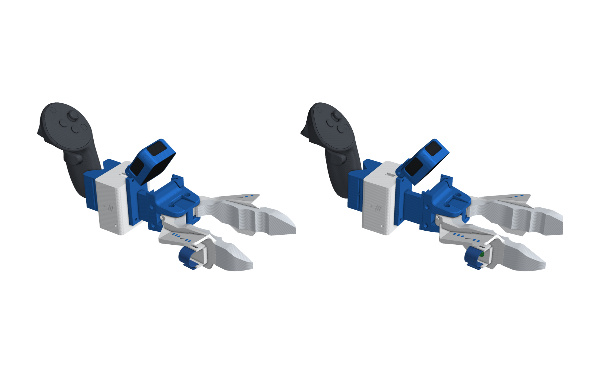
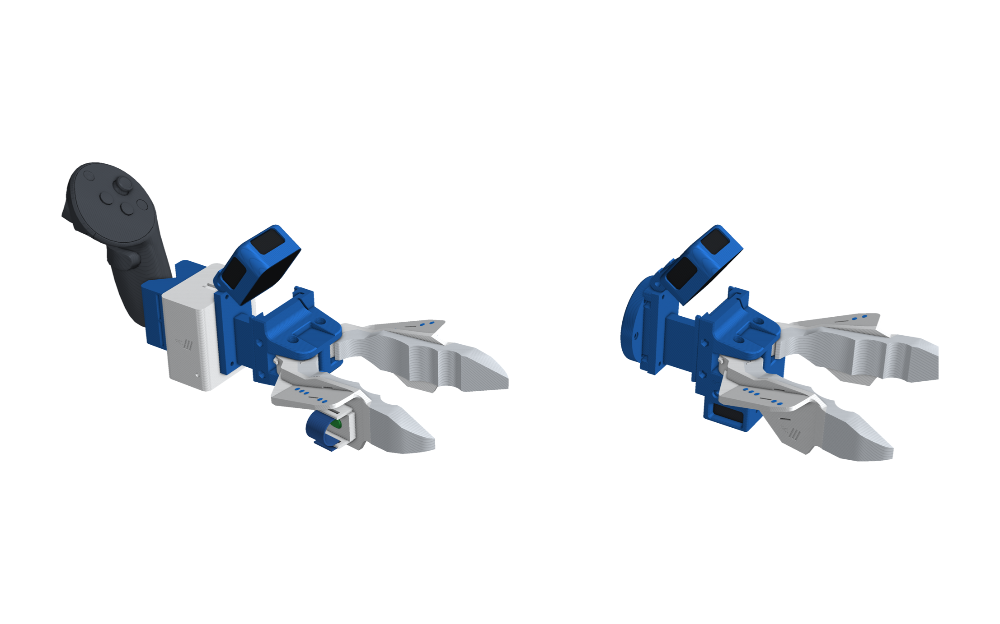
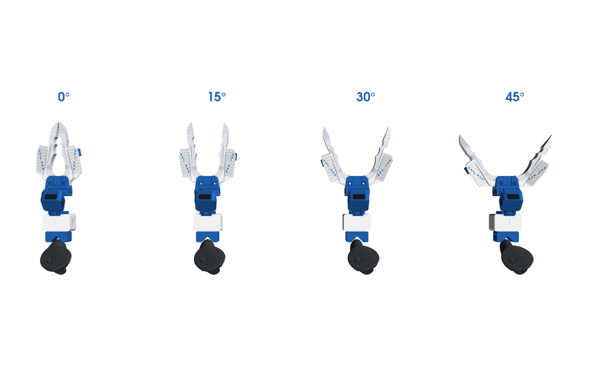
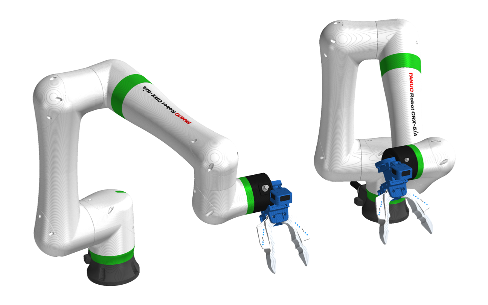
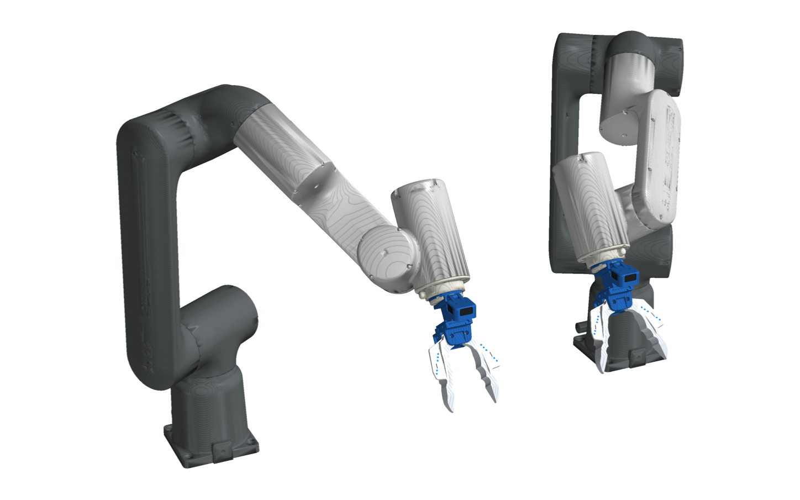
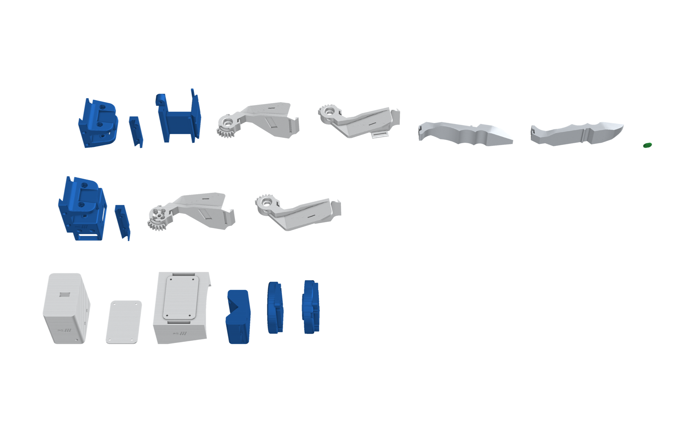

# D405 + Quest · Chopstick

The same geared chopstick jaws as the Insta360 kit, with a different sensing head:

- **Intel RealSense D405:** a close-range depth camera on the HandUMI tilting mount, looking at the jaws.
- **Electronics box:** a Raspberry Pi Pico 2, an IMU and a USB 3 hub, so one USB-C cable carries everything to the
  laptop.
- **Meta Quest Touch Pro controller:** clamped upright behind the head, used only for tracking. Its own cameras track it
  (paired to a Quest 3S or 3 headset), which gives the gripper's pose live. Its buttons do nothing.

The robot twin carries the same jaws and the same D405 at the same tilt.

| Build | Use | Files |
|---|---|---|
| `chopstick_right` | handheld, right hand: the index-finger button **starts and stops** recording | `assembly/chopstick_right.*` |
| `chopstick_left` | handheld, left hand: the index-finger button **cancels** the take | `assembly/chopstick_left.*` |
| `chopstick_openarm` | robot twin on OpenArm (link7 adapter) | `assembly/chopstick_openarm.*` |
| `chopstick_iso50` | robot twin on any ISO 9409-1-50-4-M6 flange (UR e-series, ABB GoFa, FANUC CRX, ...) | `assembly/chopstick_iso50.*` |

  
  

## The head

- **`d405_frame`:** the base interface at the front (the same tongue and two M3 × 55 screws as every end effector), a
  back plate, and a Ø12 × 10 mm hinge knuckle on top.
- **`d405_cup`:** the HandUMI D405 cup, used unchanged. It hangs on the knuckle by its two lugs with an M4 × 30 bolt
  and nyloc nut, so you can **tilt the camera** to taste (15° to 65° down; 35° default) and lock it.
  - At 35° the jaws and tips are inside the D405's 7–50 cm depth range, with the tips about 190 mm away.
  - The cup has side windows and a **window in its top wall**, so the USB cable leaves from the top and drops into the
    box.
- **`ebox`:** bolts to the back plate with the same four M3 inserts the robot plates use. It holds the Pico 2, the IMU
  and the USB 3 hub. See [electronics.md](electronics.md).
- **`quest_cradle`:** a 90° V-cradle on the box's back wall. The controller's handle stands upright in it on 2 mm foam,
  held by two 20 mm straps, so its head and tracking face stay above the gripper clear of your hand.

## How it works

- **Jaws:** two jaws on 624 bearings at (67.33, ±15.0) mm, tied by 24-tooth spur gears, so they open by the same
  angle in opposite directions. A rubber band reopens them, and each jaw swings 72° before anything touches.
- **Opening:** the tips are 48 mm apart at 10° per jaw, 96 mm at 20° and 141 mm at 30°. The tool tip is at
  (204.7, 0, −3.7) mm.
- **D405 camera frame:** at 35° tilt, the front-face centre sits at (38.6, 0, 47.9) mm. The tilt turns it about the
  hinge axis at (2.4, 0, 37.2) mm, along Y.
- **Blue dots:** on the jaws' shelves, the same as in the Insta360 kit. The D405 sees them up close, which gives the jaw
  angle.

## Finger sleeves and the record button

Each handheld jaw has a 5.5 mm pad where your finger rests and pushes. Two slotted fins along the pad hold an elastic
hook-and-loop strap that wraps your finger, adjustable to any size.

The index-finger jaw carries the only button: a stiff 6 × 6 mm switch under a TPU cover (green for record, red for cancel), wired to the Pico in the
box.

- **Right-hand gripper:** start / stop.
- **Left-hand gripper:** cancel.

## On the robot

  
  

- **Robot head:** the robot twin uses `d405_frame` and the cup without the box or controller, since the robot knows
  its own pose. The D405 plugs straight into the robot PC.
- **Mounting:** the frame's back plate takes `openarm_adapter` or `iso_flange_plate` directly. Bolt the plate to the
  robot, then screw the frame on (4 × M3 × 10, reached from the side with a ball-end hex key).
- **Servo:** a Feetech SM40BL drives the left jaw.

## Files

| Folder | Contents |
|---|---|
| `STEP/`, `STL/` | Every printed part for the four builds (gripper frame, jaws closed); `d405_cup.stl` is the HandUMI cup placed at 35°; `*_dots.stl` are the blue inlays |
| `assembly/` | `<build>.glb` / `.stl` at a typical opening (the camera and controller drawn as simple bodies) |
| `urdf/` | `pg_<build>.urdf`: `pg_jaw` with its mimic, `pg_camera` (D405 at 35°), `pg_tcp`, `pg_tip_*`; robot builds have `pg_flange` |
| `img/` | Renders |

- **Bill of materials:** [bom.md](bom.md).
- **Wiring:** [electronics.md](electronics.md).

## Build

1. **Print:** use blue PLA for the frame, base, clips, cradle and plates, and white PLA for the jaws and box. Add the
   blue dot inlays to the jaws. Print the tips in white TPU and the button cover in green TPU (record, right hand) or red TPU (cancel, left hand).
2. **Jaws:** build them as in the Insta360 kit: inserts, tips, bearings, button on the index jaw, rubber band, and gears
   meshed with the tips touching.
3. **Camera:** screw the D405 into the cup (2 × M3 × 6). Hang the cup on the frame's knuckle with the M4 × 30 bolt and
   nyloc nut, set the tilt and tighten. Route the cable out of the cup's top window.
4. **Box:** fit the electronics ([electronics.md](electronics.md)). Bolt the box to the back plate (M3 × 10 into its
   inserts), feed the D405 cable into its top slot and the button wire through the side hole, then close the lid.
5. **Controller:** screw the cradle to the box's back (4 × M3 × 8). Line the V with foam, stand the controller's handle
   in it and strap it in with two 20 mm straps.
6. **Assemble:** join the frame to the base with the clip and two M3 × 55 screws, then fit the finger straps.
