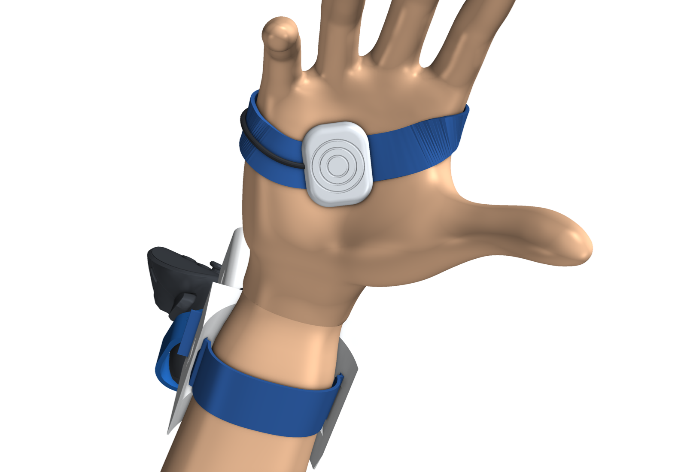
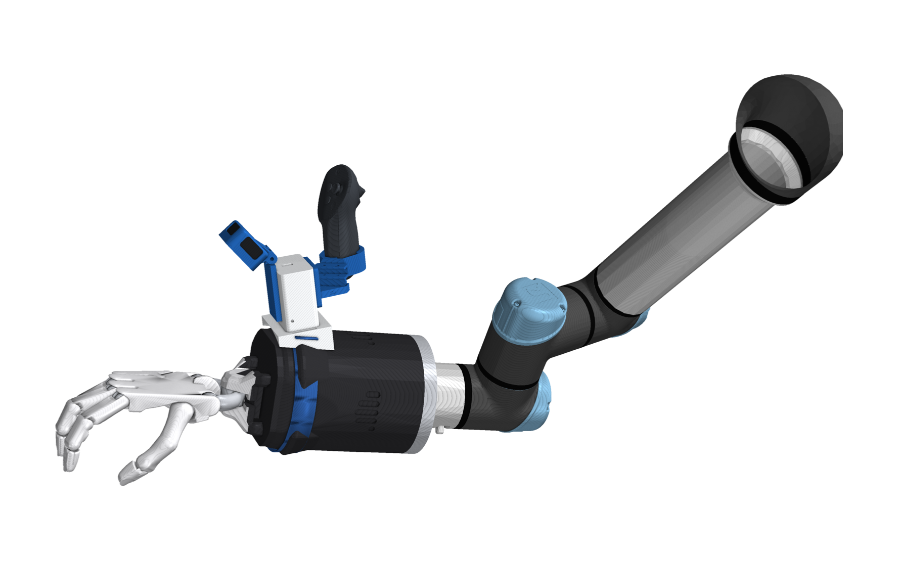

# D405 + Quest · Hand

For bare-hand demonstrations, the whole D405 head rides on the back of your forearm, just behind the wrist:

- **D405** on its tilt hinge, looking forward and down over your hand at what it grasps;
- **electronics box** (Pico 2, IMU, USB 3 hub);
- **Quest Touch Pro controller** in HandUMI's controller support, facing forward, so it tracks the wrist;
- **thumb strap and palm button:** a strap from the saddle round your palm, between thumb and index finger, carrying a
  soft button you press with your curled fingers to start and stop recording.

There are no jaws: your own hand is the end effector.

| Build | Use | Files |
|---|---|---|
| `hand` | the D405 head on the wrist (right arm shown; the left uses the mirror Quest parts) | `assembly/hand.*`, `urdf/pg_hand.urdf` |

## How it works

- **`d405_frame_hand`:** the frame without the front interface or its channel, just the back plate and the hinge
  knuckle. On the wrist nothing needs to sit in front of the camera.
- **`ebox_wrist_saddle`** replaces `ebox_lid`. Its top is the lid: the same footprint and four M2 screws. Underneath is
  a saddle shaped to the back of the forearm (concave, R 38 mm), 60 mm long, with two slotted wings for a 25 mm
  hook-and-loop strap round the forearm, and a **front tab** for the thumb strap.
- **Pitch:** the saddle tilts the head 15° forward. Set the D405's own tilt on its hinge (15° to 65°) so it frames your
  fingers. The camera frame turns about the hinge axis at (2.4, 0, 37.2) mm.
- **Tracking:** the Quest Touch Pro controller stands in HandUMI's controller support (on `quest_arm`, as on the
  Chop-UMI head) behind the box, face forward, where its tracking cameras see the room. Its buttons are not used.

## Thumb strap and palm button

The forearm strap holds the saddle where it sits; the thumb strap stops it sliding up the arm or turning round it, so
the camera stays put relative to your hand.

- **Thumb strap:** a 20 mm hook-and-loop strap. It loops round the front tab's bar, runs along the back of your hand,
  goes round the palm through the web between thumb and index finger, and closes on itself over the back of the hand.
  It doesn't move the saddle: the saddle stays just behind the wrist.
- **`palm_button`:** one soft TPU 95A part, 32 × 26 × 10 mm, threaded on the strap in your palm under the middle and
  ring fingers. **Curl those two fingers into your palm, like Spider-Man firing a web, to press it: once to start
  recording, again to stop.** Inside is a soft 6 × 6 mm tactile switch (about 160 gf) under a 1.2 mm membrane with a
  nub; three shallow rings on the dome let you find it by feel. It slides along the strap to fit your palm.
- **Wire:** a thin 2-core wire from the button's wrist end, round the outer (little-finger) edge of the hand on the
  strap, back along it to the box, and in through the button-wire hole in the box's side wall. Wiring:
  [electronics.md](electronics.md).

## On a robot hand

For a dexterous robot hand, the same D405 head goes on the robot's forearm, in the same place relative to the hand as on
your wrist. The robot then sees what you saw.

- **`ebox_wrist_saddle_robot`** is `ebox_wrist_saddle` with a wider saddle (R 68.5 mm) for round robot forearms up to
  Ø137 mm, and without the thumb tab (the robot doesn't need the thumb strap or the button).
- **Fixing:** the same 25 mm strap goes round the forearm through the wings.
- **Shown:** a Shadow Hand (MuJoCo Menagerie model) on a UR5e, with the saddle's front edge about 30 mm behind the
  wrist.

## Files

| Folder | Contents |
|---|---|
| `STEP/`, `STL/` | `d405_frame_hand`, `d405_cup` (HandUMI cup at 35°), `ebox`, `ebox_wrist_saddle`, `ebox_wrist_saddle_robot`, `quest_arm_*` and `quest_support_*` (right and left), `palm_button` |
| `assembly/` | `hand.glb` / `hand.stl` |
| `urdf/` | `pg_hand.urdf` (no joints; `pg_camera` on `pg_base`) |

- **Bill of materials:** [bom.md](bom.md).
- **Wiring:** [electronics.md](electronics.md).

## Build

1. **Print:** `d405_frame_hand`, `d405_cup`, `quest_arm` and `quest_support` (right or left) in blue PLA; `ebox` and
   `ebox_wrist_saddle` in white PLA; `palm_button` in TPU 95A.
2. **Camera:** screw the D405 into the cup and hang the cup on the knuckle (M4 × 30 + nyloc). Route its cable out of
   the top window into the box.
3. **Box:** fit the electronics, bolt the box to the frame's back plate, and screw the saddle on in place of the lid.
   Add a thin foam pad under it.
4. **Controller:** screw `quest_arm` to the box's back, bolt HandUMI's controller support to it, line the ring with
   thin foam tape and push the controller's handle in, face forward.
5. **Palm button:** push the switch into the button's pocket through the slit at its wrist end, solder the wire, and
   lead it out of the wire channel. Thread the thumb strap through the button's tunnel.
6. **Wear it:** strap the saddle on just behind the wrist with the 25 mm strap through its wings, the camera facing your
   fingers. Loop the thumb strap round the front tab's bar, lay it along the back of your hand, take it round your palm
   between thumb and index finger with the button under your middle and ring fingers, and close it on itself. Run the
   wire along the strap into the box's side hole (the one on your little-finger side).
