# D405 + Quest · Para-UMI

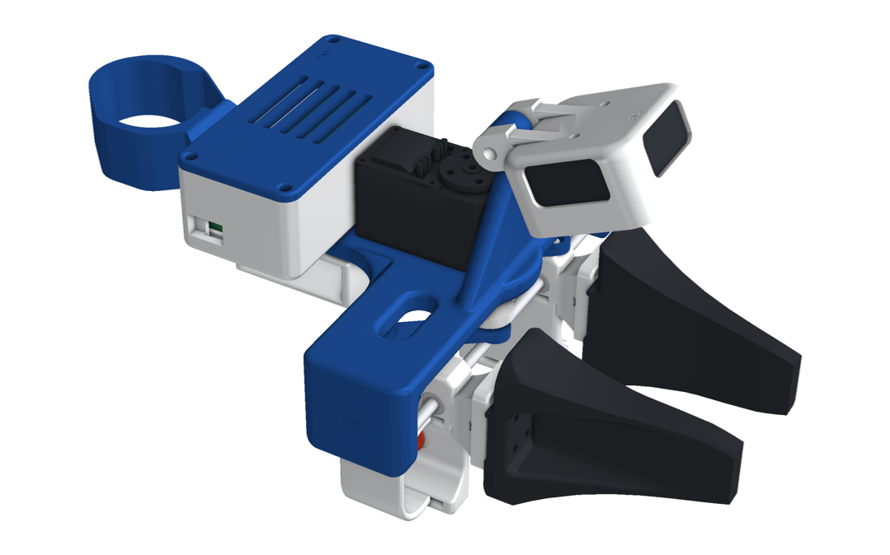

This is the HandUMI parallel gripper from [The-UMI-no-one-wants](https://github.com/Pruthvi-Neuracore/The-UMI-no-one-wants),
**exactly as it is**. It has everything HandUMI has:

- the T-plate main support and end cover;
- finger links with sleeves and the universal tip flange;
- the record button in the index sleeve;
- crank and connecting links, rods, and the STS3215 width encoder;
- the electronics box and the controller support.

The D405 sits in HandUMI's cup (`d405_wrist_mount`) on the Ø12 / M4 hinge, looking forward and down at the fingers.
This is the same cup the D405 chopstick and hand builds use. The Insta360 X5 kit's parallel gripper is this same device
with an X5 cradle on the hinge instead.

  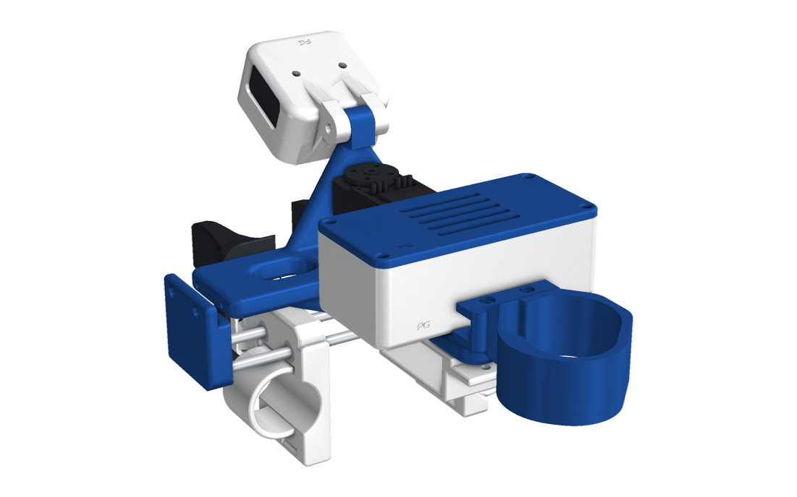
  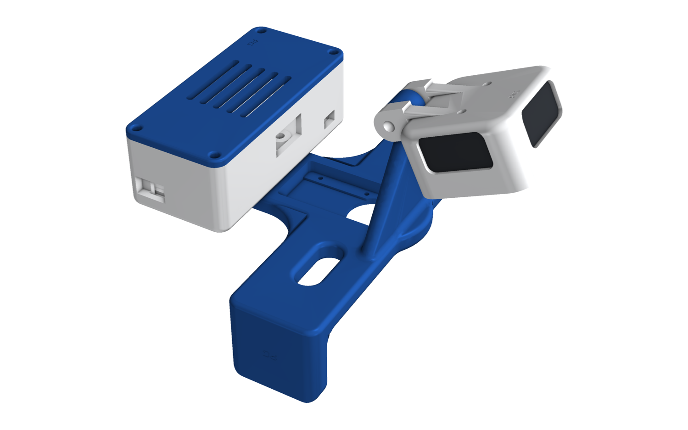

## How it works

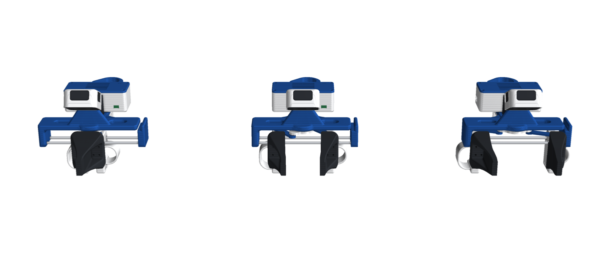

- **Linkage (HandUMI):** your fingers sit in the two finger links, which slide on two Ø4 rods (LM4UU bearings). A crank
  on the STS3215 servo axis and two connecting links tie the links together, so they always move the same amount in
  opposite directions.
- **Width:** the servo runs with its torque off and works only as the width encoder. The links travel about 87 mm
  from closed to fully open.
- **Record button:** a 6 × 6 mm switch sits in the index sleeve under a TPU cover.
  - **Right-hand gripper:** green cover. A press starts and stops recording.
  - **Left-hand gripper:** red cover. A press cancels the take.

  The parts are HandUMI's; only the cover colour and the firmware role differ.
- **Camera:** the D405 records depth and colour over USB 3, through the hub in the electronics box, so one USB-C cable
  goes to the laptop. Its cable leaves from the cup's top window. The hinge sets the view; HandUMI's default is 65°
  below horizontal, with the fingers about 9 to 10 cm away.
- **Tracking:** HandUMI's controller support holds the Quest controller for live pose (tracking only).

## Swappable tips

Each finger link ends in HandUMI's universal 20 × 30 mm flange, with these hole patterns:

- M2: 8 × 12 mm;
- M3: 12 × 24 mm, plus a centre pair;
- M4: a 12 mm pair.

Swap the tips to match the gripper of the robot you'll deploy on, so the jaws you record with are the jaws the robot has.

| Tips on the device | For |
|---|---|
| 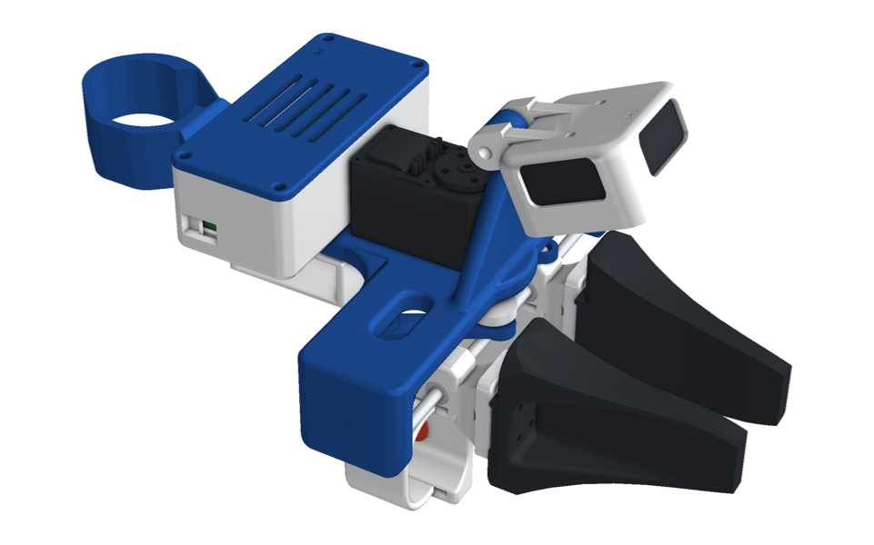 **AgileX Piper** jaw + pad |  AgileX Piper |
| 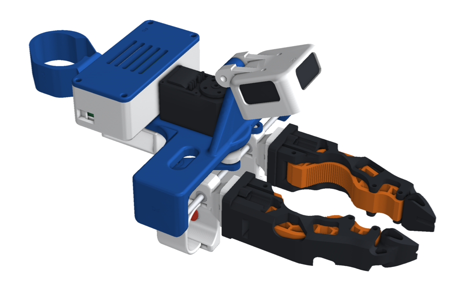 **Open-ENPIRE** compliant finger (TPU insert) | 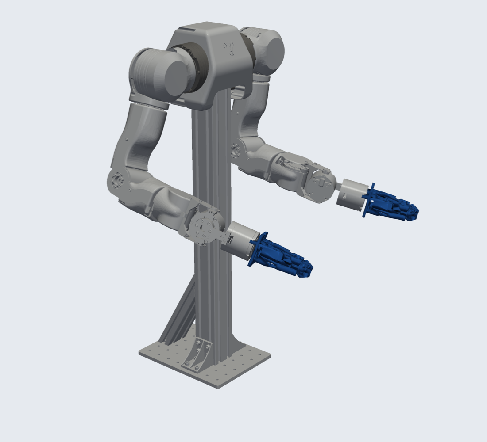 OpenArm with Open-ENPIRE fingers |
| 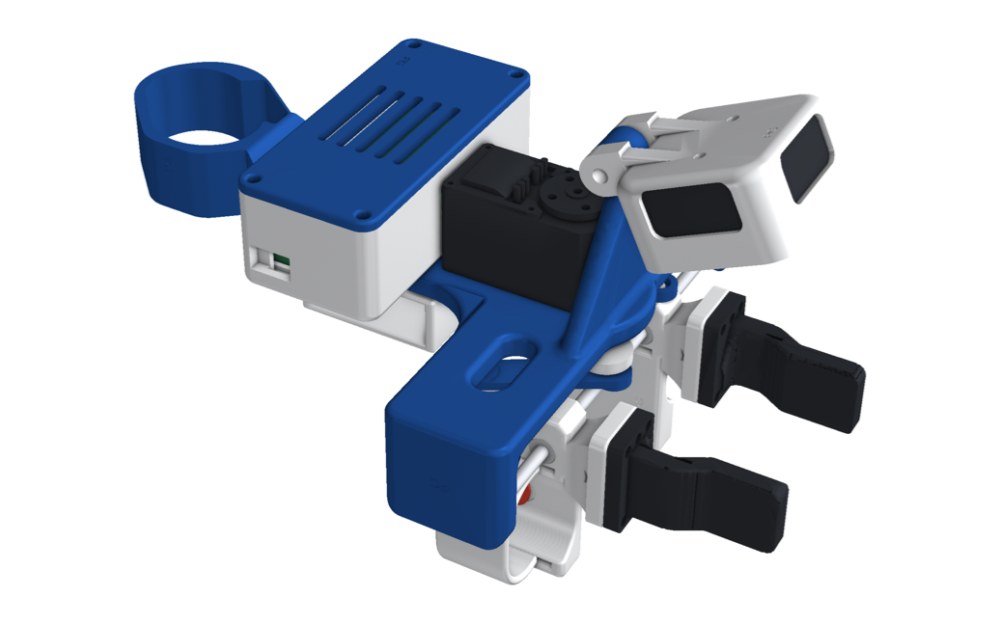 **Robotiq Hand-E** finger (print two; the index one is turned 180°) |  UR5, ABB GoFa, FANUC CRX with Hand-E |

  
  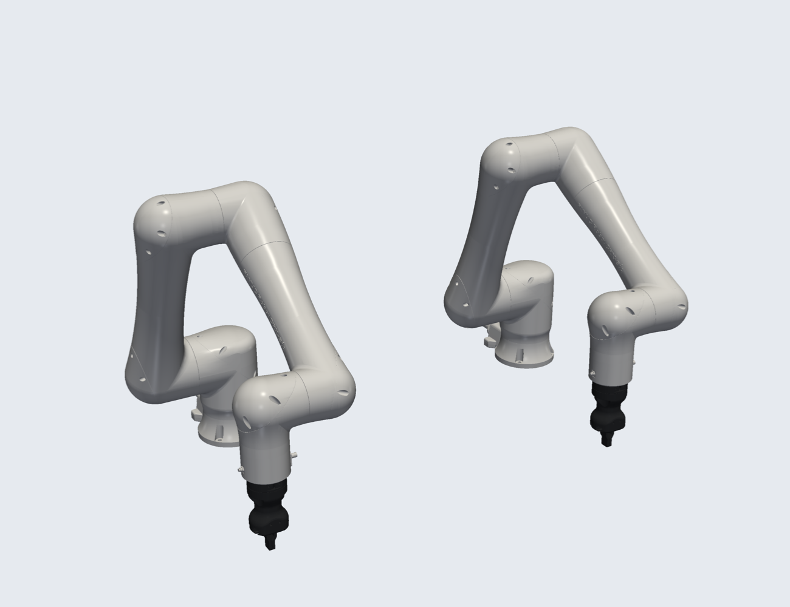

The robot renders are HandUMI's: the robot carries its own gripper with the same finger shape, so they're the same for both
camera kits.

## The camera on the robot

The robot carries its own gripper, and the tips above give the device the same fingers. To give the robot the same
**view** too, each robot gets a printed **camera post**. It carries HandUMI's Ø12 / M4 hinge knuckle at the same pose
relative to the fingertips as on the device, so the same `d405_wrist_mount` and D405 bolt on, at the same tilt, and the
robot sees what the device saw.

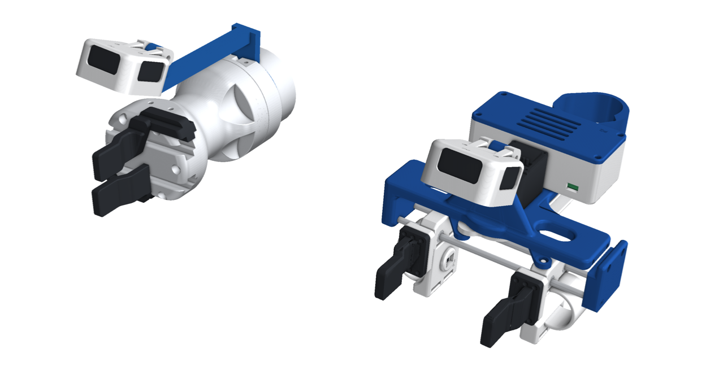

| Post | Robots | Fixing |
|---|---|---|
| `camera_post_hande` | UR5 / UR5e, ABB GoFa, FANUC CRX with a Robotiq Hand-E | A 6 mm plate between the ISO 9409-1-50-4-M6 flange and the Hand-E's coupler (the flange screws get 6 mm longer), with the post up the side of the Hand-E |
| `camera_post_piper` | AgileX Piper | A split collar round the gripper's round body (2 × M3 × 16 + nuts) |
| `camera_post_openarm` | OpenArm with Open-ENPIRE fingers | A split collar round link7's gripper housing (2 × M3 × 16 + nuts) |

  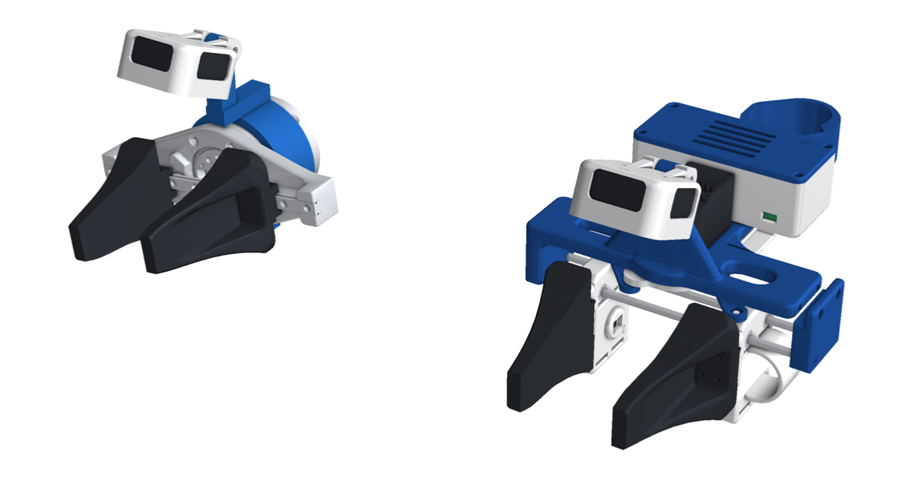
  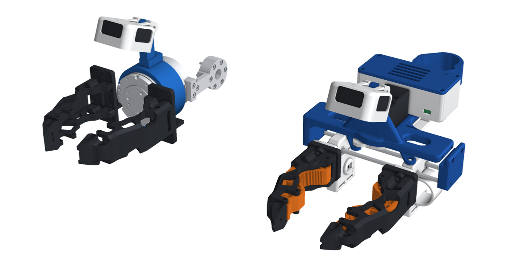

- **Same pose:** the fingertip frame (midway between the two fingertip pads, along the approach, across the jaws) is
  found on the device with each tip set and on the robot with its own fingers; the hinge sits in the same place in that
  frame. The jaws are symmetric, so the camera can go on either side of the robot's gripper.
- **Checked:** neither the post nor the camera touches the robot's gripper or wrist, with the fingers at both ends of
  their stroke.
- **Files:** `STEP/robot/`, `STL/robot/`. Generator: `cad/d405/robot_cameras.py`.

## Files

| Folder | Contents |
|---|---|
| `STEP/right/`, `STL/right/` | Every printed part for a right hand (HandUMI's, including `d405_wrist_mount`) |
| `STEP/left/`, `STL/left/` | The same for a left hand (mirror parts) |
| `STEP/gripper_tips/`, `STL/gripper_tips/` | The three tip sets |
| `STEP/robot/`, `STL/robot/` | The robot camera posts |
| `assembly/` | `para-umi_right_<tips>.glb` (coloured, one node per part, metres, Y up) and `.stl` (mm, Z up), half open, once per tip set |
| `img/` | Renders |

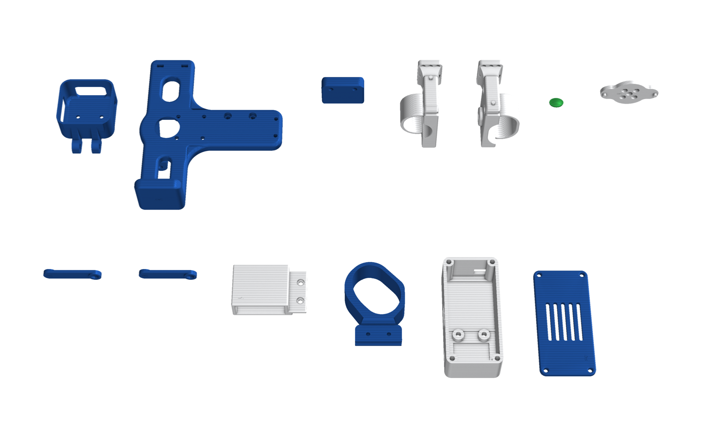

- **Bill of materials:** [bom.md](bom.md).
- **Wiring:** [electronics.md](electronics.md).
- **Generator:** `cad/d405/t_gripper.py`. It uses HandUMI's own assembly code and parts, vendored in
  `cad/d405/handumi/`.

## Build

Follow HandUMI's guide: print `STL/right/` or `STL/left/` and a pair of tips, and fix the D405 in its cup with
2× M3 × 5. Then hang the cup on the hinge with an M4 × 30 bolt and nyloc nut, and run the camera cable out of the top
window into the box. For the button covers, use green TPU on the right hand (record) and red on the left (cancel).
