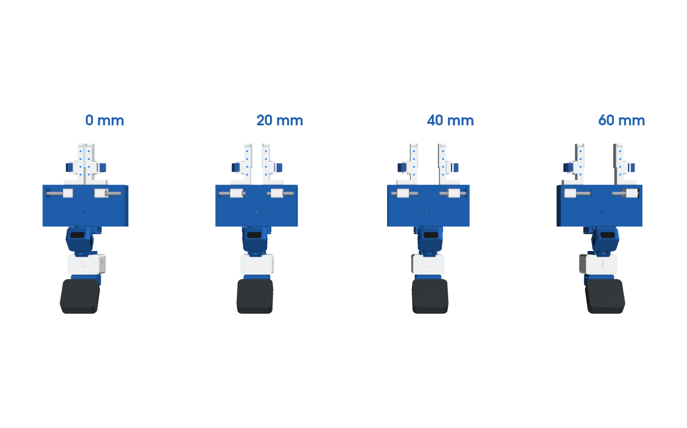
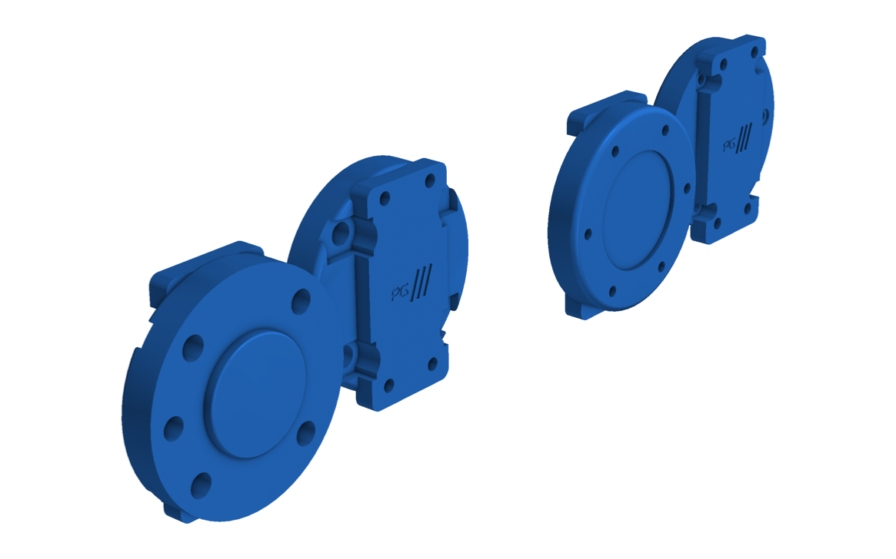
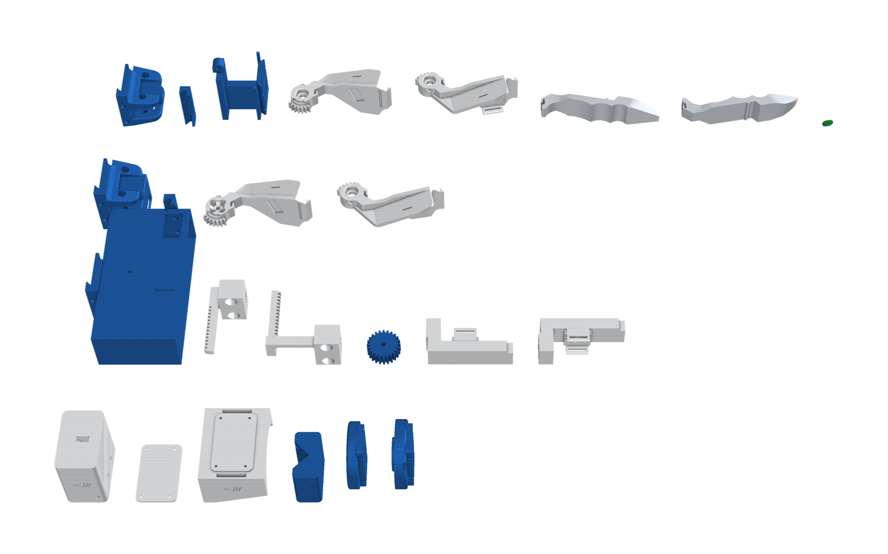

# D405 + Quest · Parallel

The rack-and-pinion parallel jaws on the D405 head. The handheld version also has the electronics box and the Quest
3S controller (tracking only). Two fingers slide straight together and stay parallel: you pinch them shut and springs
open them. On the robot, a servo turns the pinion.

| Build | Use | Files |
|---|---|---|
| `parallel_right` | handheld, right hand: the index-finger button **starts and stops** recording | `assembly/parallel_right.*` |
| `parallel_left` | handheld, left hand: the index-finger button **cancels** the take | `assembly/parallel_left.*` |
| `parallel_openarm` | robot twin on OpenArm | `assembly/parallel_openarm.*` |
| `parallel_iso50` | robot twin on any ISO 9409-1-50-4-M6 flange | `assembly/parallel_iso50.*` |

## How it works

- **Rails:** two Ø6 mm steel rods run across the housing at (x, z) = (118, ±12) mm. Each carriage rides on two LM6UU
  bushings.
- **Synchronising:** a 24-tooth, module 1.25 pinion at (82, 0) mm meshes with one rack on each carriage: the left rack
  in front of it, the right rack behind it. So the fingers always move by the same amount in opposite directions.
- **Stroke:** 30 mm per finger, so the TPU pads open 0 to 60 mm. The tool tip is at (206, 0, 0) mm.
- **Opening it:** handheld, two compression springs on the rods push the fingers apart. On the robot, a Feetech SM40BL
  under the housing turns the pinion.
- **Tracking:** four blue dots on each finger's top, seen up close by the D405.

## The head

The same head as the D405 chopstick ([../chopstick/README.md](../chopstick/README.md#the-head)):

- **`d405_frame`:** carries the HandUMI D405 cup on a tilt hinge (15° to 65°, M4 bolt), with the cable out of the
  cup's top window.
- **`ebox`:** the Pico 2, IMU and USB 3 hub, with one USB-C to the laptop. It bolts to the frame's back plate.
- **`quest_cradle`:** holds the Quest 3S controller upright for tracking.

## Finger sleeves and the record button

- **Sleeve:** each handheld finger has a pad on its outer face, two slotted fins and an elastic hook-and-loop strap.
- **Button:** the index finger's pad carries the only button, wired to the Pico.
  - Right-hand gripper: green cover, start / stop.
  - Left-hand gripper: red cover, cancel.

## On the robot

- **Robot head:** `d405_frame` and the cup only (no box or controller).
- **Mounting:** the back plate takes `openarm_adapter` or `iso_flange_plate`.
- **Servo:** `parallel_base_sa` carries the SM40BL, which turns `parallel_pinion_servo`.

## Files

| Folder | Contents |
|---|---|
| `STEP/`, `STL/` | Every printed part for the four builds (gripper frame, closed); `*_dots.stl` are the blue inlays |
| `assembly/` | `<build>.glb` / `.stl`, rods, servo, camera and controller included |
| `urdf/` | `pg_<build>.urdf`: prismatic `pg_finger` (m) with its −1 mimic, `pg_pinion` following, plus `pg_camera` (D405 at 35°) and `pg_tcp`; robot builds have `pg_flange` |
| `img/` | Renders |

- **Bill of materials:** [bom.md](bom.md).
- **Wiring:** [electronics.md](electronics.md).

## Build

1. **Carriages:** press two LM6UU bushings into each carriage, and two M3 inserts into its front face.
2. **Rods and springs:** slide the rods through the end walls and the carriages, with springs between the carriages
   (handheld).
3. **Pinion:** drop it in through the top window with the carriages centred, and fit the M4 axle.
4. **Fingers:** screw them on (2 × M3 × 14 each) and glue the TPU pads on. Fit the index button and the straps.
5. **Head:** build the head as for the D405 chopstick, then join the frame to the parallel base with the clip and two
   M3 × 55 screws.
6. **Robot twin:** fit the servo into the cradle with its shaft in the pinion, bolt the plate to the robot and screw
   the frame to the plate.
