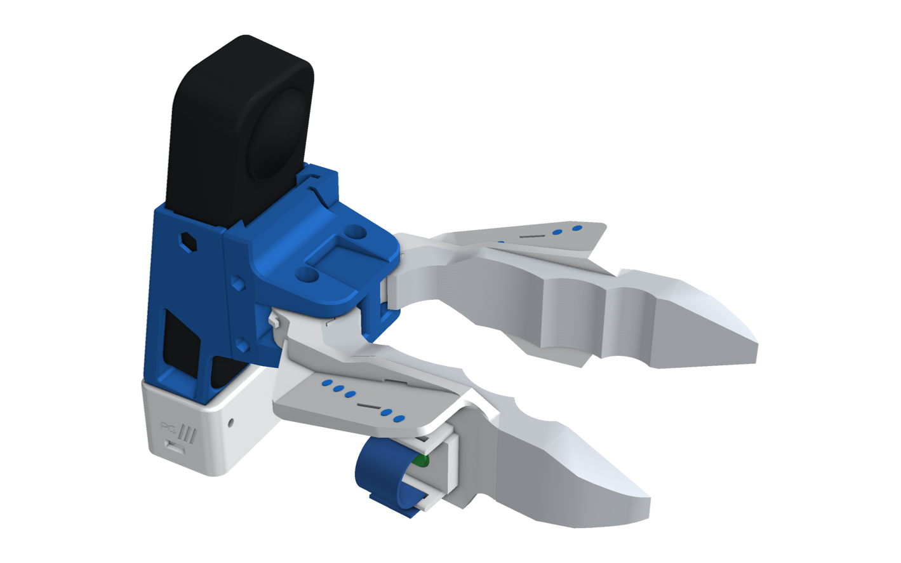
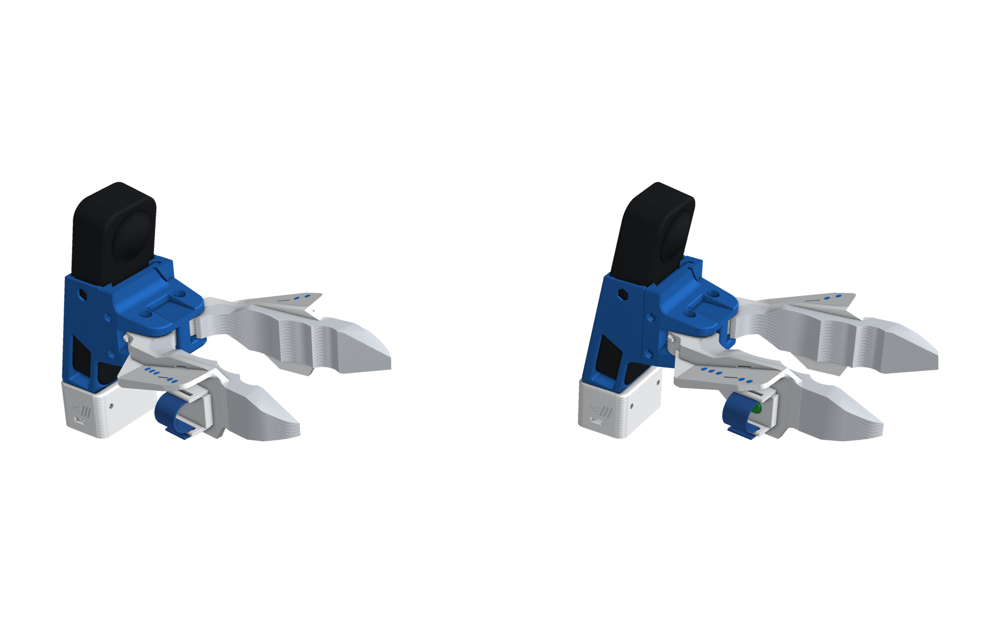
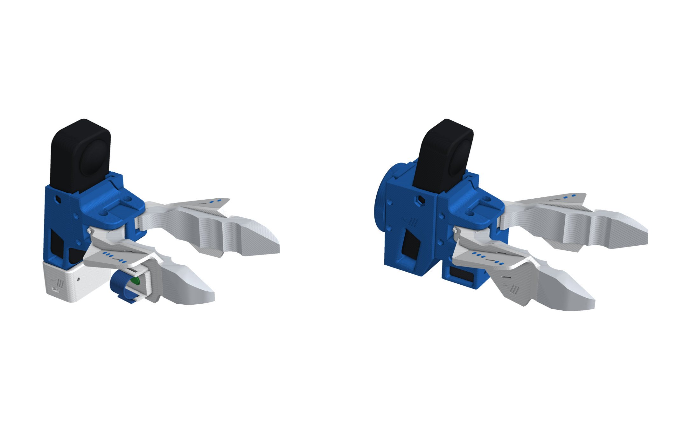
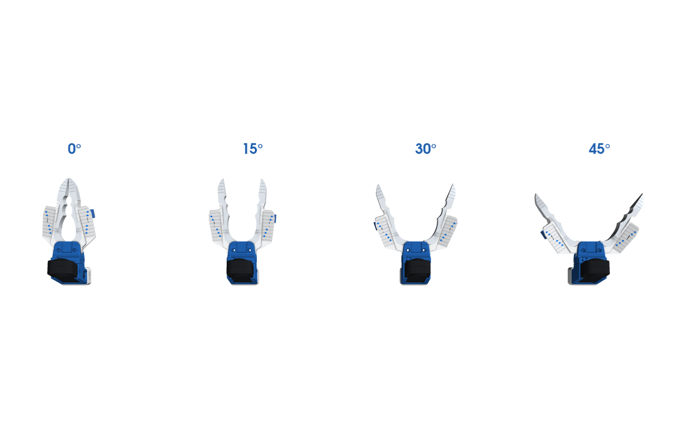
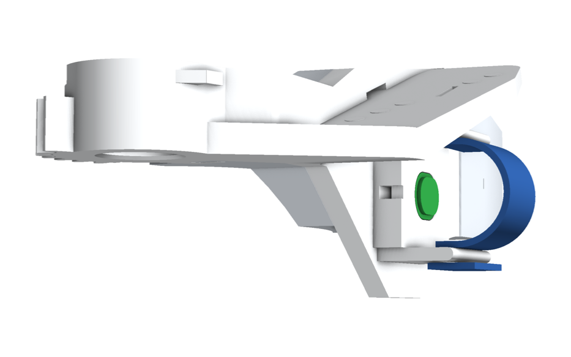
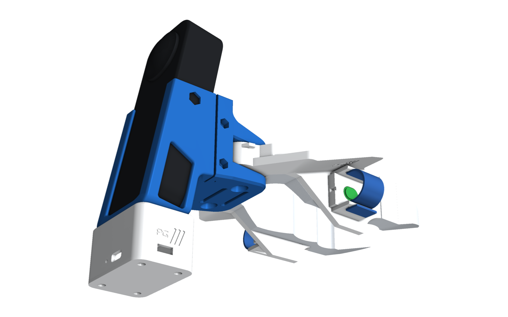
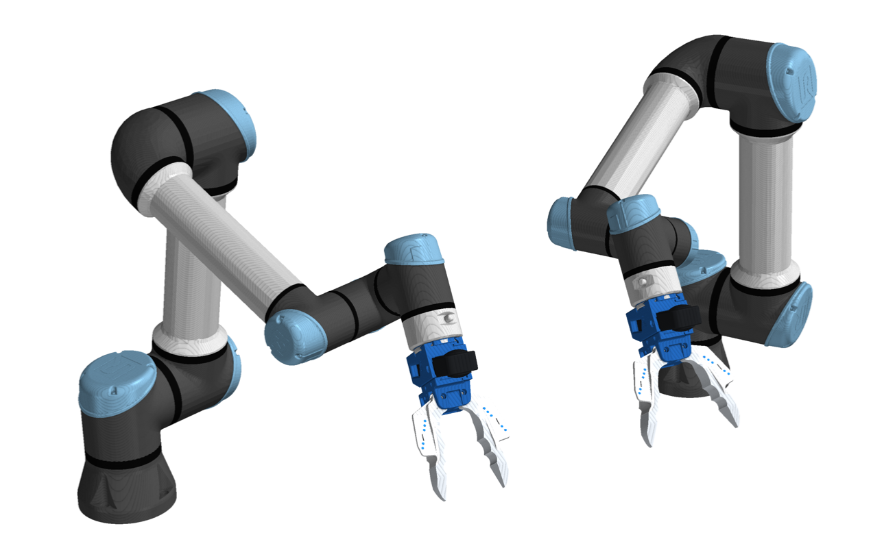
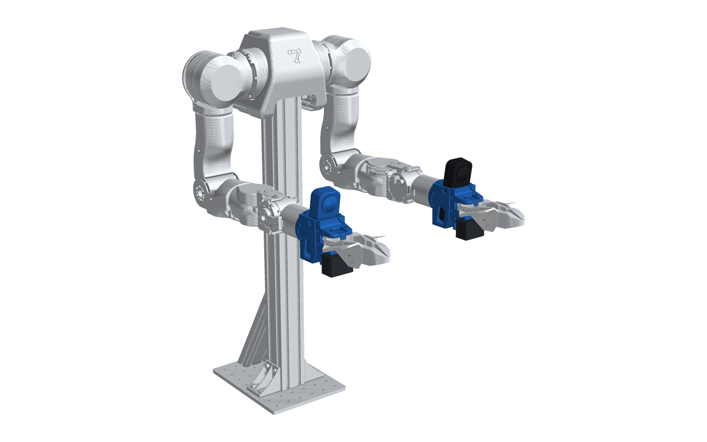
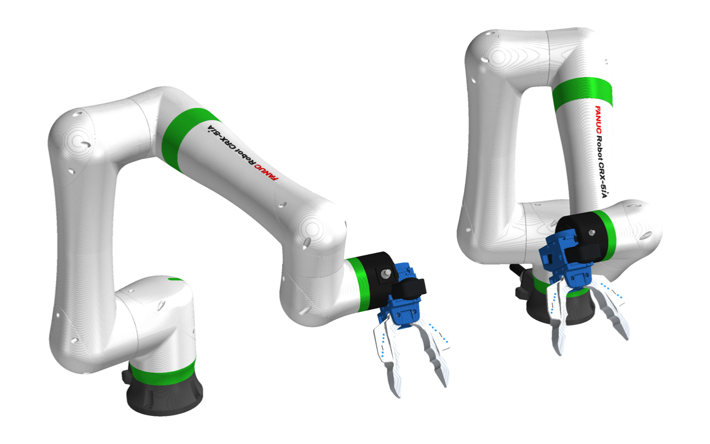
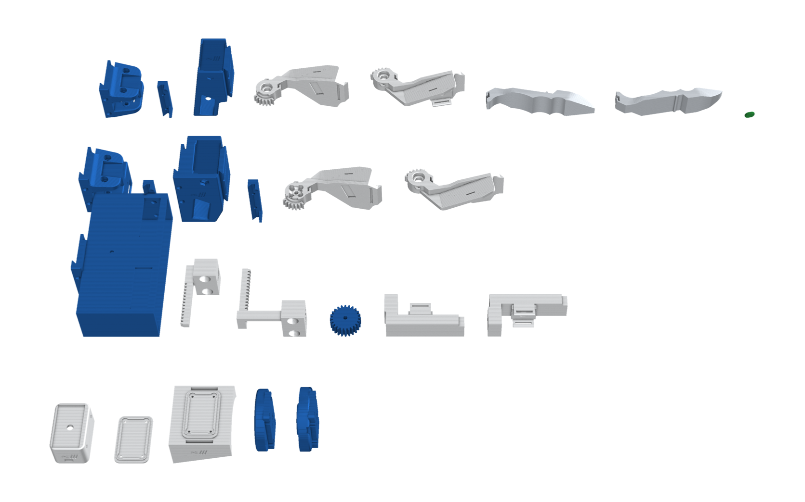

# Insta360 X5 · Chopstick

A pinch gripper you hold like chopsticks, with an Insta360 X5 riding on top. You squeeze two printed jaws together
with your thumb and index finger, and they open by themselves when you let go.

The X5 records the scene and its own IMU. The camera's pose comes from mapping that video, and blue dots on the jaws
let the video show how far they are open.

The robot twin carries the same jaws, the same camera at the same spot, and a servo. Anything you demonstrate
handheld, the robot can reproduce with identical geometry.

| Build | Use | Files |
|---|---|---|
| `chopstick_right` | handheld, right hand: the index-finger button **starts and stops** recording | `assembly/chopstick_right.*`, `urdf/pg_chopstick_right.urdf` |
| `chopstick_left` | handheld, left hand: the index-finger button **cancels** the take | `assembly/chopstick_left.*` |
| `chopstick_openarm` | robot twin on OpenArm (link7 adapter) | `assembly/chopstick_openarm.*` |
| `chopstick_iso50` | robot twin on any ISO 9409-1-50-4-M6 flange (UR e-series, ABB GoFa, FANUC CRX, ...) | `assembly/chopstick_iso50.*` |

  
  

## How it works

- **Two jaws, one motion.** Each jaw turns on two 624 bearings about a vertical pivot, at (67.33, ±15.0) mm. A pair of
  24-tooth spur gears (module 1.25, 30 mm apart) ties them together, so they always open by the same angle in
  opposite directions. A rubber band through the base reopens them.
- **Opening:** the tips are 48 mm apart at 10° per jaw, 96 mm at 20°, 141 mm at 30° and 199 mm at 44°. Each jaw can
  swing 72° before anything touches.
- **Tool tip:** where the white TPU tips meet, at (204.7, 0, −3.7) mm in the gripper frame (origin at the mounting
  face, +X forward, +Y left, +Z up).
- **Camera:** the X5 is tilted 10° nose-down. Its two lens domes sit at (45.5, 0, 55.1) and (23.4, 0, 58.9) mm, so
  the tool tip is 178 mm ahead of the camera and 30 mm below it.
- **Tracking dots:** five Ø3.5 mm blue dots sit on each jaw's top shelf, printed as inlays (`*_dots.stl`). The jaw
  angle is read from where they appear in the video.

## Finger sleeves and the record button

Your finger sits under each jaw's dotted shelf and presses the jaw's outer wall to close the jaws.

- **Pad:** a 5.5 mm pad on that wall is where your finger rests.
- **Fins:** two 8 mm fins along its edges hold your finger in place.
- **Strap:** an elastic hook-and-loop strap threads through slots in the fins and wraps over your finger. It is soft,
  adjustable and fits any finger size.

The **index finger** jaw also carries the only button: a stiff 6 × 6 mm switch under a domed TPU cover (green for record, red for cancel), set flush
in the pad.

- **Right-hand gripper:** the button is in the right jaw (`jaw_right_dc_button`) and starts and stops a take.
- **Left-hand gripper:** the button is in the left jaw (`jaw_left_dc_button`) and cancels the take.
- **Thumb jaws:** these use the plain pad.

The same wall is pushed to grasp, so the pod counts only short, deliberate presses. See [electronics.md](electronics.md).

## The PG pod

A small sealed box under the camera frame, held by the X5's own 1/4"-20 screw (a longer one), with a pocket that
keys onto the frame. It holds a XIAO ESP32-S3, an IMU, a 300 mAh battery and a power switch, so the gripper stays
wireless. Because the IMU is clamped to the camera, its gyro lines up with the X5's own IMU, which puts button presses
on the video's clock.

## On the robot

  

  
  

- **Robot gripper:** it uses the robot base (`chopstick_base_sa`) and the robot X5 frame (`x5_frame` + `x5_clip_b`).
  A Feetech SM40BL servo drives the left jaw through its rotor plate, and the gears drive the right.
- **Mounting:** the frame's back takes either mount plate. Both have the same front, with four M3 heat-set inserts.

- **`openarm_adapter`** fits OpenArm's link7:
  - 6 × M3 on PCD 50, with a pocket for the boss;
  - the jaws open along link7 Y, like the stock hand.
- **`iso_flange_plate`** fits ISO 9409-1-50-4-M6:
  - 4 × M6, a Ø31.45 spigot and a Ø6 dowel;
  - with the usual tool0 convention, the camera ends up on top when the arm reaches forward.

## Files

| Folder | Contents |
|---|---|
| `STEP/`, `STL/` | Every printed part for the four builds, in mm, in the gripper frame, jaws closed. `*_dots.stl` are the blue inlays |
| `assembly/` | `<build>.glb` (coloured, one node per part, metres, Y up) and `<build>.stl` (one mesh, mm, Z up), at a typical opening |
| `urdf/` | `pg_<build>.urdf` with its meshes: `pg_jaw` (rad, one jaw) with the right jaw as a mimic, plus `pg_camera`, `pg_tcp` and `pg_tip_*`; robot builds have a `pg_flange` root |
| `img/` | Renders |

- **Bill of materials:** [bom.md](bom.md).
- **Wiring:** [electronics.md](electronics.md).
- **Generators:** `cad/insta360_x5/`.

## Build

1. **Print:** use blue PLA for the frames, base, clips and plates, and white PLA for the jaws and pod. Add each jaw's
   `*_dots.stl` as a blue part or modifier. Print the tips in white TPU and the button cover in green TPU (record, right hand) or red TPU (cancel, left hand).
2. **Base:** fit M2 × 4 inserts in the back of the base and M3 × 4 in its underside.
3. **Jaws:** glue the TPU tips on and press two 624 bearings into each jaw.
4. **Button (index jaw):** solder the wire to the switch and lay it in the pad's channel. Press the switch in with its
   plunger up, then press the TPU cover over it.
5. **Join the jaws:** hook the rubber band through the base's centre cavity onto both jaws. Mesh the gears **with the
   tips touching**, then fit the two M3 shoulder screws.
6. **Camera:** set the X5 in the frame. Join the frame to the base with the clip and
   two M3 × 55 screws.
7. **Pod:** build it ([electronics.md](electronics.md)) and seat it under the frame. Screw the 1/4"-20 × 5/8" up through
   it into the camera before closing the lid.
8. **Straps:** loop each strap through one fin, wrap it over your finger, then through the other fin and fold it back.
9. **Robot twin:** screw the servo's rotor plate to `jaw_left_sa` and slide the servo into the base. Bolt the mount
   plate to the robot, then screw the frame onto the plate from inside the camera cavity. Calibrate the servo's zero
   with the tips touching.
