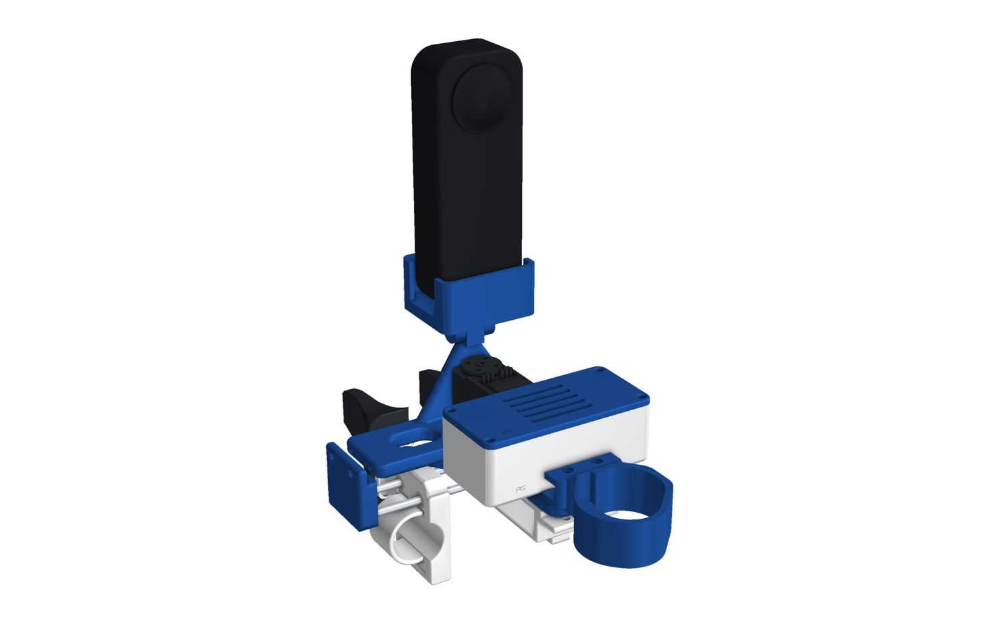
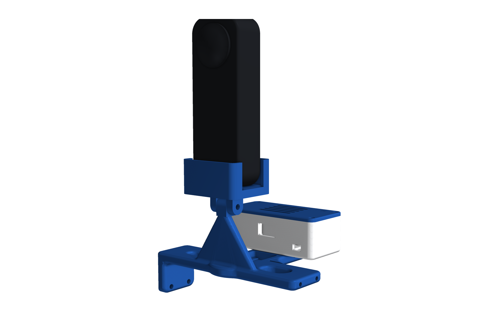
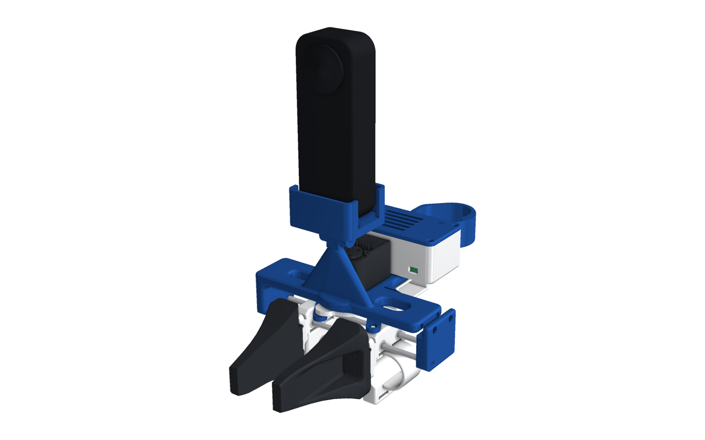
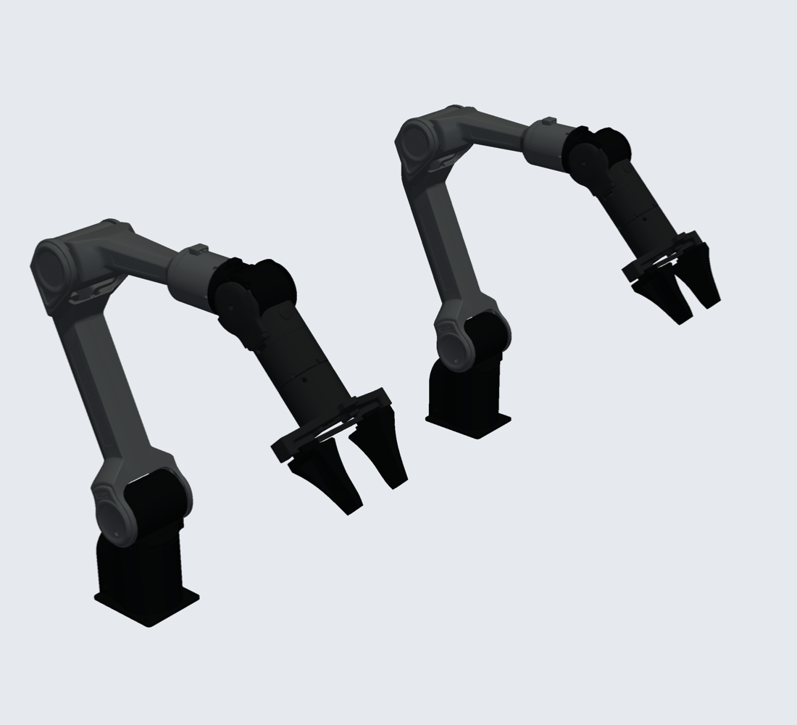
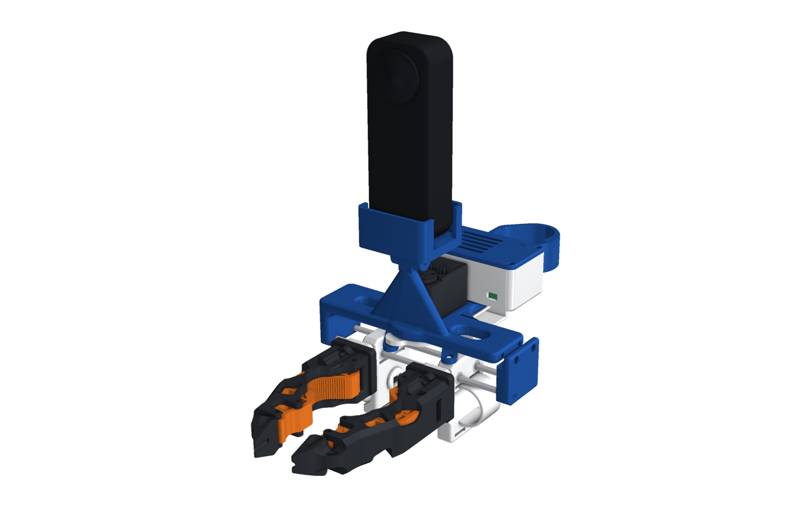
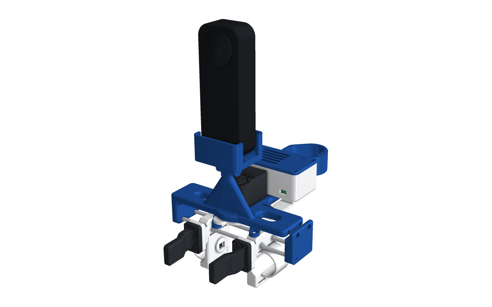
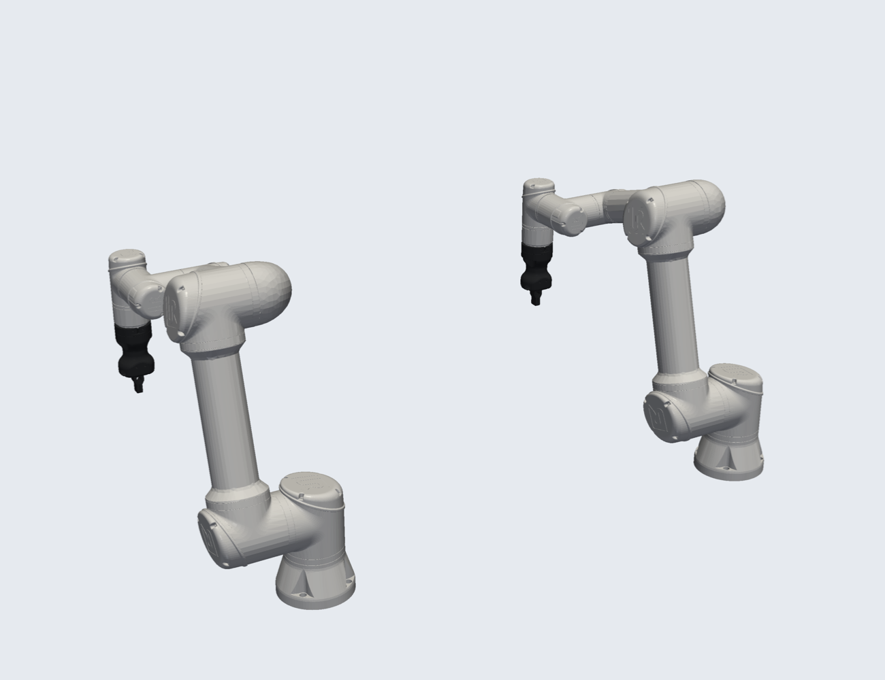
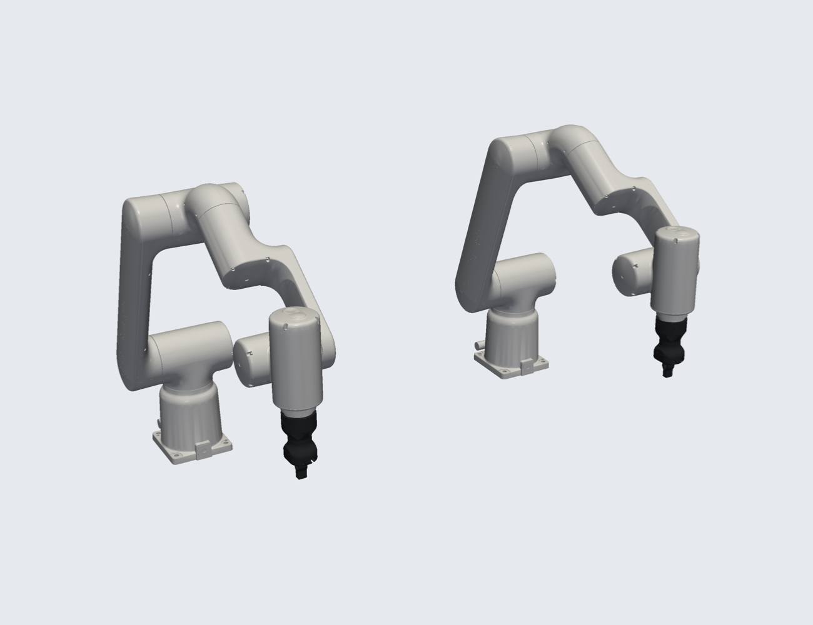
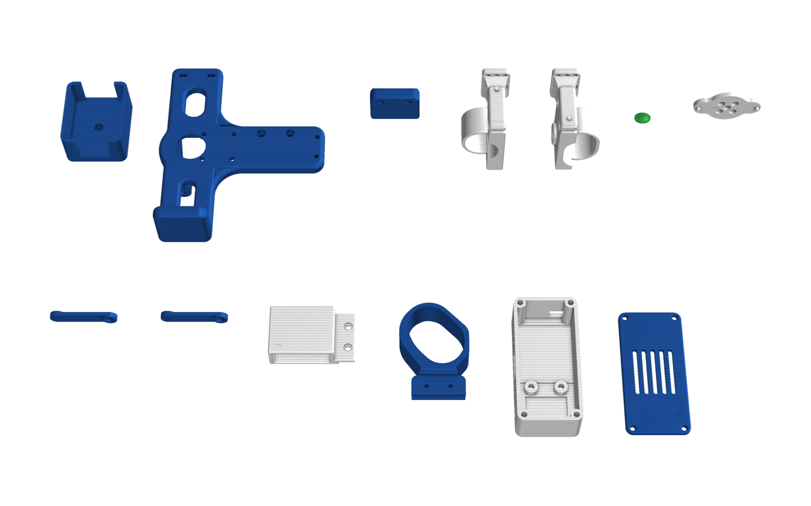

# Insta360 X5 · Parallel

This is the HandUMI parallel gripper from [The-UMI-no-one-wants](https://github.com/Pruthvi-Neuracore/The-UMI-no-one-wants),
**unchanged**, with an Insta360 X5 in place of the D405. It keeps everything HandUMI has:

- the T-plate main support and end cover;
- finger links with sleeves and the universal tip flange;
- the record button in the index sleeve;
- crank and connecting links, rods, and the STS3215 width encoder;
- the electronics box and the controller support.

Only one part is new: **`x5_wrist_mount`**. It hangs on the same Ø12 / M4 hinge as HandUMI's D405 cup and holds the X5
upright, so its two lenses sit clear above the gripper.

  
  

## How it works

- **Linkage (HandUMI):** your fingers sit in the two finger links, which slide on two Ø4 rods (LM4UU bearings). A crank
  on the STS3215 servo axis and two connecting links tie the links together, so they always move the same amount in
  opposite directions.
- **Width:** the servo runs with its torque off and works only as the width encoder. The links travel about 87 mm
  from closed to fully open.
- **Record button:** a 6 × 6 mm switch sits in the index sleeve under a TPU cover.
  - **Right-hand gripper:** green cover. A press starts and stops recording.
  - **Left-hand gripper:** red cover. A press cancels the take.

  The parts are HandUMI's; only the cover colour and the firmware role differ.
- **Camera:** the X5 records 360° video and its own IMU, and its pose comes from mapping that video.
  - **Tilt:** loosen the M4 hinge bolt to tilt the camera, from about 63° back to fully forward, then tighten the nyloc
    nut. Upright, its weight sits over the pivot.
  - **Clash check:** the cradle and camera don't touch any HandUMI part, closed, half open or fully open, with every
    tip set.

## Swappable tips

Each finger link ends in HandUMI's universal 20 × 30 mm flange, with these hole patterns:

- M2: 8 × 12 mm;
- M3: 12 × 24 mm, plus a centre pair;
- M4: a 12 mm pair.

Swap the tips to match the gripper of the robot you'll deploy on, so the jaws you record with are the jaws the robot has.

| Tips on the device | For |
|---|---|
|  **AgileX Piper** jaw + pad |  AgileX Piper |
|  **Open-ENPIRE** compliant finger (TPU insert) |  OpenArm with Open-ENPIRE fingers |
|  **Robotiq Hand-E** finger (print two; the index one is turned 180°) |  UR5, ABB GoFa, FANUC CRX with Hand-E |

  
  

The robot renders are HandUMI's: the robot carries its own gripper with the same finger shape, so nothing about them
changes with the camera.

## Files

| Folder | Contents |
|---|---|
| `STEP/right/`, `STL/right/` | Every printed part for a right hand: HandUMI's parts plus `x5_wrist_mount` |
| `STEP/left/`, `STL/left/` | The same for a left hand (mirror parts; `x5_wrist_mount` is shared) |
| `STEP/gripper_tips/`, `STL/gripper_tips/` | The three tip sets |
| `assembly/` | `x5_parallel_right_<tips>.glb` (coloured, one node per part, metres, Y up) and `.stl` (mm, Z up), half open, once per tip set |
| `img/` | Renders |

- **Bill of materials:** [bom.md](bom.md).
- **Wiring:** [electronics.md](electronics.md).
- **Generator:** `cad/insta360_x5/t_gripper.py`. It uses HandUMI's own assembly code and parts, vendored in
  `cad/insta360_x5/handumi/`; the mount itself is `handumi/cad/x5_wrist_mount.py`.

## Build

1. **Build HandUMI:** follow HandUMI's guide for everything except the camera. Print the parts in `STL/right/` or
   `STL/left/`, plus a pair of tips.
2. **Print the cradle:** print `x5_wrist_mount` in PETG or PLA, with the base plate down and no supports.
3. **Fit the cradle:** slide its two lugs over the main support's hinge knuckle and fit the M4 × 30 bolt and nyloc nut.
   Tighten until the cradle holds its angle.
4. **Fit the camera:** set the X5 in the cradle and screw a low-head 1/4"-20 × 3/8" camera screw up through the base
   plate into its socket. The head sits in the counterbore, between the lugs.
5. **Check the ports:** the side walls have a 24 mm slot for the X5's ports and battery door. Check them against your
   camera before you print.
