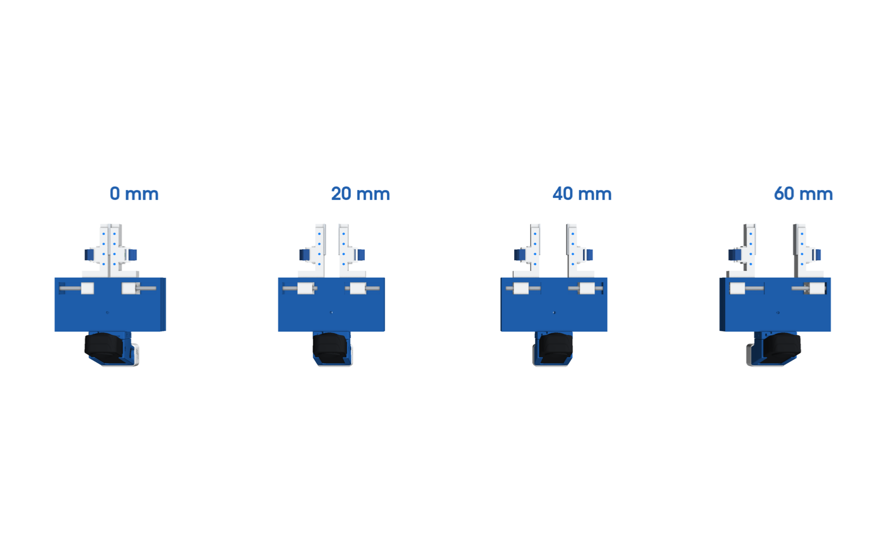
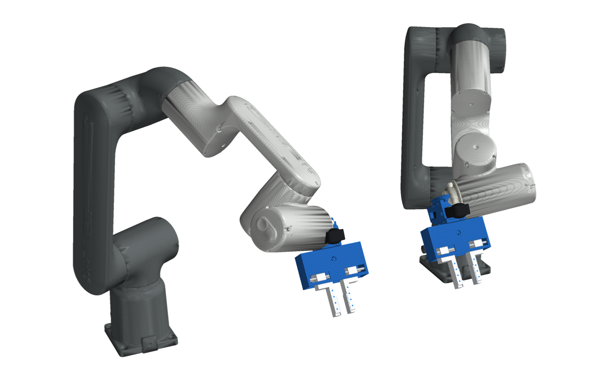
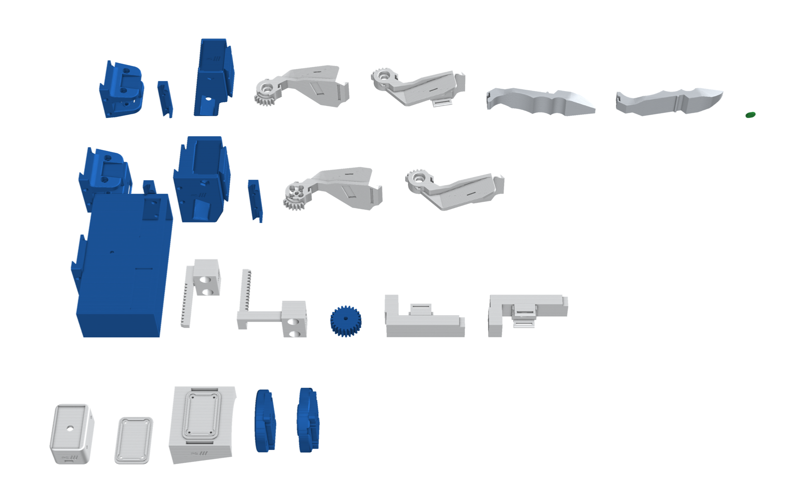

# Insta360 X5 · Parallel

Two fingers that slide straight together and stay parallel. It is the same X5 camera, frame and pod as the chopstick,
with a rack-and-pinion jaw module in front.

- **Handheld:** you pinch the fingers shut and springs open them.
- **Robot twin:** a servo turns the pinion.
- **Fit:** both bolt to the same frame interface as the chopstick base, so a frame can carry either end effector.

| Build | Use | Files |
|---|---|---|
| `parallel_right` | handheld, right hand: the index-finger button **starts and stops** recording | `assembly/parallel_right.*` |
| `parallel_left` | handheld, left hand: the index-finger button **cancels** the take | `assembly/parallel_left.*` |
| `parallel_openarm` | robot twin on OpenArm | `assembly/parallel_openarm.*` |
| `parallel_iso50` | robot twin on any ISO 9409-1-50-4-M6 flange | `assembly/parallel_iso50.*` |

## How it works

- **Rails:** two Ø6 mm steel rods run across the housing (along Y) at (x, z) = (118, ±12) mm. Each finger's carriage
  rides on two LM6UU linear bushings.
- **Synchronising:** a 24-tooth, module 1.25 pinion on a vertical axle at (82, 0) mm sits between two racks, one on
  each carriage.
  - The left carriage's rack runs in front of the pinion, in the top half of its 12 mm face.
  - The right carriage's rack runs behind it, in the bottom half. An arm over the pinion ties it to its carriage.

  When one finger moves, the pinion turns and moves the other the same amount the other way. The pinion's tooth
  phase is set so it meshes cleanly with both racks.
- **Stroke:** 30 mm per finger, so the TPU pads open 0 to 60 mm. The tool tip is at (206, 0, 0) mm, between the pads
  near their ends.
- **Opening it:** handheld, two compression springs on the rods sit between the carriages and push the fingers apart.
  On the robot, a Feetech SM40BL under the housing turns the pinion: 1 mm of finger travel is 1/15 rad of pinion.
- **Tracking:** four blue dots on each finger's top let the video show how far the fingers are open.

## Finger sleeves and the record button

Each handheld finger has the same sleeve as the chopstick jaws:

- **Pad:** a 5.5 mm pad on the finger's outer face, where your finger rests and pushes.
- **Fins:** two slotted fins along the pad's edges.
- **Strap:** an elastic hook-and-loop strap wraps your finger through the fins.

The index finger's pad carries the only button, under a TPU cover (green for record, red for cancel):

- **Right-hand gripper:** start / stop.
- **Left-hand gripper:** cancel.

## On the robot

- **Robot parts:** `parallel_base_sa` adds a cradle under the housing for the SM40BL, whose shaft comes up through the
  bottom plate into `parallel_pinion_servo`. The robot fingers are plain (no sleeves).
- **Frame and plates:** the robot X5 frame and the mount plates are the same as for the chopstick.

## Files

| Folder | Contents |
|---|---|
| `STEP/`, `STL/` | Every printed part for the four builds (gripper frame, closed); `*_dots.stl` are the blue inlays |
| `assembly/` | `<build>.glb` / `.stl` at a typical opening, rods and servo included |
| `urdf/` | `pg_<build>.urdf`: `pg_finger` (prismatic, m, one finger) with the right finger as a −1 mimic, `pg_pinion` following, plus `pg_camera`, `pg_tcp` and `pg_tip_*`; robot builds have a `pg_flange` root |
| `img/` | Renders |

- **Bill of materials:** [bom.md](bom.md).
- **Wiring:** [electronics.md](electronics.md).

## Build

1. **Carriages:** press two LM6UU bushings into each carriage, and two M3 heat-set inserts into its front face.
2. **Rods and springs:** slide a rod through one end wall and both carriages, with a spring between the carriages
   (handheld). Repeat with the second rod, then press both into the far end wall.
3. **Pinion:** with the carriages the same distance from the centre, drop the pinion in through the top window
   between the racks. Fit the M4 axle through the top and bottom plates.
4. **Fingers:** screw them to the carriages (2 × M3 × 14 each) and glue the TPU pads on. Then fit the index button and
   the straps, as for the chopstick.
5. **Camera and pod:** join the frame to the base with the clip and two M3 × 55 screws. Mount the pod under the frame
   with the 1/4"-20 × 5/8".
6. **Robot twin:** screw the rotor plate to `parallel_pinion_servo` and slide the SM40BL into its cradle with its shaft
   in the pinion. Bolt the plate to the robot and the frame to the plate.
