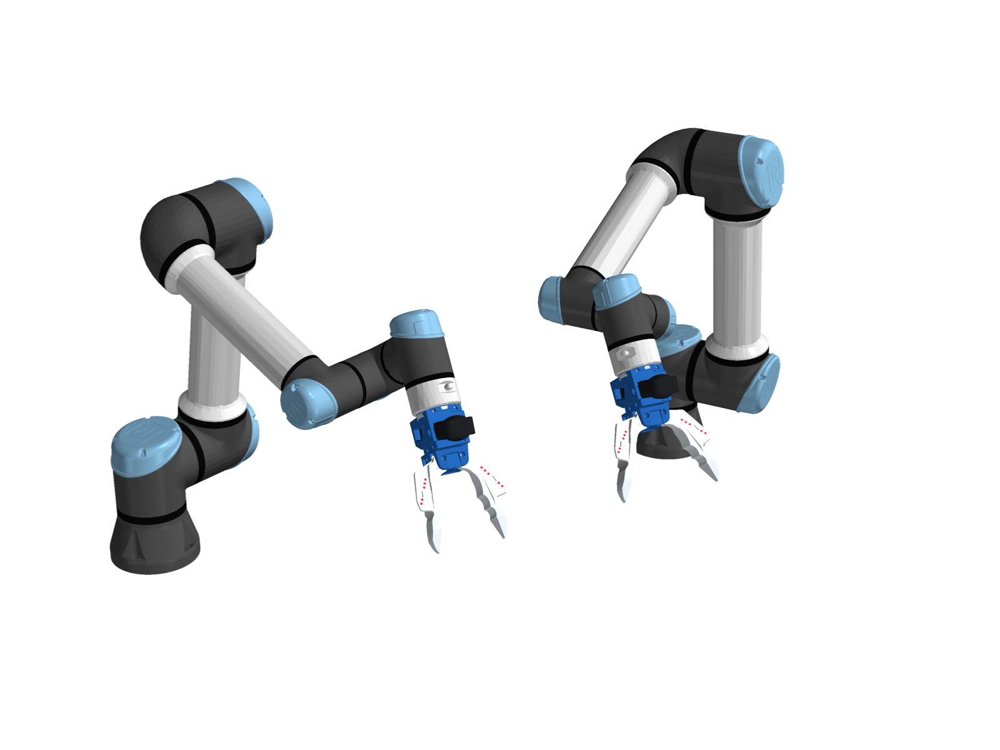
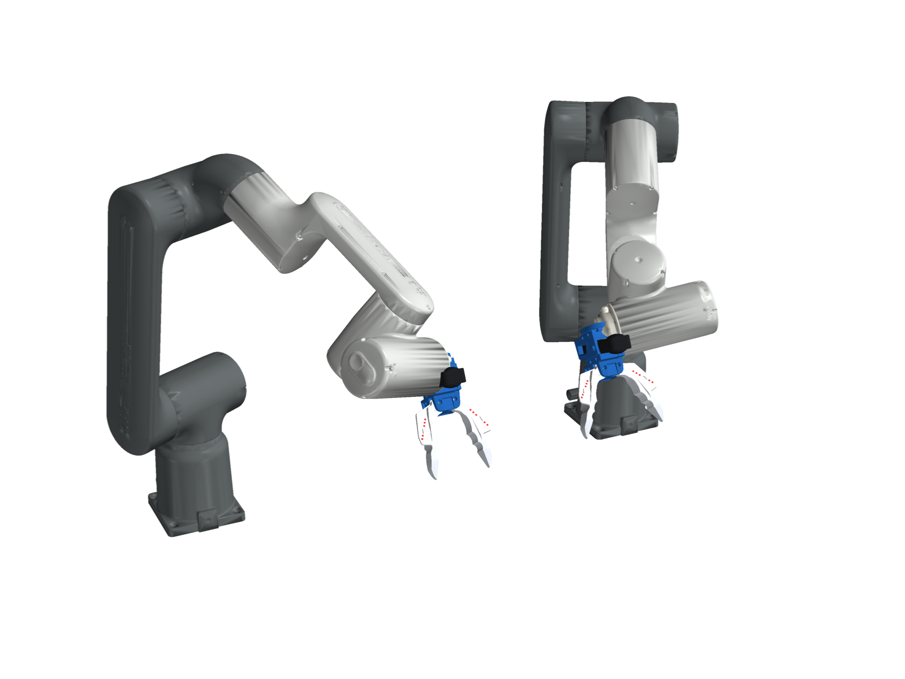
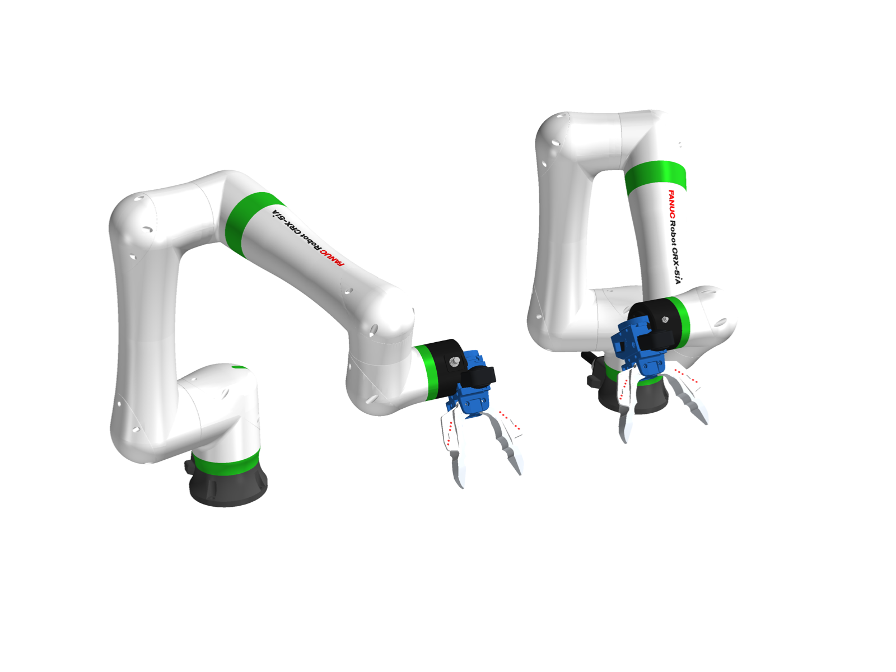
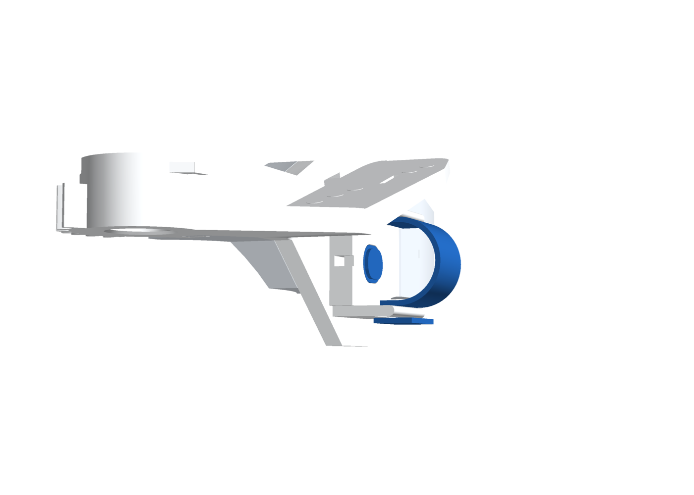
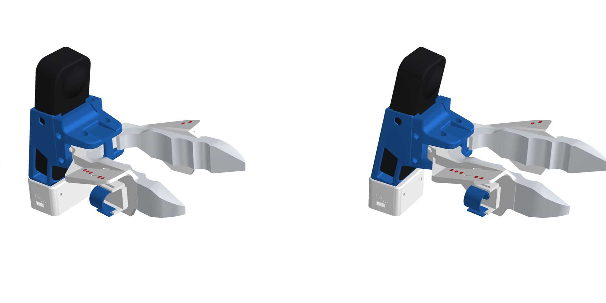
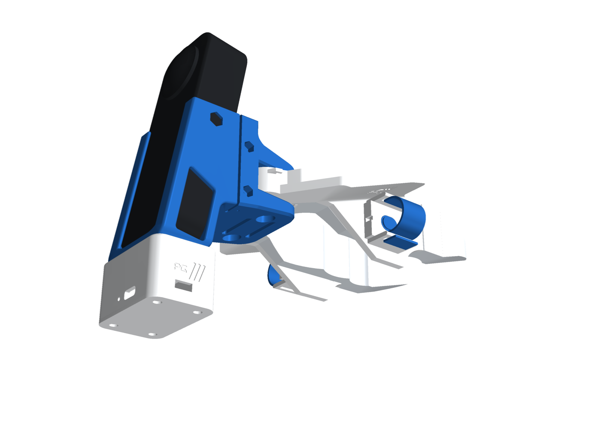
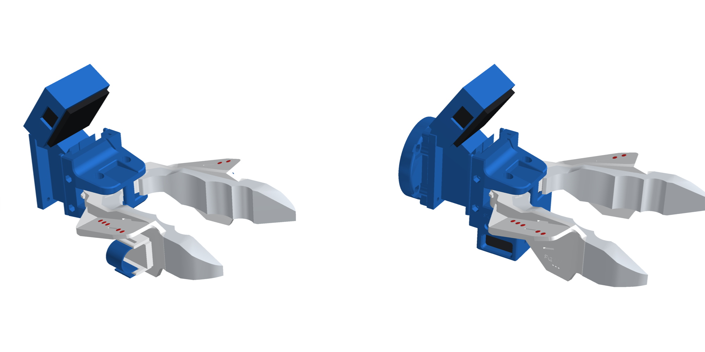
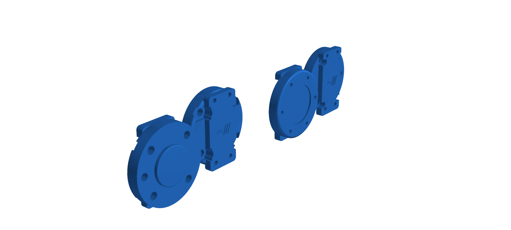

# PG Chopstick

<p align="center">
  
</p>

A chopstick-style gripper for collecting manipulation data in the wild, with matching robot grippers so the data
transfers straight onto a robot.

- **Pinch to grasp:** two printed jaws are geared together, and you pinch them with your thumb and index finger.
- **Camera on top:** a 360° camera rides above the jaws, and red dots on the jaws let it read how far they're open.
- **One button under your index finger:** elastic hook-and-loop straps hold your fingers in place and fit any finger
  size. Each gripper has one record button, in the index-finger sleeve: the right hand's starts and stops a take, the
  left hand's cancels it.
- **The robot sees what you saw:** the robot twin carries the same jaws and the same camera position, so the
  demonstration is reproduced exactly. It mounts on OpenArm, or on any cobot with the standard ISO 50 tool flange
  (UR, ABB GoFa, FANUC CRX).

<p align="center">
  
  <br><em>Bimanual UR5 with two PG Chopsticks on ISO 50 flange plates.</em>
</p>

<table>
<tr>
<td align="center"><br><em>ABB GoFa CRB 15000, ISO 50 plate</em></td>
<td align="center"><br><em>FANUC CRX-5iA ×2, ISO 50 plate</em></td>
</tr>
<tr>
<td align="center"><br><em>OpenArm, link7 adapter</em></td>
<td align="center"><br><em>Handheld (left) and robot twin (right)</em></td>
</tr>
</table>

## Contents

- [The builds](#the-builds)
- [How it works](#how-it-works)
- [Finger sleeves and the recording buttons](#finger-sleeves-and-the-recording-buttons)
- [The PG pod](#the-pg-pod)
- [The D405 option](#the-d405-option)
- [Robot mounts](#robot-mounts)
- [Example: bimanual UR5](#example-bimanual-ur5)
- [Retargeting](#retargeting)
- [Files](#files)
- [Rebuild from source](#rebuild-from-source)
- [What is and isn't verified](#what-is-and-isnt-verified)

## The builds

| Build | Camera | Mount | Parts |
|---|---|---|---|
| `data_right` | Insta360 X5 | right hand | `chopstick_base_dc`, `chopstick_clip_dc`, `x5_lite_frame`, `jaw_left_dc`, **`jaw_right_dc_button`**, `tip_tpu_left/right`, `sleeve_button_cover_right`, `x5_button_*`, `pg_pod`, `pg_pod_lid`, + 2 elastic finger straps |
| `data_left` | Insta360 X5 | left hand | as `data_right`, with **`jaw_left_dc_button`** + `jaw_right_dc` and `sleeve_button_cover_left` |
| `data_d405` | RealSense D405 | handheld | `jaw_left_dc` + `jaw_right_dc` (no button, no pod), `d405_frame` in place of `x5_lite_frame` |
| `openarm` | Insta360 X5 | OpenArm link7 | `chopstick_base_sa`, `chopstick_clip_sa`, `x5_frame`, `x5_clip_b`, `jaw_left_sa`, `jaw_right`, tips, `openarm_adapter` |
| `openarm_d405` | RealSense D405 | OpenArm link7 | as `openarm`, with `d405_frame` (no clip B) |
| `iso50` | Insta360 X5 | ISO 9409-1-50-4-M6 | as `openarm`, with `iso_flange_plate` |
| `iso50_d405` | RealSense D405 | ISO 9409-1-50-4-M6 | as `openarm_d405`, with `iso_flange_plate` |

A bimanual kit is a `data_right` and a `data_left` gripper, which differ only in which jaw carries the button, plus
two robot grippers with the same camera. In every build each jaw opens 72° before anything touches; this is checked for every pair of parts.

<p align="center"></p>

**Colours:**

- **Blue PLA:** the structure (bases, clips, camera frames, mount plates).
- **White PLA:** the jaws and the pod.
- **Red:** the dots on the jaws, printed as inlays.
- **White TPU:** the tips.
- **Blue TPU:** the button covers.

[docs/bom.md](docs/bom.md) has the full bill of materials, [docs/build.md](docs/build.md) the build steps and
[docs/pod.md](docs/pod.md) the electronics.

## How it works

<p align="center"></p>

- **Jaws:** each jaw turns on two 624 bearings, at (67.33, ±15.0) mm. A pair of 24-tooth spur gears (module 1.25,
  30 mm centres) ties them together, so both open by the same angle θ in opposite directions. On the handheld gripper
  a rubber band reopens them; on the robot, a Feetech SM40BL servo drives the left jaw and the gears drive the right.
- **Gripper frame:** origin at the centre of the mounting face, +X along the jaws, +Y to the left jaw, +Z up (camera
  side). Every part file and URDF uses this frame.
- **Tip gap:** 48 mm at θ = 10°, 96 mm at 20°, 141 mm at 30° and 199 mm at 44°. The closed tips are pre-loaded
  0.17 mm into each other (TPU).
- **Tool tip (TCP):** where the TPU tips meet, at (204.7, 0, −3.7) mm.
- **X5 camera:** tilted 10° nose-down. Its frame sits midway between the lens domes at (34.4, 0, 57.0) mm, and the TCP
  is 178 mm ahead of it and 30 mm below.
- **Red dots:** five Ø3.5 mm dots on each jaw's top shelf. Their positions are measured from the CAD.
  `theta_from_dots` fits θ from wherever the camera sees them, within 0.6° at 0.5 mm of noise per dot.

## Finger sleeves and the recording buttons

<p align="center">
  
  
</p>

You hold the handheld gripper like chopsticks: thumb in the sleeve on one jaw, index finger in the sleeve on the other.
Each finger sits under the jaw's dotted shelf and presses the jaw's outer wall.

- **The pad:** each handheld jaw has a 5.5 mm pad on its outer wall. This is what your finger pad rests on and pushes
  to close the jaws.
- **Strap fins:** two fins run along the pad's long sides, 2.4 mm thick and 8 mm tall. They cradle the sides of your
  finger, and each has a 17 × 2.5 mm slot.
- **The elastic strap:** a 16 mm hook-and-loop strap, about 12 cm per finger (bought, not printed). Loop one end
  through one fin's slot, wrap it over your finger, thread it through the other fin's slot and fold it back onto
  itself. It stretches, adjusts to any finger size and is soft against the skin. It stays under the shelf, so the
  camera still sees the dots.
- **The button (index-finger jaw only):** a 6 × 6 mm tactile switch in a pocket in the pad, under a domed TPU cover set
  flush in a 12 × 9 mm oval recess. A wire channel runs out of the back of the pad to the pod. The thumb jaw's pad is
  plain.

| Gripper | Index finger on | Button | Role |
|---|---|---|---|
| `data_right` (right hand) | right jaw | `jaw_right_dc_button` | **start / stop recording** |
| `data_left` (left hand) | left jaw | `jaw_left_dc_button` | **cancel recording** (discard the current take) |

Both pods run the same firmware: the right-jaw button input toggles recording and the left-jaw input cancels. Both
pods report to one host, so the left hand's cancel discards the take the right hand started.

The wall that holds the button is also the one you push to grasp, so:

- **Use a stiff switch** (250–320 gf).
- **Firmware filters grasps:** a short, deliberate press counts; a grasp holds the wall much longer.

## The PG pod

<p align="center"></p>

A 35 × 53 × 29 mm box clamped under the X5 frame by the camera's own 1/4"-20 screw (a longer one), with a 3 mm pocket
that keys it to the frame. It contains:

- a **Seeed XIAO ESP32-S3** (Wi-Fi/BLE, LiPo charging, USB-C on the back),
- an **IMU breakout** on the top wall,
- a **300 mAh LiPo**,
- a **slide switch**,
- **two wire entries** in the front, one per side, so the same pod serves either hand.

Because the IMU is clamped to the camera, cross-correlating its gyro with the X5's own IMU puts the pod's events (button
presses, IMU) on the video's clock. A sharp tap at the start of a take makes that easy. Wiring and firmware notes are
in [docs/pod.md](docs/pod.md).

## The D405 option

<p align="center"></p>

`d405_frame` puts an Intel RealSense D405 where the X5 goes:

- **Base interface:** it keeps the X5 frame's interface to the base, so it fits the handheld and robot bases alike.
- **Mounting:** the camera is pitched 35° down, held by 2 × M3 on its back, with cable windows on both sides.
- **Range:** the tips are about 190 mm away, inside the 7–50 cm depth range.
- **Back plate:** it takes either robot mount directly.
- **Camera frame:** centred on the front face at (39.4, 0, 47.4) mm.

## Robot mounts

<p align="center"></p>

Both plates have the same front: a 31.6 mm tongue that fits between the X5 frame's rear legs (or sits flat on the D405
frame's back plate), with 4 × M3 heat-set inserts at (±9, ±26.9) mm. The camera frame screws onto it from inside.

- **`iso_flange_plate`** fits **ISO 9409-1-50-4-M6** flanges (UR e-series, ABB GoFa, FANUC CRX, ...):
  - 4 × M6 on PCD 50 at 45°, with M6 × 14 screws through counterbores;
  - a Ø31.45 × 3 mm centring spigot and a Ø6 dowel hole;
  - it fits in 90° steps.

  Default pose (`T_FLANGE`): the gripper's +X along the flange +Z (approach), and the camera on the flange's −X side,
  which is on top when the arm reaches forward with the usual tool0 convention.
- **`openarm_adapter`** fits OpenArm's link7 flange:
  - 6 × M3 on PCD 50, with M3 × 16 screws;
  - a Ø36.5 pocket over the boss;
  - the jaws open along link7 Y, like the stock hand.

  It was checked against the link7 mesh: the plate sits flush, all six holes line up, and nothing clashes.

## Example: bimanual UR5

Two handheld grippers record the demo; two UR5s (or UR5e) with the `iso50` build replay it.

1. **Build** a `data_right` gripper (start/stop button) and a `data_left` gripper (cancel button), and fit the elastic
   straps.
2. **Build** two `iso50` robot grippers with X5 cameras, and bolt an `iso_flange_plate` to each UR tool flange.
3. **Add the gripper to the robot model:** for each arm, put `urdf/pg_chopstick_iso50.urdf` under the arm's `tool0`
   with an identity fixed joint (`<side>_tool0` → `chopstick_flange`). Use the arm's own tool0, not a tool0 placed after
   another gripper.
4. **Record:** press the right index button to start, and again to stop. Press the left index button to throw the take
   away. Each X5 records its own video and IMU, and each pod logs its IMU and button presses.
5. **Retarget each hand onto its arm:**

```python
import numpy as np
from pg_chopstick import Retargeter, ServoMap

# demo world -> each arm's base (from your cell calibration)
T_left_base_world, T_right_base_world = np.load("left_base_world.npy"), np.load("right_base_world.npy")

left = Retargeter(T_left_base_world, camera="x5", mount="iso50", servo=ServoMap(zero=2048, sign=1))
right = Retargeter(T_right_base_world, camera="x5", mount="iso50", servo=ServoMap(zero=2051, sign=-1))

for t, (T_world_cam_L, th_L), (T_world_cam_R, th_R) in demo:          # per frame, from the camera tracking
    cmd_L, cmd_R = left(T_world_cam_L, th_L), right(T_world_cam_R, th_R)
    # cmd["T_base_link7"]: target for the arm's tool flange (feed to UR IK / servoL);
    # cmd["servo_steps"]: SM40BL goal position
```

Or offline, per arm:

```bash
pg-chopstick-retarget demo_right.csv -o ur_right.csv --camera x5 --mount iso50 --base-world right_base_world.npy
```

The same works for ABB GoFa and FANUC CRX. For OpenArm, use `mount="openarm"`; `urdf.py --openarm-urdf` splices the
gripper onto both OpenArm arms for IK.

## Retargeting

Because the robot carries the same jaws and camera mount as the handheld gripper, retargeting is exact:

- the robot's camera goes where the demo camera was, which fixes the flange pose;
- θ is copied straight across, and the servo position comes from a two-number calibration.

The other option is to drive OpenArm's stock parallel hand: its TCP is matched, and the tip gap becomes the finger
opening. [docs/retargeting.md](docs/retargeting.md) covers the frames, the formulas and the CLI.

## Files

| Path | Contents |
|---|---|
| `hardware/STEP/`, `hardware/STL/` | One file per part, in mm, in the gripper frame, jaws closed |
| `hardware/STL/*_dots.stl` | The red dots as separate bodies, for multi-material slicers |
| `hardware/reference/` | Bought parts drawn for the assemblies (the elastic finger straps) |
| `hardware/tags/` | ArUco tag sheet (DICT_4X4_50, 14 mm), one tag per gripper |
| `assembly/pg_chopstick_<build>.{glb,stl}` | Full assemblies at 20° open. The GLB has coloured nodes, in metres, Y up; the STL is one mesh in mm, Z up |
| `urdf/pg_chopstick_<build>.urdf` | One URDF per build; robot builds have a `chopstick_flange` root |
| `retarget/` | `pg_chopstick` Python package (kinematics, retargeting, CLI) and its tests |
| `cad/` | Everything that builds the above |

## Rebuild from source

Use Python 3.12 with `build123d`, `trimesh`, `manifold3d`, `scipy`, `pyvista` and `yourdfpy`. `make_tags.py` also
needs OpenCV with the aruco module. The robot renders need the robot descriptions from the Neuracore robots
repository. Run from `cad/`:

```bash
python extract_parts.py && python restyle.py                  # PG parts from the upstream sources (sleeves, badges)
python pod.py && python d405_frame.py && python openarm_adapter.py && python iso_flange_plate.py
python kinematics.py --check                                   # kinematics JSON, dot inlays, jaw clash sweep
python urdf.py                                                 # urdf/
python assembly.py --check --openarm /path/to/openarm_description
python render_docs.py --openarm /path/to/openarm_description   # gripper renders
python robots.py /path/to/Neuracore_Robots                     # UR5 / ABB GoFa / FANUC CRX-5iA bimanual renders
python make_tags.py
python sync_readme.py                                          # copy this README to the repo root
cd ../retarget && pip install -e .[test] && pytest
```

## What is and isn't verified

- **Verified in CAD and code:**
  - jaw kinematics, and every part against every other at 20° and across the full opening, in all seven builds
    (pads, strap fins, straps and pod included);
  - the OpenArm adapter against the link7 mesh;
  - URDF ↔ kinematics consistency for every build;
  - retargeting for both cameras and both mounts (23 tests).
- **Not yet done:**
  - nothing has been printed;
  - the ISO plate's spigot and dowel are drawn to the standard, not checked on an arm;
  - the servo's calibration and mass are estimates;
  - the pod firmware isn't written.
- **Not included:** the vision pipeline (dot detection, camera tracking) and a servo bus driver.

Licences: [NOTICE.md](NOTICE.md).
