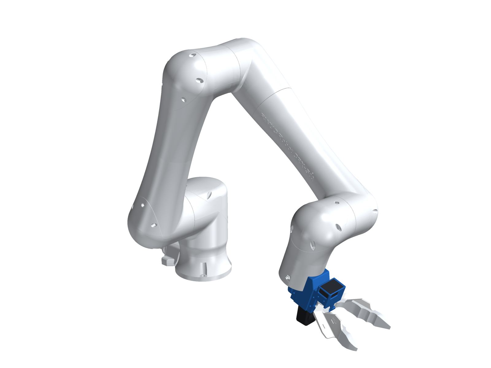

# PG Chopstick

<p align="center">
  
</p>

A chopstick-style gripper for collecting manipulation data in the wild, with matching robot grippers so the data
transfers straight onto a robot. Two printed jaws are geared together, and you pinch them with your fingers. A
360° camera rides on top, and red dots on the jaws let the camera read how far they're open.

- **Handheld data gripper:** passive and wireless. It carries an **Insta360 X5** and the **PG pod**: a battery-powered
  ESP32-S3, an IMU screwed rigidly to the camera, and a record button.
- **D405 option:** a **RealSense D405** depth camera on its own frame, which fits the same bases.
- **Robot twin:** the same jaws and camera position, with a servo on the driver jaw. It mounts two ways:
  - **OpenArm:** an adapter that bolts to the link7 flange.
  - **Any ISO 9409-1-50-4-M6 cobot:** UR e-series, ABB GoFa, FANUC CRX and the like.
- **PG look:** blue structure and white jaws. Every part carries the engraved PG badge (logo plus speed grooves).

<p align="center">
  
  <br><em>Left: the handheld gripper with the PG pod under the camera. Right: the robot twin on the OpenArm adapter,
  with its servo under the driver jaw.</em>
</p>

<p align="center">
  
  
</p>

## Builds

| Build | Camera | Mount | Parts |
|---|---|---|---|
| `data` | Insta360 X5 | handheld | `chopstick_base_dc`, `chopstick_clip_dc`, `x5_lite_frame`, `jaw_left_dc`, `jaw_right`, `tip_tpu_left/right`, `x5_button_*`, **`pg_pod`, `pg_pod_lid`, `pg_pod_button`** |
| `data_d405` | RealSense D405 | handheld | as `data`, with **`d405_frame`** in place of `x5_lite_frame` (no pod) |
| `openarm` | Insta360 X5 | OpenArm link7 | `chopstick_base_sa`, `chopstick_clip_sa`, `x5_frame`, `x5_clip_b`, `jaw_left_sa`, `jaw_right`, tips, **`openarm_adapter`** |
| `openarm_d405` | RealSense D405 | OpenArm link7 | as `openarm`, with **`d405_frame`** (no clip B) |
| `iso50` | Insta360 X5 | ISO 9409-1-50-4-M6 | as `openarm`, with **`iso_flange_plate`** |
| `iso50_d405` | RealSense D405 | ISO 9409-1-50-4-M6 | as `openarm_d405`, with **`iso_flange_plate`** |

For retargeting, the robot must carry the same camera the demos were recorded with. In each assembly a jaw opens
72° before it touches anything.

Files:

- `hardware/STEP/` and `hardware/STL/`: one file per part, in mm, in the gripper frame, with the jaws closed.
- `hardware/STL/*_dots.stl`: the red dots as separate bodies, for any multi-material slicer.
- `hardware/tags/`: an ArUco tag sheet.
- `assembly/pg_chopstick_<build>.{glb,stl}`: the full assemblies at 20° open. The GLB has coloured nodes, in metres,
  Y up. The STL is one mesh in mm, Z up.
- `urdf/pg_chopstick_<build>.urdf`: one URDF per build.

<p align="center"></p>

[docs/bom.md](docs/bom.md) has the bill of materials and filament colours. [docs/build.md](docs/build.md) has the
build steps. [docs/pod.md](docs/pod.md) covers the pod's electronics and wiring.

## How it works

<p align="center"></p>

- **Jaws:** two jaws on 624 bearings, at (67.33, ±15.0) mm. They are tied by 24-tooth spur gears (module 1.25, 30 mm
  centres), so both open by the same angle θ. A rubber band reopens the handheld jaws. On the robot, a Feetech SM40BL
  drives the left jaw.
- **Gripper frame:** origin at the centre of the mounting face, +X along the jaws, +Y to the left jaw, +Z up.
- **Tip gap:** 48 mm at 10°, 96 mm at 20°, 141 mm at 30° and 199 mm at 44°.
- **Tool tip (TCP):** where the TPU tips meet, at (204.7, 0, −3.7) mm.
- **Cameras:**
  - **X5:** tilted 10° nose-down. Its camera frame sits between the lens domes at (34.4, 0, 57.0) mm, and the TCP is
    178 mm ahead of it and 30 mm below.
  - **D405:** pitched 35° down, with its front face centred at (39.4, 0, 47.4) mm. The tips are 190 mm away, inside its
    7–50 cm depth range.
- **Red dots:** five Ø3.5 mm dots per jaw. `theta_from_dots` turns observed dot positions into θ.

<p align="center"></p>

## The PG pod

<p align="center"></p>

The pod is a 35 × 53 × 29 mm box clamped under the X5 frame by the camera's own 1/4"-20 screw (a longer one), with a
3 mm pocket that keys onto the frame. Inside:

- a **Seeed XIAO ESP32-S3**: Wi-Fi/BLE, LiPo charging, USB-C
- an **IMU breakout**
- a **300 mAh LiPo**
- a **slide switch**
- a **record button** under a white-and-blue TPU cap

Because the IMU is bolted to the camera, its gyro can be cross-correlated with the X5's own IMU, which puts both on
one clock. The button marks events, and recording starts and stops by voice on the X5.

## Robot mounts

<p align="center"></p>

Both plates have the same front: a 31.6 mm tongue that fits between the X5 frame's rear legs (or sits flat on the
D405 frame's back plate), with 4 × M3 heat-set inserts at (±9, ±26.9) mm.

- **`openarm_adapter`** fits the link7 flange in the OpenArm description: 6 × M3 on PCD 50, a Ø36.5 pocket over the
  boss, and M3 × 16 screws through counterbores. The jaws open along link7 Y, like the stock hand. It was checked
  against the link7 mesh: the plate sits flush, all six holes line up, and nothing clashes.
- **`iso_flange_plate`** fits ISO 9409-1-50-4-M6 flanges: 4 × M6 on PCD 50 at 45°, M6 × 14 screws through
  counterbores, a Ø31.45 × 3 mm centring spigot and a Ø6 dowel hole. It fits in 90° steps. `T_FLANGE` in
  `cad/iso_flange_plate.py` gives the default orientation (gripper +X along the flange +Z).

## Retargeting

```python
from pg_chopstick import ChopstickKinematics, Retargeter

kin = ChopstickKinematics.load(camera="x5")                    # or "d405"
theta = kin.theta_from_dots(left_dots_cam, right_dots_cam, frame="camera")
rt = Retargeter(T_base_world, camera="x5", mount="iso50")      # or mount="openarm"; end_effector="stock" for the OpenArm hand
cmd = rt(T_world_camera, theta)
# cmd["T_base_link7"]: flange target (OpenArm link7 or the cobot's tool flange) for IK
# cmd["servo_steps"]: SM40BL position
```

There is a CLI (`pg-chopstick-retarget demo.csv -o robot.csv --camera x5 --mount iso50`) and an OpenArm URDF splice
for IK. See [docs/retargeting.md](docs/retargeting.md).

## Rebuild

Use Python 3.12 with `build123d`, `trimesh`, `manifold3d`, `scipy`, `pyvista` and `yourdfpy`. `make_tags.py` also
needs OpenCV with the aruco module. Run from `cad/`:

```bash
python extract_parts.py && python restyle.py                  # upstream parts -> PG-badged hardware/STEP, STL
python pod.py && python d405_frame.py && python openarm_adapter.py && python iso_flange_plate.py
python kinematics.py --check                                   # kinematics JSON, dot inlays, jaw clash sweep
python urdf.py                                                 # urdf/
python assembly.py --check --openarm /path/to/openarm_description
python render_docs.py --openarm /path/to/openarm_description --fanuc /path/to/crx5ia/arm.urdf
python make_tags.py
cd ../retarget && pip install -e .[test] && pytest
```

## What is and isn't verified

- **Verified in CAD and code:**
  - jaw kinematics, and every part against every other in all six builds
  - the OpenArm adapter against the link7 mesh
  - URDF ↔ JSON consistency for every build
  - retargeting for both cameras and both mounts (23 tests)
- **Not yet built:**
  - nothing has been printed yet: the pod, the D405 frame and both plates are all unprinted
  - the ISO plate's centring spigot and dowel are drawn to the standard, not checked on an arm
  - the servo calibration and mass are estimates
  - the pod firmware isn't written
- **Not included:** the vision side, which detects the dots and tracks the camera, and a servo bus driver.

Licences: [NOTICE.md](NOTICE.md).
