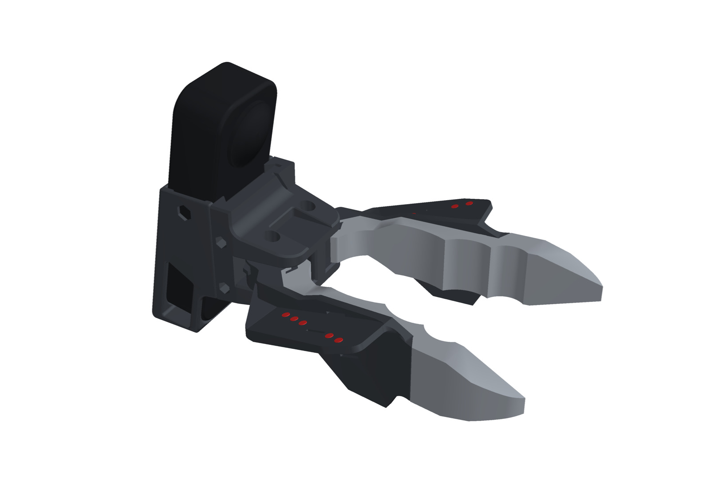
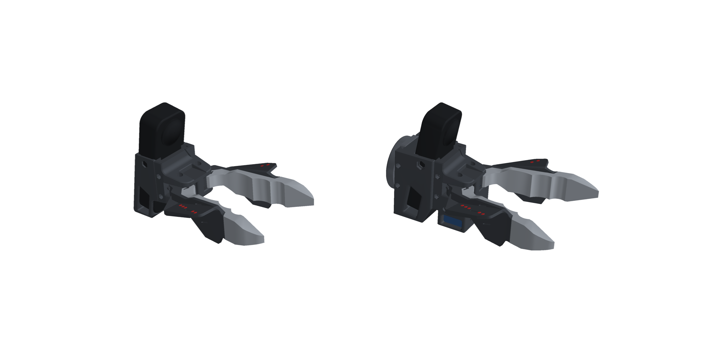
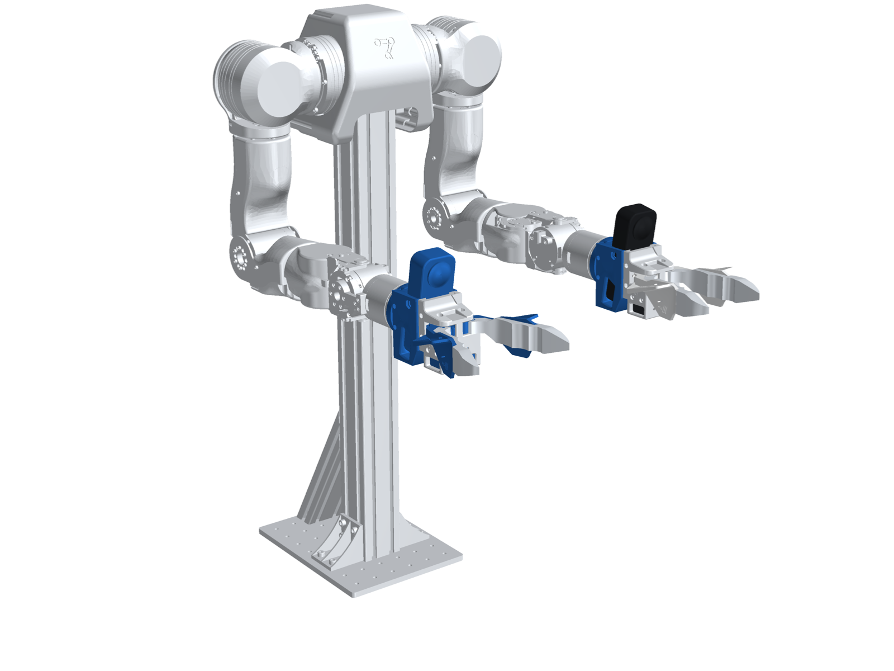
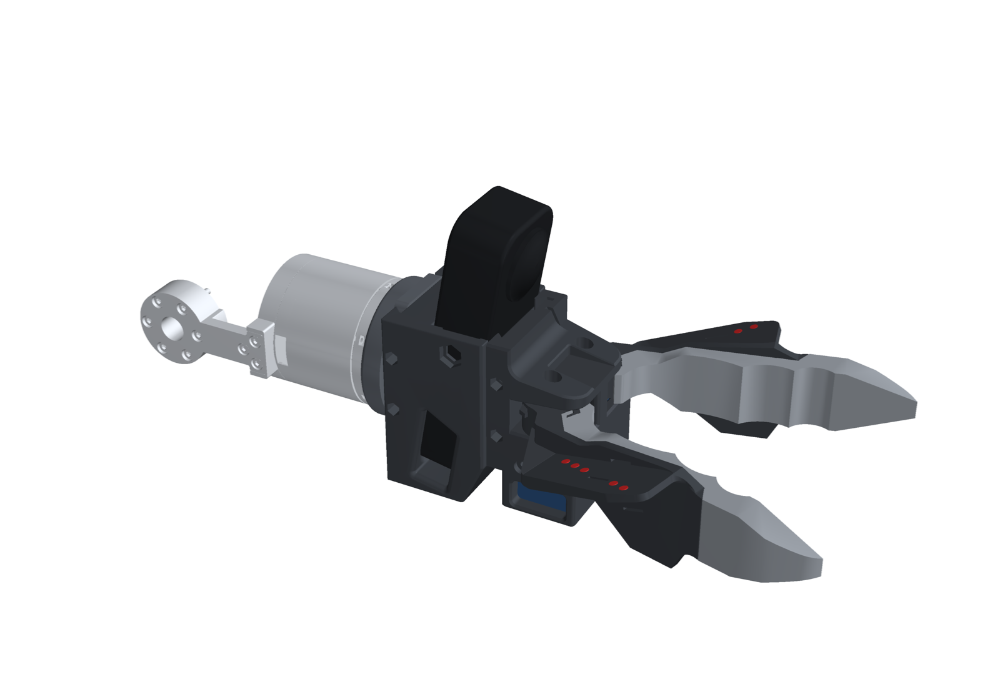
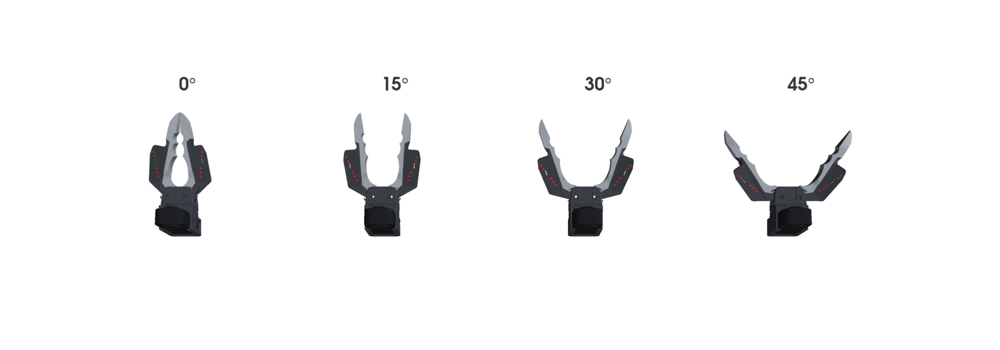
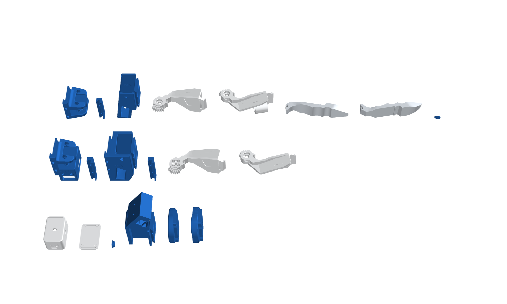
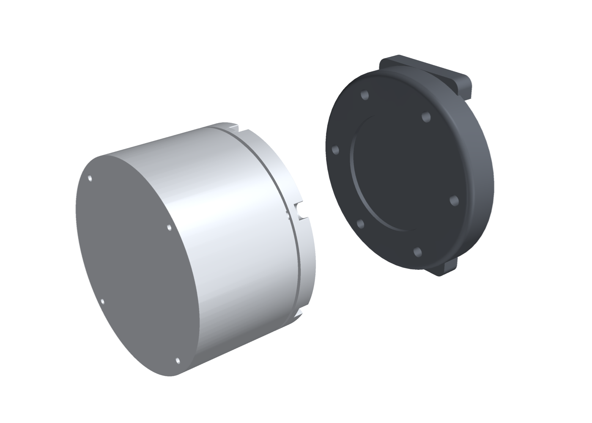
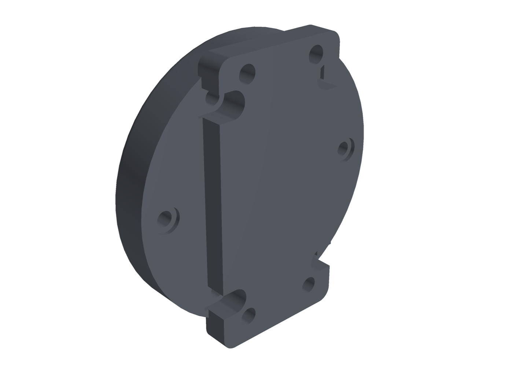

# Chopstick: a KIWI-style chopstick gripper for the UMI, with an OpenArm twin

<p align="center">
  
</p>

A handheld **data gripper** and its **robot twin on OpenArm**, built on the chopstick gripper from
[KIWI: Kinematic Interface for the Wild](https://lingfeng.moe/KIWI/) ([hardware](https://github.com/TToTMooN/KIWI_hardware),
Apache-2.0). The jaws are passive and finger-driven. An Insta360 X5 360° camera rides on top. The only electronics on the
handheld tool are the camera itself: no encoder and no wiring. Jaw opening is read from the camera image using red dots
printed on the jaws.

<p align="center">
  
  <br><em>Left: the handheld data gripper. Right: the robot twin, with the OpenArm adapter plate and the SM40BL servo
  under the driver jaw. Both have the same jaws and the same camera position.</em>
</p>

This folder adds what KIWI's release leaves to you:

- **Per-part CAD** (STEP and STL), split out of KIWI's assemblies into one gripper frame. Jaws are stored closed, so every
  file lines up with every other and with the URDF.
- **An OpenArm flange adapter** that fits the link7 flange in our OpenArm description. KIWI's own OpenArm plate does not
  fit that flange; see [below](#openarm-adapter).
- **Measured kinematics**: pivots, gear coupling, the tool-tip point, the X5 lens centres, the red-dot positions, the
  jaw angle → tip gap curve, and the clash-free opening. All of it is checked against the CAD.
- **URDFs** for the data gripper and the OpenArm gripper, plus a script that swaps the gripper onto both arms of the
  OpenArm URDF.
- **Retargeting** (`retarget/`): camera pose + jaw angle in → OpenArm link7 target + gripper command out. It works with
  the chopstick robot gripper or the stock OpenArm parallel hand. Tested.

<p align="center">
  
  
</p>

## How it works

<p align="center"></p>

- **Two jaws on 624 bearings**, at (67.33, ±15.0) mm in the gripper frame. A pair of 24-tooth spur gears (module 1.25,
  30 mm centres) ties them together, so they always open by the same angle in opposite directions. Pinch the jaws with
  your fingers to close them; a rubber band opens them again.
- **Gripper frame:** origin at the centre of the robot-plate mounting face, +X along the jaws, +Y to the left jaw,
  +Z up (camera side). The jaw angle θ is one jaw's opening from closed.
- **Tip gap** (between the TPU tip ends) is 24 mm at θ = 5°, 48 mm at 10°, 96 mm at 20°, 141 mm at 30° and 199 mm at 44°.
  Each jaw can open 72° before it touches the base, clip or camera frame. The closed tips overlap by 0.17 mm in the CAD,
  which is the TPU preload.
- **Camera:** the X5 is tilted 10° nose-down. Its two lens domes are centred at (45.5, 0, 55.1) and (23.4, 0, 58.9) mm.
  The camera frame sits midway between them. The tool tip (TCP) is 178 mm ahead of the camera along its axis and 30 mm
  below it.
- **Red dots:** there are 5 per jaw, Ø3.5 mm, on the jaw's top face. Their centres are measured by registering KIWI's
  painted 3MF onto the STEP (0.002 mm RMS) and stored in the kinematics JSON. `ChopstickKinematics.theta_from_dots`
  turns observed dots into θ.
- **Shared extrinsics:** the robot gripper has the same base geometry, the same pivots and the same camera position as
  the data gripper. The camera → TCP transform is therefore identical, and retargeting is exact: put the robot's camera
  where the demo camera was, and copy θ.

## Builds

| Build | Parts | Notes |
|---|---|---|
| **Data gripper** (handheld, ×2 for bimanual) | `chopstick_base_dc`, `chopstick_clip_dc`, `x5_lite_frame`, `jaw_left_dc`, `jaw_right`, `tip_tpu_left`, `tip_tpu_right`, `x5_button_cap`, `x5_button_shaft` | Passive. Strap on the base, finger loops on the jaws. |
| **Robot gripper on OpenArm** (×2) | `chopstick_base_sa`, `chopstick_clip_sa`, `x5_frame`, `x5_clip_b`, `jaw_left_sa` (servo driver), `jaw_right`, `tip_tpu_left`, `tip_tpu_right`, `x5_button_*`, **`openarm_adapter`** | Feetech SM40BL servo on the left jaw; the gears drive the right jaw. |

Files: `hardware/STEP/*.step` (design source, mm, gripper frame), `hardware/STL/*.stl` (print, mm, one body each),
`hardware/print/KIWI-3dprint.3mf` (KIWI's Bambu Studio project with the red dots painted, H2D, 0.4 mm, 0.2 mm layers),
`hardware/tags/` (ArUco sheets). The full assemblies are in `assembly/`: `chopstick_data.*` and `chopstick_openarm.*`,
at θ = 20°. The GLB has one coloured node per part, in metres, Y up. The STL is a single mesh in mm, Z up.

<p align="center"></p>

Bill of materials: [docs/bom.md](docs/bom.md). Build steps: [docs/build.md](docs/build.md). They follow KIWI's
[assembly guide](https://github.com/TToTMooN/KIWI_hardware/blob/main/chopsticks/chopsticks_assembly.pdf) and add the
OpenArm adapter.

## OpenArm adapter

<p align="center">
  
  
</p>

KIWI ships a mounting plate for "OpenArm V1" with four holes on a 26.9 mm square. The link7 flange in the OpenArm
description we use (Neuracore `openarm_description`, `meshes/arm/v10/link7`) has a different interface: 6 × M3 on a 50 mm
PCD, a face at link7 z = 94.5 mm, and a 1 mm high Ø35 boss. The stock OpenArm hand bolts to that same pattern.
`openarm_adapter` is drawn against that flange:

- **Back:** sits flat on the link7 face, with a Ø36.5 × 1.5 mm pocket over the boss. The 6 × Ø3.4 holes on PCD 50 take
  **M3 × 16** socket-head screws, fitted first from the front into counterbores. The four counterbores at the tongue's
  edges are opened to the side.
- **Front:** a 31.6 mm tongue that fits between the X5 frame's two rear legs, with **4 × M3 heat-set inserts** under the
  frame's rear-wall holes at (±9, ±26.9) mm. Drill the frame's four Ø2.8 holes out to Ø3.2, then screw the frame on from
  inside the camera cavity (camera out) with **M3 × 10**.
- **Orientation** matches the stock hand: the jaws open along link7 Y, and the camera points up (link7 +X) with the elbow
  bent 90° from zero.
- **Checked** in `cad/assembly.py --check`: no overlap with the frame, clip B, base, camera or link7 mesh; the back face
  is flush on the link7 face; and all six holes sit on link7's tapped holes. The wall between a counterbore and an insert
  is 1.4 mm.

**Check your arm first.** If your link7 flange is not the PCD-50 pattern above (for example, an arm that matches KIWI's
plate), use KIWI's [`plate_openarm`](https://github.com/TToTMooN/KIWI_hardware/tree/main/robot_mounts) instead. Then
change `T_LINK7` in `cad/openarm_adapter.py` and rerun the pipeline.

## Retargeting

```python
from chopstick_retarget import OpenArmRetargeter, ChopstickKinematics

kin = ChopstickKinematics.load()
theta = kin.theta_from_dots(left_dots_cam, right_dots_cam, frame="camera")   # or kin.theta_from_gap(gap)
rt = OpenArmRetargeter(T_base_world, end_effector="chopstick")              # or "stock" for the parallel hand
cmd = rt(T_world_camera, theta)
# cmd["T_base_link7"] -> OpenArm IK target; cmd["servo_steps"] -> SM40BL position (or cmd["finger"] for the stock hand)
```

There is also a CLI (`chopstick-retarget demo.csv -o openarm.csv`) and a URDF splice for IK. See
[docs/retargeting.md](docs/retargeting.md) for the frames, the calibration and how the camera pose from KIWI's
localisation plugs in.

## Rebuild

Python 3.12 with `build123d`, `trimesh`, `manifold3d`, `scipy`, `pyvista` and `yourdfpy`. These are the same tools as
the `cad` branch. Run from `cad/`:

```bash
python extract_parts.py                    # KIWI STEP/3MF -> hardware/STEP, hardware/STL
python openarm_adapter.py                  # hardware/*/openarm_adapter.*
python kinematics.py --check               # retarget/chopstick_retarget/chopstick_kinematics.json (+ jaw clash sweep)
python urdf.py                             # urdf/*.urdf, urdf/meshes/
python assembly.py --check --openarm /path/to/openarm_description   # clash + flange checks, assembly/
python render_docs.py --openarm /path/to/openarm_description        # docs/img/
python urdf.py --openarm-urdf /path/to/openarm_description/openarm.urdf --out openarm_chopstick.urdf
cd ../retarget && pip install -e .[test] && pytest
```

## What is and isn't verified

- **Verified in CAD and code:** the jaw kinematics, the clash-free range, the URDF ↔ JSON consistency, the identical
  camera → TCP transform in both builds, the adapter fit against the link7 mesh, and the retargeting maths (12 tests).
- **Not yet built or tested on hardware:** the OpenArm adapter print, the servo calibration (`ServoMap.zero` and
  `ServoMap.sign`), and the servo's mass, which is estimated at 150 g in the URDF. Also, the jaw limit is geometric only:
  the rubber band and your hand stop the data gripper sooner.
- **Not included:** the vision side, which detects the red dots and localises the X5 in the scene. That is KIWI's
  software, [due 16 Oct 2026](https://github.com/TToTMooN/KIWI_software). Also not included: a servo bus driver.
  `ServoMap` gives you the target position, and you send it with Feetech's SDK.

Credits and licences: [NOTICE.md](NOTICE.md).
