# HandUMI · D405

  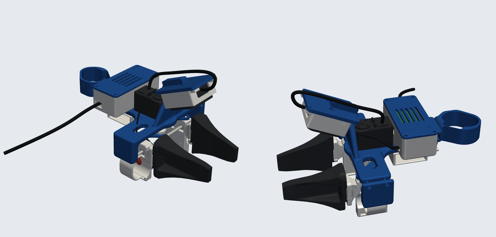

A hand-worn gripper for collecting bimanual manipulation data without a robot in the loop. It has an
**Intel RealSense D405** depth camera on the wrist, an on-board **IMU and Raspberry Pi Pico 2**, a **record button** under
your index finger, and a single USB cable to your laptop.

- **Fixed depth wrist camera:** the D405 screws straight onto a tab at the end of a braced camera post, with its own
  2× M3 rear threads, the way it sits on a robot's camera plate (as on Scissor-UMI). A light hood guards it. Nothing
  turns, so the view can't drift between sessions. It looks forward and down at the fingers (65° below horizontal, about
  9–10 cm away; the D405's minimum range is 7 cm). The cable leaves through the hood's top window and runs back into the
  electronics box.
- **Robot finger mounts:** each finger link ends in a flange that carries the real finger mounts of four robots at once:
  AgileX Piper, Robotiq Hand-E, I2RT YAM and OpenArm v1. Each robot's own fingers, or printed copies of them, bolt
  straight on with that robot's screws, and the two jaws meet on the device's centre plane. See
  [Robot finger mounts](#robot-finger-mounts).
- **Finger sleeves:** each finger link has a sleeve that wraps the finger, so the fingers stay in place while you open and
  close the gripper.
- **Record button:** a 6 × 6 mm tactile switch sits in the inner wall of the index-finger sleeve under a soft, domed
  TPU pad where your finger pad rests. Press it with your index finger, once to start recording and again to stop. It's wired to the Pico.
- **One cable:** a closed electronics box holds a USB 3 hub, the Pico 2 and the IMU. The camera and the Pico both connect to
  the hub, and one USB-C cable goes to the laptop. See [docs/electronics.md](docs/electronics.md).
- **Moulded look:** every printed part is softly rounded: a blended T-plate outline, rounded slot rims, a concave blend into
  the end wall; the end cover and electronics box match.
- **Small PG mark:** every printed part has a small PG logo engraved 0.2 mm deep on one visible face, as a subtle
  maker's mark. The gripper tips stay plain.
- **Checked in a full assembly:** the gripper is clash-checked closed, half-open and fully open with every tip set, and
  every tip is checked to sit flat on its flange with its holes on the flange's holes.

## Robot finger mounts

  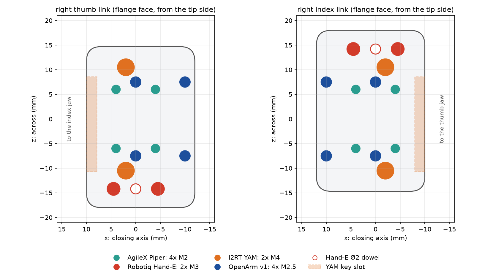

Each robot's pattern is the one its own finger bolts to on the robot, measured from the maker's drawing or CAD. The
screws are the robot's own; they go through the finger and cut their thread in the printed flange (or use the pilot
size below with a tap). A drop of threadlocker holds them.

| Robot | Screws into the flange | Pattern | Locating | Measured from |
|---|---|---|---|---|
| AgileX Piper (and the handumi-hw tip library) | 4× M2 (pilot Ø1.7) | 8 mm along the closing axis × 12 mm | the screws | `piper_description` finger (`link7`): the fingertip seat |
| Robotiq Hand-E | 2× M3 (pilot Ø2.6) | 9 mm along the closing axis | Ø2 mm dowel between the screws | Hand-E manual, 5.1.4: finger on rack, fingertip holder |
| I2RT YAM | 2× M4 (pilot Ø3.4) | 21 mm across | the finger's 18.7 × 3 × 5 mm key in a slot | YAM tip mesh (i2rt) and the Open-ENPIRE YAM finger |
| OpenArm v1 | 4× M2.5 (pilot Ø2.1) | 10 mm along the closing axis × 15 mm | the screws | OpenArm v1's printed finger base |

What makes it work on both links:

- **Every finger meets on the centre plane.** A pattern is placed on each link so its finger's centre plane lands where
  the two jaws meet. A robot whose finger sits off its own screw line gets its pattern off centre: the Hand-E's finger is
  14.2 mm from its rack screws, so its pattern sits 14.2 mm to one side on the thumb link and 14.2 mm to the other side
  on the index link, just as the Hand-E's two racks do.
- **The patterns share one flange.** Some patterns are shifted along the closing axis to keep at least 0.8 mm of
  plastic between any two holes: OpenArm's by 5 mm away from the other jaw, YAM's by 2 mm toward it. Both jaws shift
  the same amount, so they still meet in the middle. The flange is 22 mm along the closing axis (10 mm toward the other
  jaw, as before, and 12 mm away from it) and as long across as each link's own holes need.
- **Hand-E:** the printed Hand-E finger has its rack groove filled, so it sits flat. A real Robotiq finger (aluminium,
  NBR, or a fingertip holder with any Robotiq fingertip on it) has a 1 mm groove where the rack goes: put
  `Hand-E-Rack-Shim` in the groove and screw the finger on through it, with a Ø2 × 6 mm dowel in the middle hole.
- **YAM:** the YAM's screws go in from the finger side, as on the robot. The finger's key sits in a slot cut into the
  flange's edge.
- **OpenArm:** OpenArm's printed finger has a rib behind its plate, beside the carriage. On HandUMI that space holds
  the other robots' holes, so HandUMI's OpenArm finger is printed without the rib. A stock OpenArm finger needs its rib
  trimmed flush with the plate. The flange backs the whole plate instead.
- **Piper's pattern is also handumi-hw's tip pattern**, so the rest of the handumi-hw tip library (ARX X5 and others)
  still fits.

Every number is a row in `cad/finger_interfaces.py` on the [`cad`](../../../tree/cad) branch. The flange holes, the
tip placement and the Hand-E shim are all computed from it, and `python finger_interfaces.py` checks the wall between
every pair of holes. To add a robot, add a row.

## Tips for different robots

Bolt on the fingers of the robot you'll deploy on, so the jaws on the device have the same shape as the robot's fingers.

| Tips on the device | Robot |
|---|---|
| 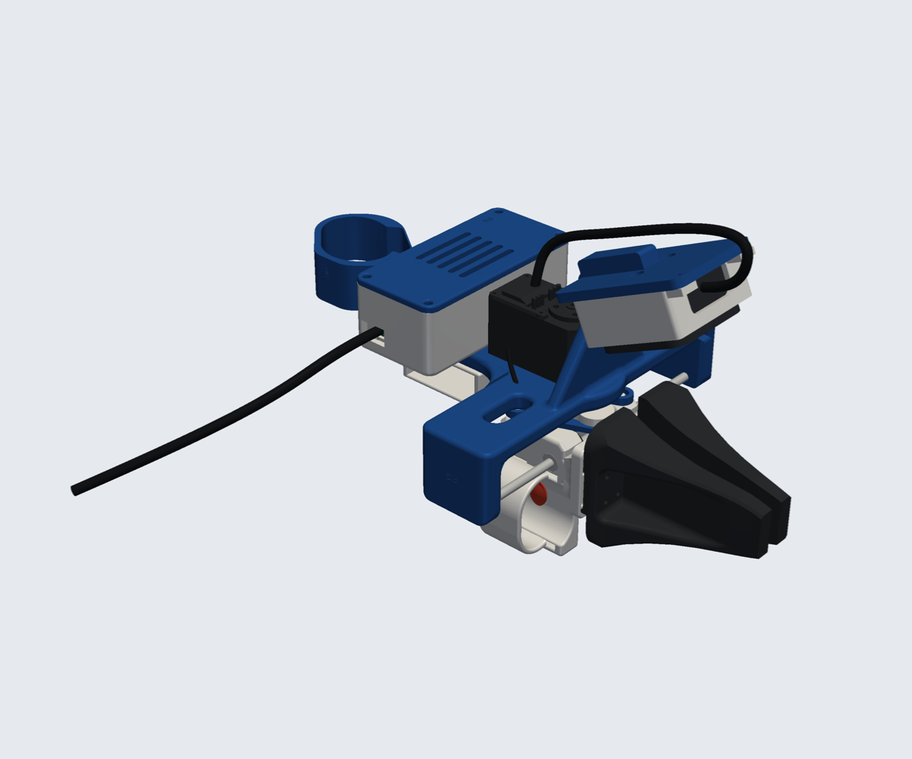 **AgileX Piper tips** | 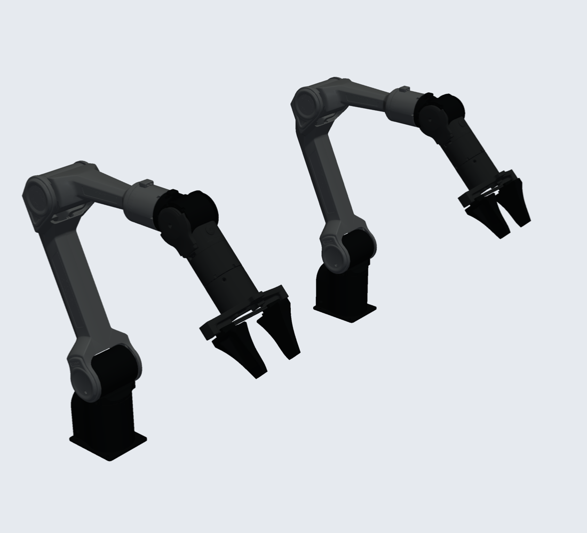 **AgileX Piper** |
| 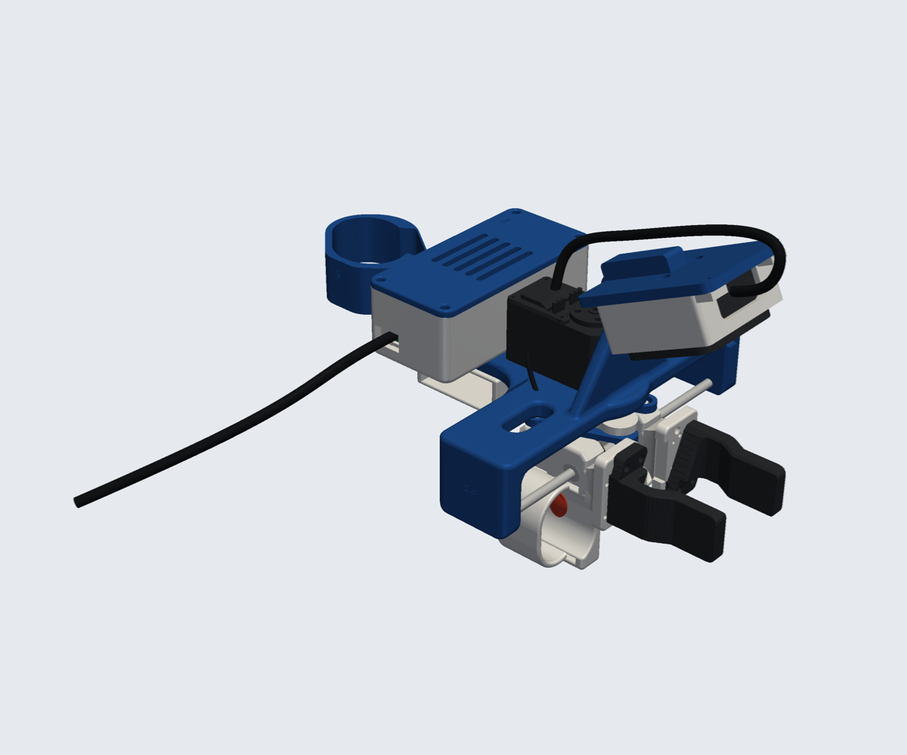 **Robotiq Hand-E fingers** | 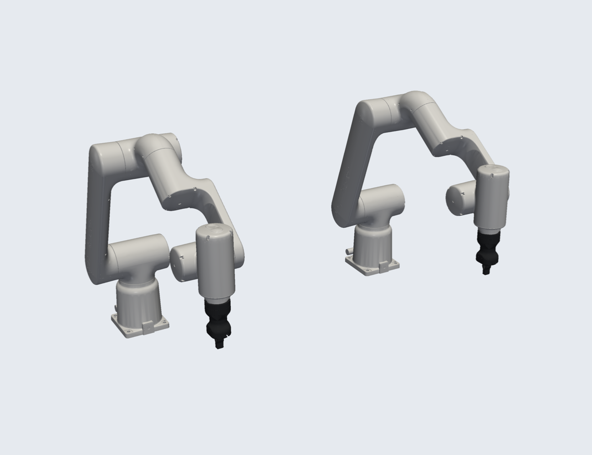 **ABB GoFa CRB 15000 (dual) with Hand-E** |
|  **Robotiq Hand-E fingers** | 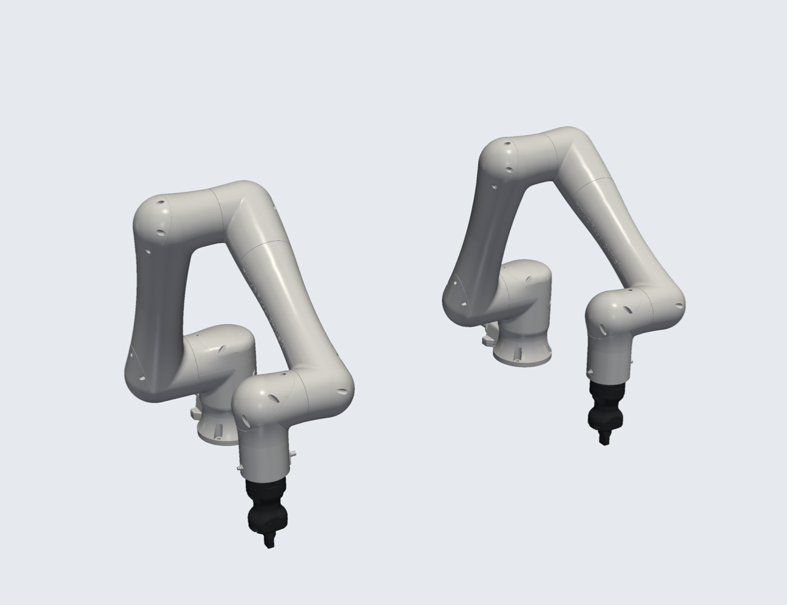 **FANUC CRX-5iA (dual) with Hand-E** |
|  **Robotiq Hand-E fingers** | 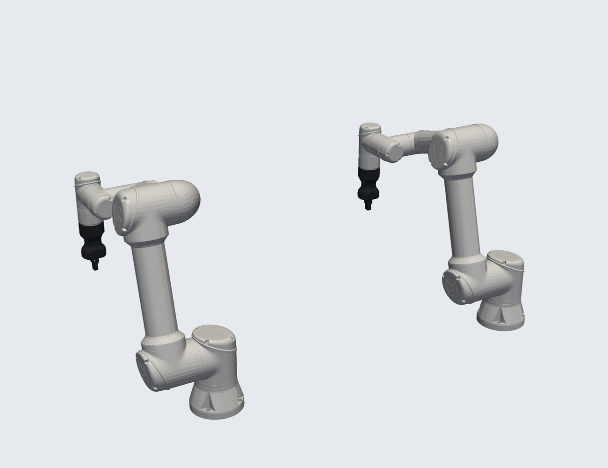 **UR5 (dual) with Hand-E** |
| 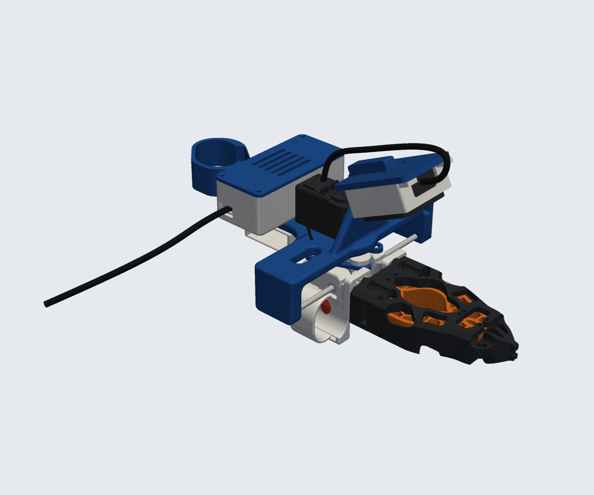 **Open-ENPIRE compliant fingers (YAM mount)** | 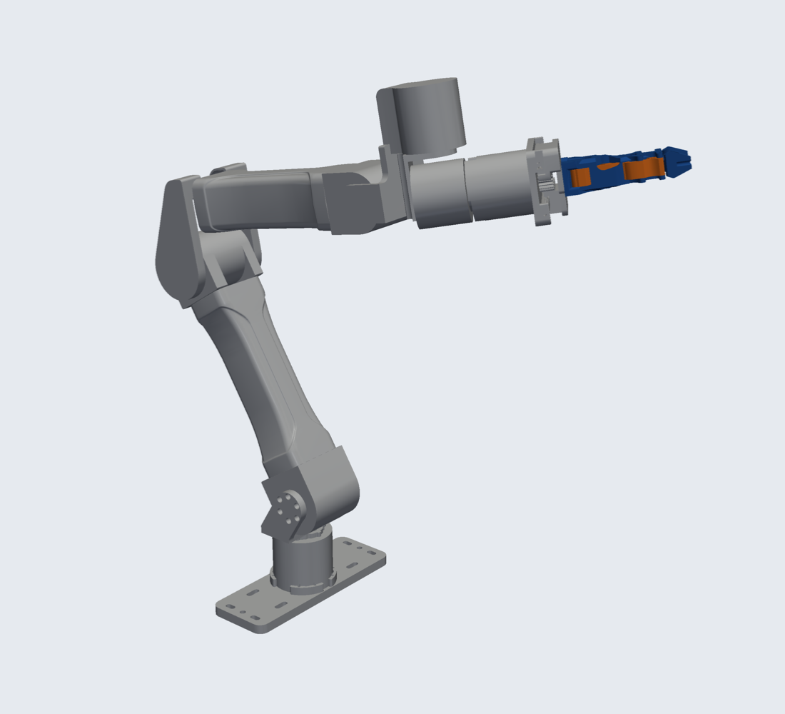 **I2RT YAM with Open-ENPIRE fingers** |
|  **Open-ENPIRE compliant fingers (YAM mount)** | 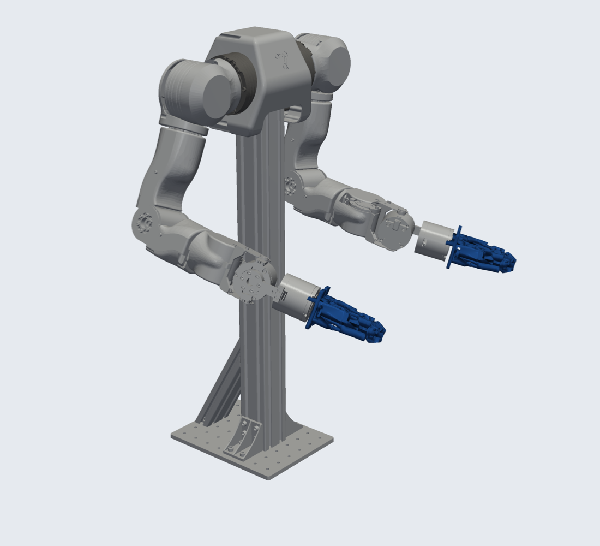 **OpenArm with Open-ENPIRE fingers** |
| 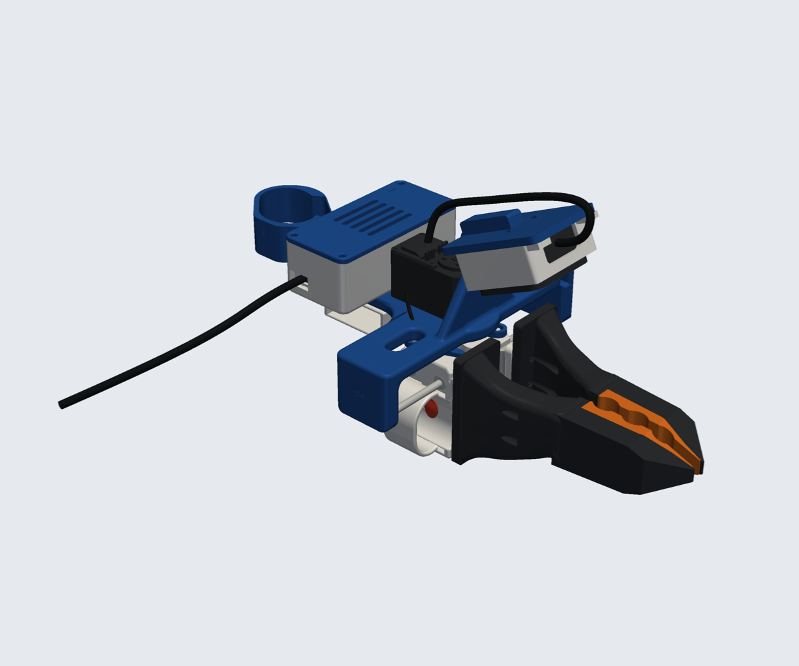 **OpenArm hard-shell fingers** | 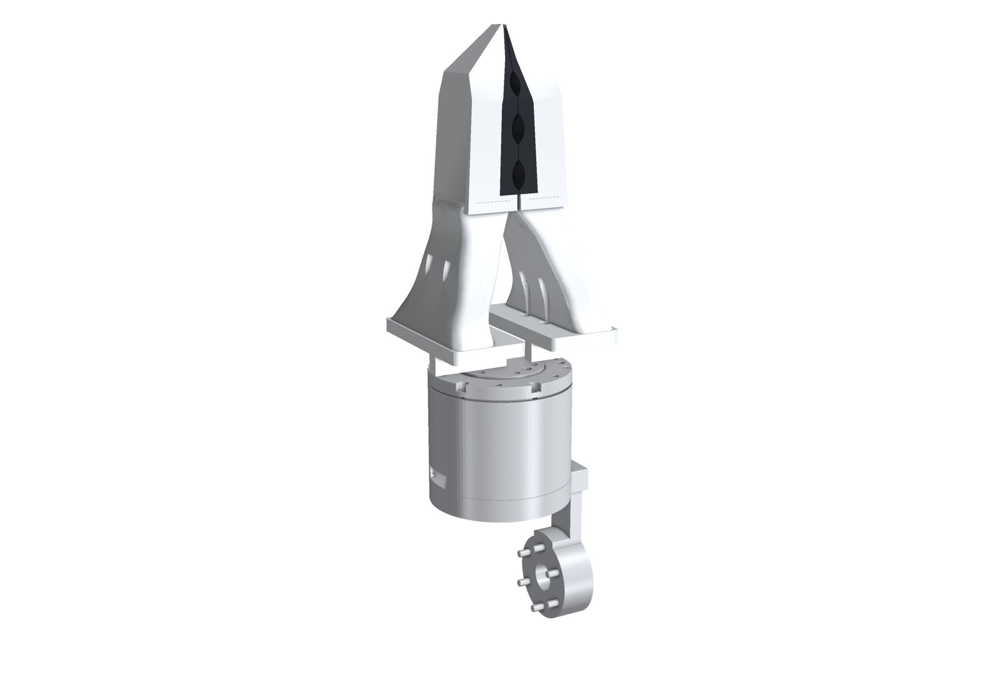 **OpenArm v1 with the same fingers** |

- **Piper tips** (`hardware/STL/gripper_tips/AgileX-Piper/`): the AgileX Piper jaw and pad, on the Piper's own
  4× M2 fingertip seat.
- **Hand-E fingers, for ABB, FANUC and UR** (`hardware/STL/gripper_tips/Robotiq-Hand-E/`): the actual Robotiq Hand-E
  finger with its own mount (2× M3 + Ø2 dowel). Print it twice; the index jaw is the same part turned 180°, as on the
  Hand-E. Or bolt on real Robotiq fingers with `Hand-E-Rack-Shim`.
- **Open-ENPIRE fingers** (`hardware/STL/gripper_tips/Open-ENPIRE/`): the compliant finger from
  [Open-ENPIRE-Gripper](https://github.com/pgeedh/Open-ENPIRE-Gripper), unmodified, with the YAM's own mount (2× M4 and a
  key). It goes on the YAM as it is. For OpenArm, the same finger shape is in `Open-ENPIRE/robot/OpenArm_Hard.stl` (mm).
  The ENPIRE fingers are about 32 mm thick, so the jaws meet before the mechanism's own stop.
- **OpenArm hard-shell fingers** (`hardware/STL/gripper_tips/OpenArm/`): this repository's hard-shell finger on
  OpenArm v1's own finger base (4× M2.5), with a TPU insert. The same fingers go on the robot.

Robot renders are made from the robots' published descriptions (sources in
[`hardware/NOTICE.md`](hardware/NOTICE.md)).

## Camera mount

  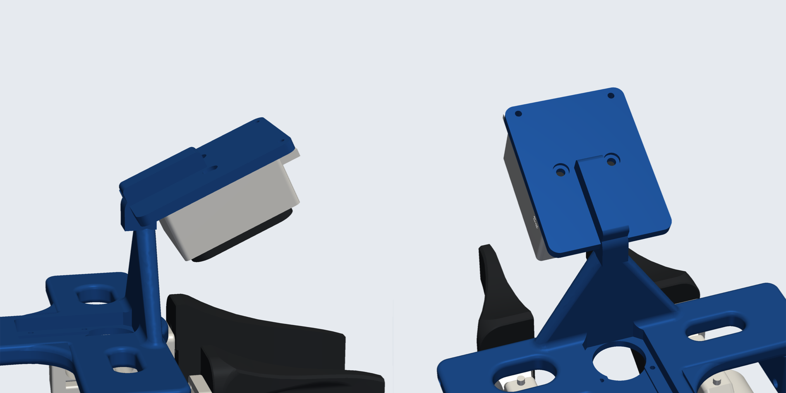

The camera post ends in a 4 mm tab, square to the camera's view. The D405's back sits flat on it, and two M3 × 6 screws
go up through counterbored holes into the camera's rear threads (2× M3, 20 mm apart). A 10 mm spine under the tab ties it
into the post. The hood is an open frame round the camera's sides, with no floor so the camera sits on the tab itself. Its
walls stop 4 mm short of the glass. It is screwed to the tab with 2× M3 × 8 through two ears at its top corners, and its
top wall has the cable window. The tilt (65°) and the camera's pose are parameters in `cad/d405_mount.py` on the `cad` branch; the camera
sits exactly where the old hinge held it at 65°, so recorded data and calibrations still apply.

## Record button

  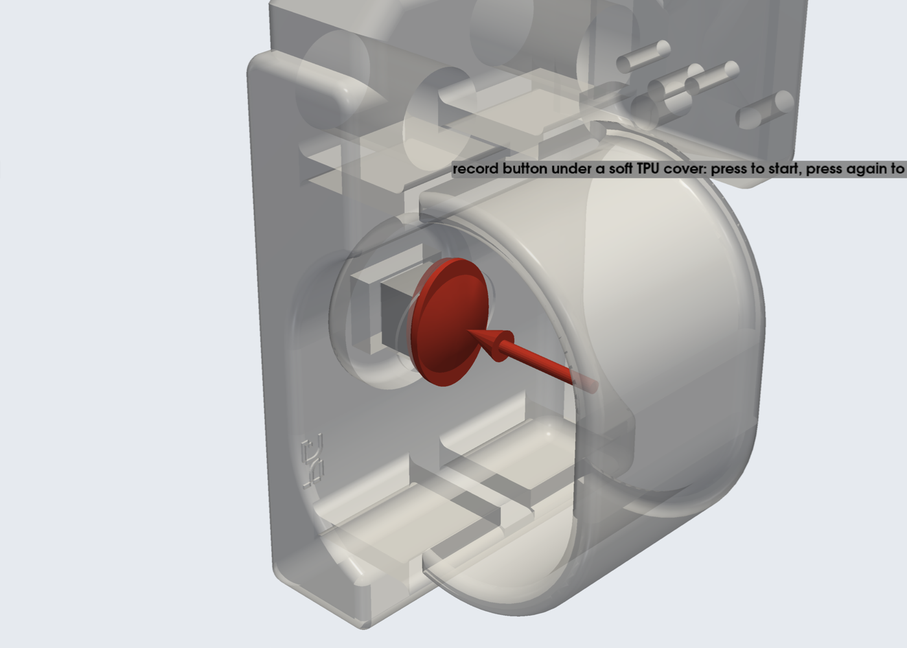

A 6 × 6 mm tactile switch is set into the inner wall of the index-finger sleeve, where the finger pad rests, under a soft
TPU cover: a 12 × 9 mm oval pad with a gentle 0.8 mm dome and rounded rim, so nothing sharp touches your finger, and a nub
underneath that presses the switch. The cover sits in a matching oval recess, and a rounded boss on the outside of the paddle
gives the switch its depth. A cavity behind the switch leaves room for its legs and solder joints and opens at the back
for soldering. Press it with your index finger: **press once to start recording, press again to stop.** It's wired to the Pico (GP15 to ground,
internal pull-up), so the recording software only has to watch one input; see [docs/electronics.md](docs/electronics.md).
That wall is also the one your finger pushes to close the gripper, so use a stiff switch (about 250–320 gf); the
software can tell a deliberate press from a grasp by its duration. The wires leave through the back of the paddle and
run along the frame to the electronics box with a little slack for the finger link's travel.

## Assembly

Step-by-step IKEA-style drawings: [`docs/assembly_guide/ASSEMBLY.md`](docs/assembly_guide/ASSEMBLY.md) (one PDF: [`docs/assembly_guide/assembly.pdf`](docs/assembly_guide/assembly.pdf)).

The full assembled device (right hand, half open) is in [`assembly/`](assembly/), once per tip set:

| File | Use |
|---|---|
| `umi_right_agilex-piper.glb`, `umi_right_robotiq-hand-e.glb`, `umi_right_open-enpire.glb`, `umi_right_openarm.glb` | Coloured, one node per part, metres, Y up; drag into Onshape, Blender or any glTF viewer |
| `umi_right_agilex-piper.stl`, `umi_right_robotiq-hand-e.stl`, `umi_right_open-enpire.stl`, `umi_right_openarm.stl` | One merged mesh in mm, Z up |

The left hand is the mirror image.

## Parts

  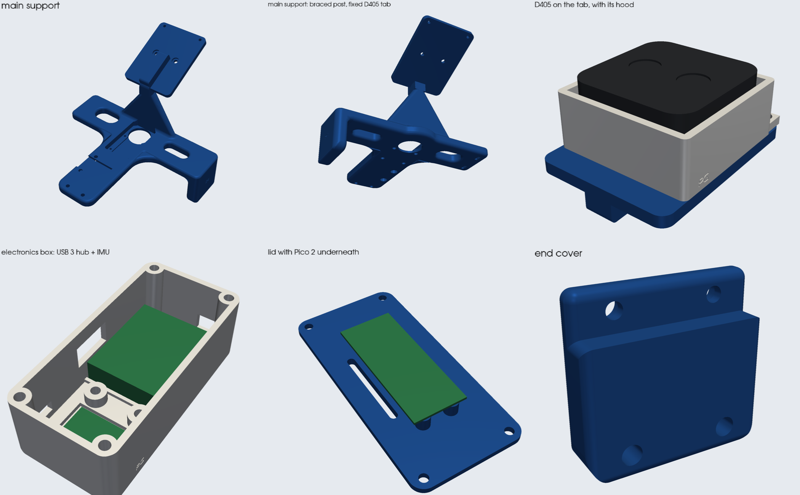

Print everything in `hardware/STL/right/` for a right hand or `hardware/STL/left/` for a left hand, plus a pair of
tips from `hardware/STL/gripper_tips/`. STEP files for every part are in `hardware/STEP/`.

| Part | File |
|---|---|
| Main support (T-plate with the camera post and the D405 tab) | `main_support.stl` |
| End cover | `end_cover.stl` |
| D405 hood | `d405_hood.stl` |
| Record-button cover (TPU) | `button_cover_tpu.stl` |
| Electronics box + lid | `electronics_box.stl`, `electronics_lid.stl` |
| Thumb and index/middle finger links (finger sleeve, robot finger flange; record button in the index sleeve) | `*_thumb_link.stl`, `*_index_middle_finger_link.stl` |
| Crank, connecting links, hand support base, controller support | `crank_mechanism_plate.stl`, `connecting_link_1/2.stl`, `hand_support_base.stl`, `*_controller_support.stl` |
| Tips (one pair) | `gripper_tips/AgileX-Piper/`, `Robotiq-Hand-E/`, `Open-ENPIRE/`, `OpenArm/` |

The two finger links of one hand are different parts: each carries its own copy of the patterns (the Hand-E pattern at
opposite ends, the YAM key slot on the side facing the other jaw).

## Hardware

Everything to buy is in [docs/bom.md](docs/bom.md). Notes:

- **Camera:** Intel RealSense D405, fixed to the tab with 2× M3 × 6 into its rear holes (2× M3×0.5, 20 mm apart, 4 mm
  max thread depth: don't go longer). The hood takes 2× M3 × 8, threaded into the tab.
- **Tips:** the robot's own finger screws: Piper 4× M2 × 10, Hand-E 2× M3 × 10 (+ Ø2 × 6 dowel, optional on the printed
  finger), YAM 2× M4 × 10, OpenArm 4× M2.5 × 8.
- **Record button:** 1× 6 × 6 mm tactile switch (stiff, ~250–320 gf), ~30 cm of thin, flexible 2-core wire, and the
  `button_cover_tpu.stl` cover printed in TPU 95A.
- **Electronics:** Raspberry Pi Pico 2, a BNO085 IMU, a small USB 3 hub and short cables. No separate servo controller or power supply. Full list and wiring: [docs/electronics.md](docs/electronics.md).

## Files

| Path | What |
|---|---|
| `hardware/STL` | Printable parts: `right/`, `left/` and `gripper_tips/` |
| `hardware/STEP` | The same parts as STEP, for editing in CAD |
| `assembly/` | Full assembly as GLB and STL |
| `docs/bom.md` | Bill of materials |
| `docs/electronics.md` | Electronics, wiring and power |

## Strength

Every printed part was analysed with linear-elastic FEA in PLA (E = 3 GPa), with quadratic tetrahedra
meshed from the STEP files and checked against hand calculations. Load cases are 15 g knocks on the camera, a 30 N
grip with the tip's 70 mm lever, a 40 N finger press, and hand and VR-controller loads. Safety factors are against
30 MPa (along layers) and 15 MPa (across layers). Results are in [`docs/fea_results.csv`](docs/fea_results.csv), with stress maps in `docs/img/fea/`.

| Part | Load case | Safety factor (along / across layers) |
|---|---|---|
| Main support with the D405 tab | camera knock, 15 g (vertical / sideways / fore-aft) | 39 / 20, 31 / 15, 32 / 16 |
| Main support | grip push on the rods, 2 × 30 N, end wall only (conservative) | 3.4 / 1.7 |
| Finger link (new flange) | 30 N grip on the tip, 70 mm lever | 5.4 / 2.7 |
| Crank plate | 30 N on each crank pin | 52 / 26 |
| Connecting link | 40 N pull | 65 / 32 |

The fixed tab is stiffer than the old hinge: the camera knocks went from 29 / 14, 20 / 10 and 17 / 8 to the values above.
The parts are meshed without their 0.2 mm engraved logo.

The D405 hood carries no load (the camera is held by its own screws). The end cover, electronics box and lid, hand
support base and controller support haven't been analysed yet.

## Grip force

The device records jaw opening (the servo's encoder), IMU motion and the depth camera. It does **not** measure grip
force yet: the servo only runs as an encoder with its torque off, so its load reading isn't meaningful. Thin-film force
sensors under the tips, read by the Pico's analog inputs, are the planned way to add it.

## References

UMI pioneered in-the-wild data collection without a robot in the loop, and YUBI brought that idea to a finger-driven
V-shaped gripper. Generalist built a proprietary hand-worn device for a V-shaped gripper too. This project is an
open-source hand-worn device for robot arms with parallel-jaw grippers.

- Cheng Chi, Zhenjia Xu, Chuer Pan, Eric Cousineau, Benjamin Burchfiel, Siyuan Feng, Russ Tedrake, and Shuran Song.
  "Universal Manipulation Interface: In-The-Wild Robot Teaching Without In-The-Wild Robots." *Robotics: Science and
  Systems (RSS)*, 2024. https://umi-gripper.github.io/
- Takehiko Ohkawa, Jumpei Arima, Yuki Noguchi, et al. "YUBI: Yielding Universal Bidigital Interface for Bimanual
  Dexterous Manipulation at Scale." arXiv:2606.10244, 2026. https://yubi.airoa.io/

## License

Third-party sources, licenses and the list of modifications are in [`hardware/NOTICE.md`](hardware/NOTICE.md).
