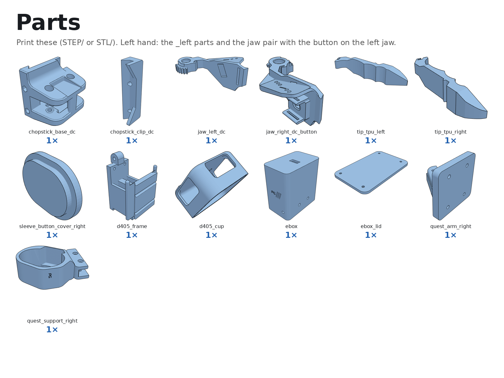
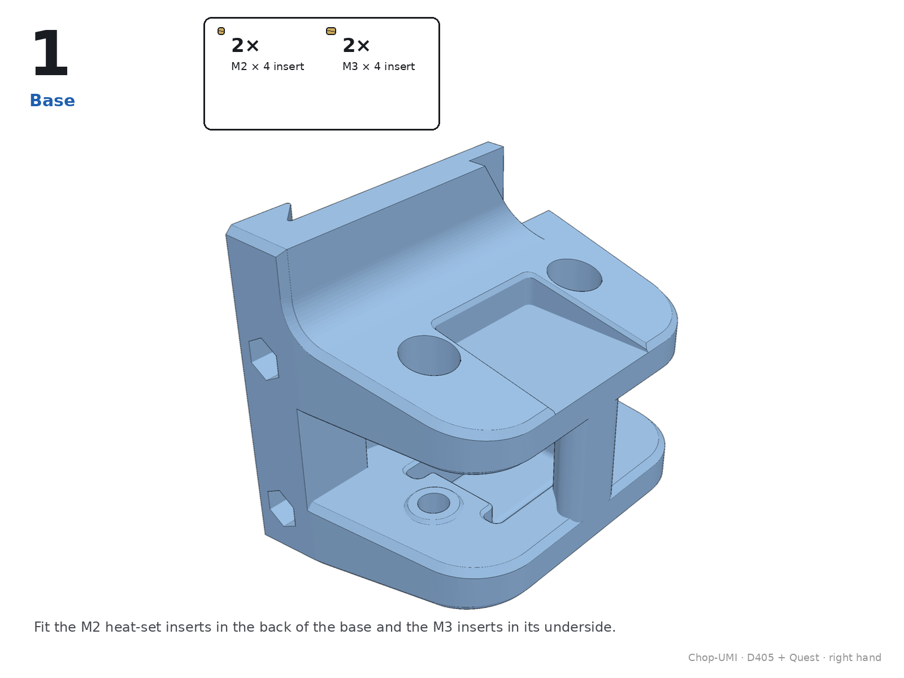
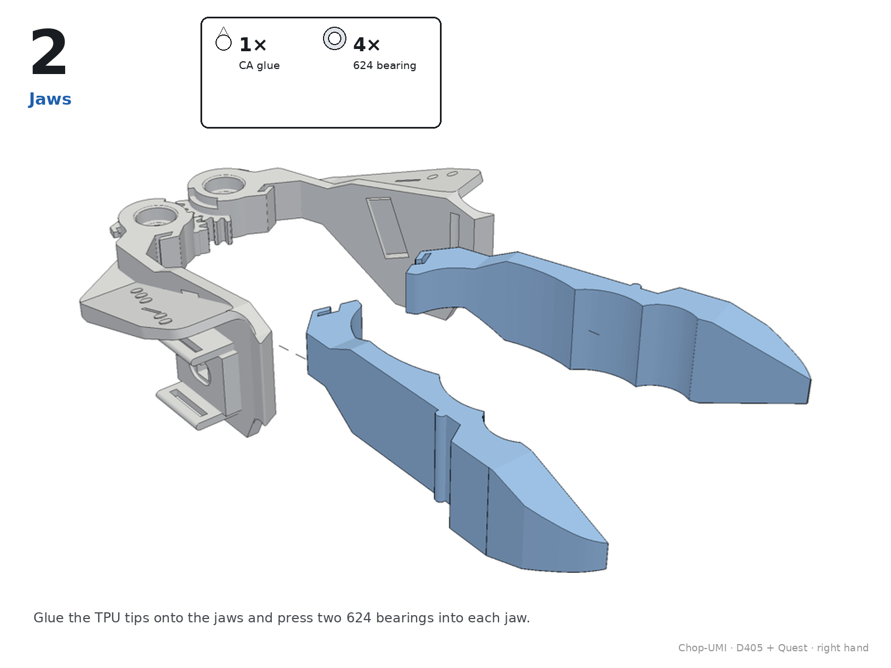
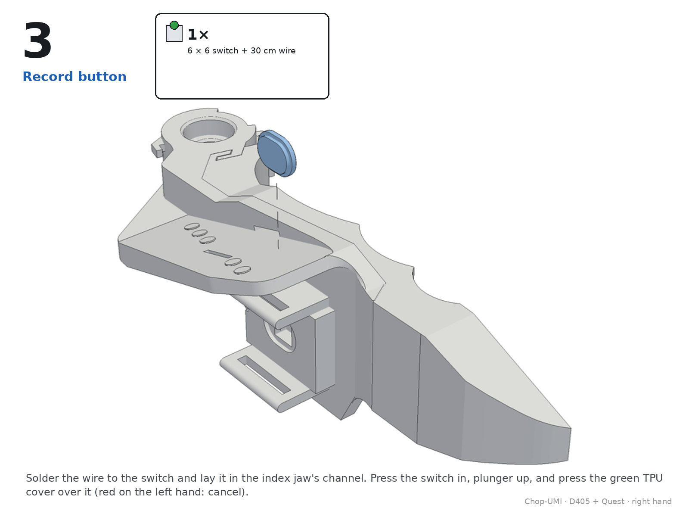
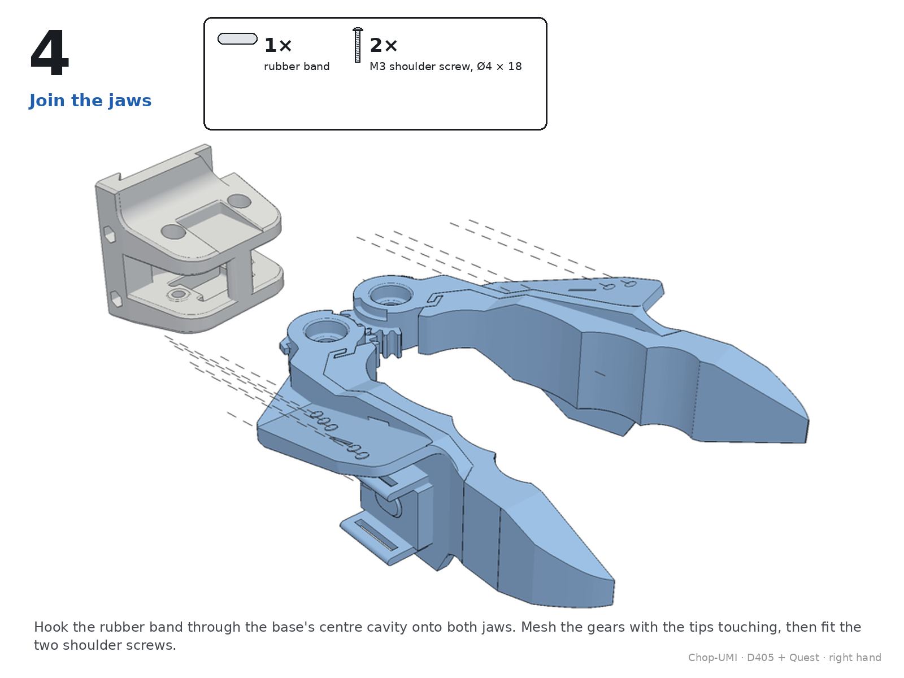
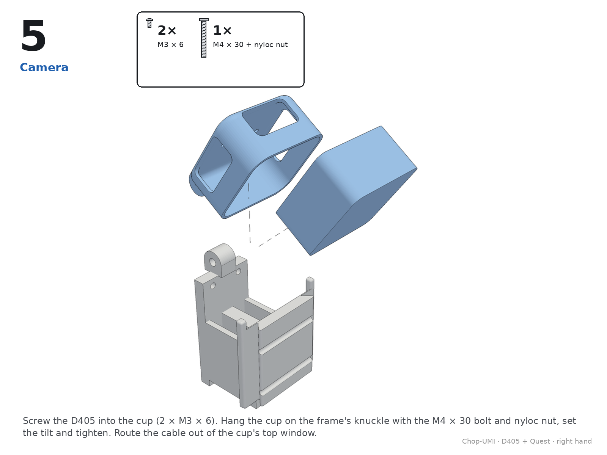
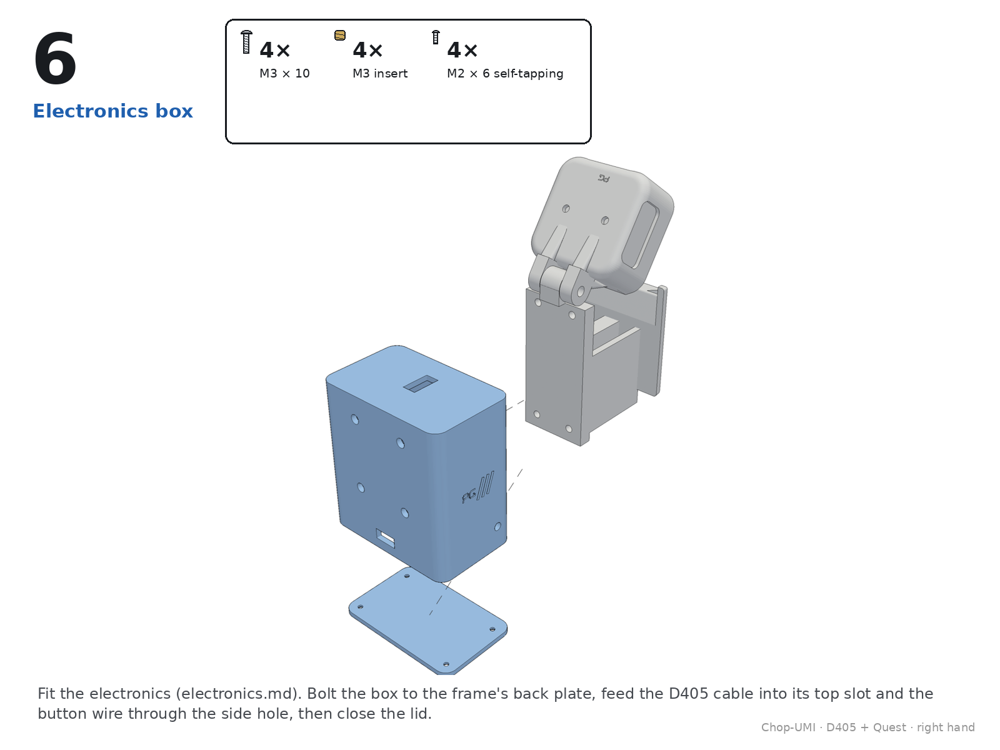
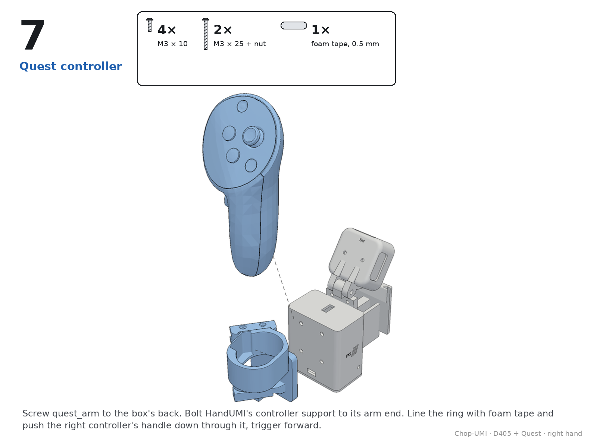
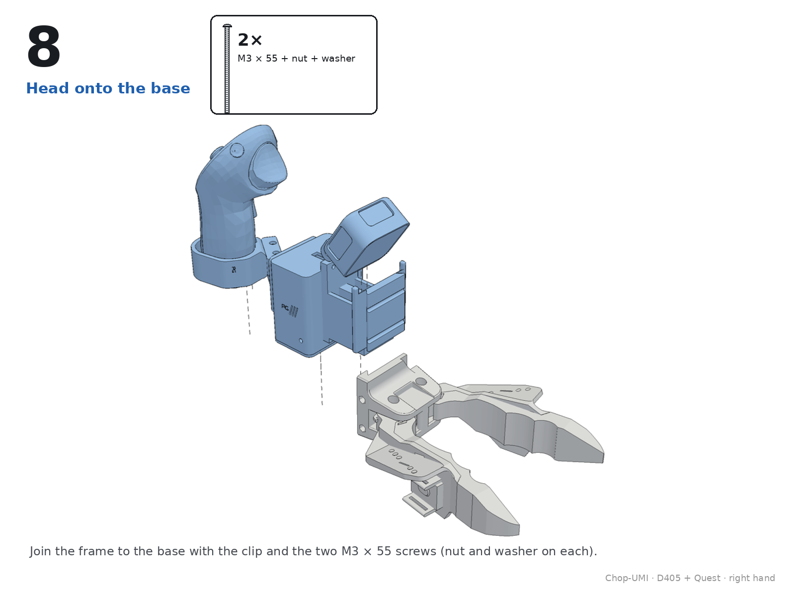
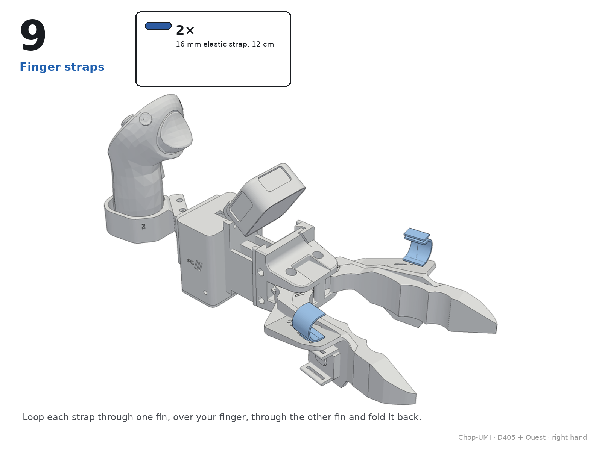

# Chop-UMI · D405 + Quest: assembly

IKEA-style pages drawn from the kit's own assembly (`assembly/chop-umi_right.glb`): new parts in blue, pulled out along the way they go in, parts already built in grey, the hardware for each step at the top. Right hand shown; the left hand mirrors it. Hardware as in [`../bom.md`](../bom.md).

All pages as one PDF: [`assembly.pdf`](assembly.pdf).

