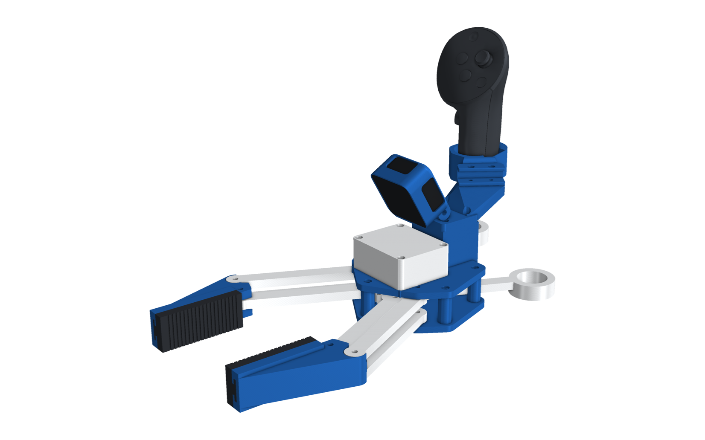
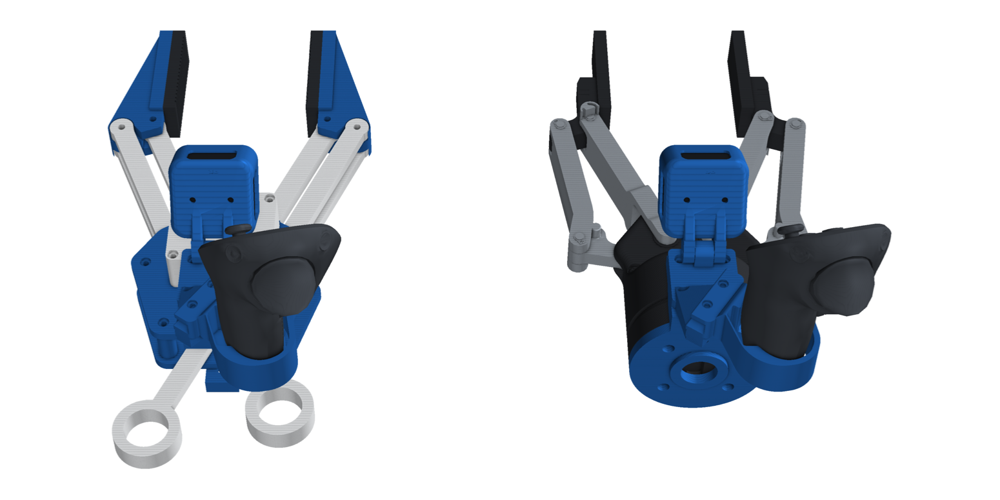
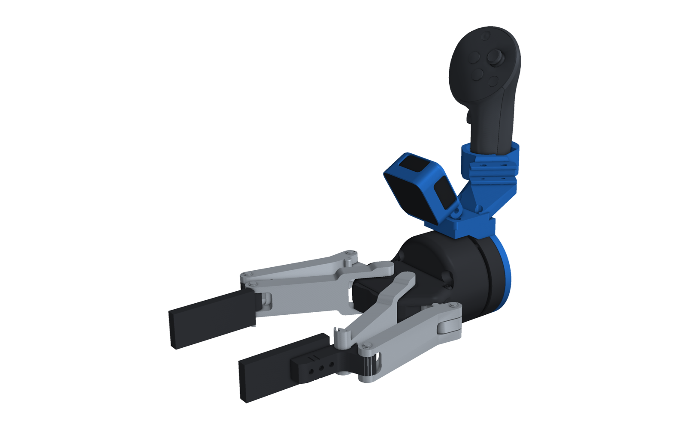
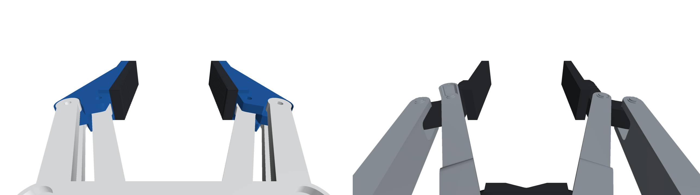
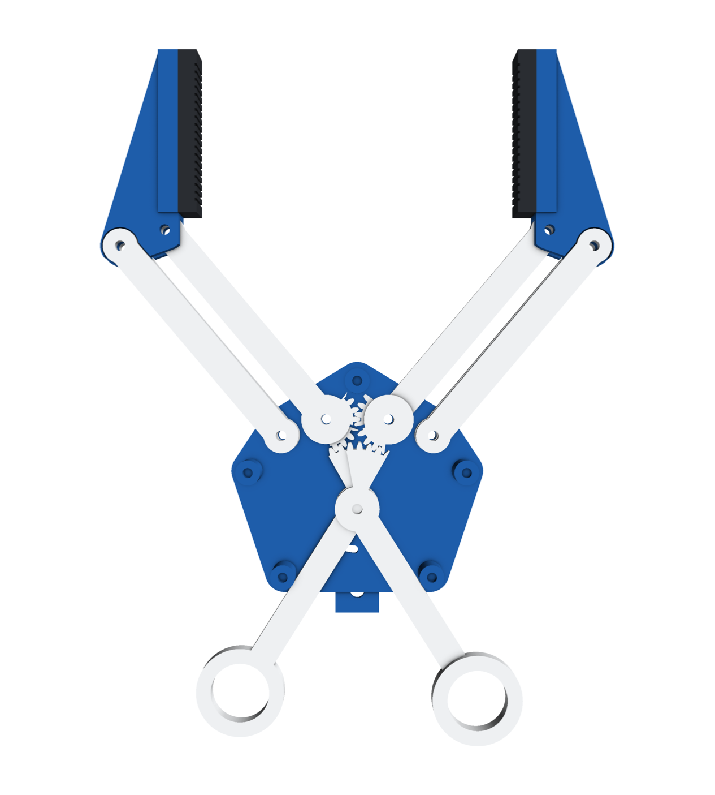
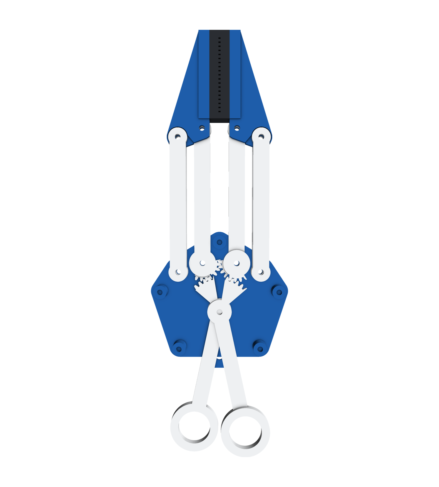
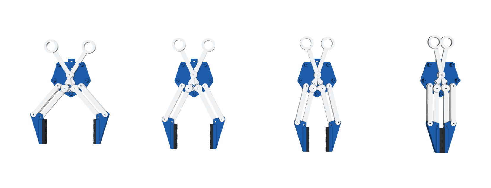

# Scissor-UMI · Robotiq 2F-140

A scissor-handled data-collection gripper whose jaws move exactly like a **Robotiq 2F-140**'s. On the robot side you
use the real 2F-140, with the same D405 + Quest head on a flange collar. The camera, the controller and the pads end
up in the same place on both, and the handheld's jaw angle is the robot's `finger_joint`, so a recorded q can be
sent straight to the gripper.

The design follows [FOMI](https://robbyant-research.github.io/FOMI/) (scissor handles, meshed sector gears that keep
the jaws symmetric, parallelogram finger links, force through the handles, a pose tracker on top). The changes here:

* **The jaw linkage is the 2F-140's own four-bar.** The pivots, the 100 mm links and the pad offset come from
  Robotiq's URDF ([`cad/kin.py`](../cad/kin.py)). The pads trace the robot's arc, including its forward travel as it
  closes, and close at the same q = 0.7.
* **The camera is a RealSense D405** in HandUMI's cup on a tilting knuckle (30° down by default). FOMI uses a fisheye.
* **The tracker is a Meta Quest Touch Pro** in HandUMI's controller ring, on top behind the camera. FOMI uses a Vive
  tracker.
* **There is a 2:1 handle gear.** The two knuckle gears (20 teeth) mesh on the 2F-140's inner pivots, and each handle
  has a 40-tooth sector on one shared axle. The loops turn only 20° over the full 0–128 mm stroke: about 96 mm apart
  open and 38 mm apart closed.

## Handheld and robot

| Handheld | Robot twin |
|---|---|
|  |  |

### What the D405 sees

These are the D405 views on the handheld (left) and on the robot (right) at the same q. The pads are in the same place
in both images. The links differ: the handheld's are straight printed bars, the 2F-140's are cast.

## Mechanism

| Open (q = 0) | Closed (q = 0.7) |
|---|---|
|  |  |

The parts are layered along x. The axis convention is the 2F-140's `robotiq_arg2f_base_link`: z is the approach
direction, y is the opening direction and x points up.

| Layer | x (mm) | What's there |
|---|---|---|
| bottom plate | −16 … −11 | standoffs, AS5047P under the handle axle, arc slot for the stop screw, record button pod |
| L1 | −10.5 … −4 | handle A + its sector, the left knuckle gear's drive teeth, lower outer links |
| L2 | −3.5 … 3.5 | the two knuckle gears' sync teeth, the inner links |
| L3 | 4 … 10.5 | handle B + its sector, the right knuckle gear's drive teeth, upper outer links |
| top plate | 11 … 16 | the mast to the head, the electronics box |

* **Jaws.** Each jaw is a parallelogram. The outer links (two, above and below) and the inner link (in the middle
  layer, one piece with its sector gear) pivot on Ø4 dowels in both plates. Their far ends carry the finger, so the
  pad stays parallel.
* **Stops.** An M3 screw in handle A runs in an arc slot in the bottom plate. The slot's ends are q = 0 and q = 0.7.
* **Sensing.** A diametric magnet sits in handle A's lower hub, over an AS5047P under the bottom plate. q is twice
  the handle angle. The Pico 2 reads it with the record button; see [`electronics.md`](electronics.md).
* **Head.** The head bolts onto a 4 × M3 interface at x = 46 mm: the top of the mast on the handheld, the collar's
  arm on the robot. It carries the D405 cup's knuckle (M4, tilts 15–65°) and a copy of HandUMI's main-support arm end,
  so HandUMI's Quest ring bolts on as it does on HandUMI. For the left hand, use `head_left` and the mirrored ring.
* **Robot collar.** A 6 mm ISO 9409-1-50-4-M6 spacer between the flange and the 2F-140's coupling. It has a pilot
  boss, a recess for the coupling's pilot and a dowel hole at 0°. Use M6 screws 6 mm longer than the coupling's own,
  and turn the collar to keep the arm clear of the coupling's cable exit.

The 2F-140's pad faces are 128.6 mm apart at q = 0 in Robotiq's URDF (the 140 mm on the datasheet is measured
elsewhere on the finger). The handheld matches the URDF.

## Files

| | |
|---|---|
| [`STEP/`](STEP/) | every printed part (STEP only) |
| [`bom.md`](bom.md) | printed and bought parts, handheld and robot |
| [`electronics.md`](electronics.md) | Pico 2, AS5047P, button, USB hub |
| [`urdf/scissor_umi_2f-140.urdf`](urdf/scissor_umi_2f-140.urdf) | handheld: jaws (`finger_joint` + mimics), pads, `d405_optical_frame`, `quest_ring_frame` |
| [`urdf/2f-140_head.urdf.xacro`](urdf/2f-140_head.urdf.xacro) | the same two frames as a macro on the robot's `robotiq_arg2f_base_link` |

Camera pose in G (mm): optical centre (71.8, 0, 48.1), looking (−0.5, 0, 0.866), i.e. 30° below the approach axis.

## Status

This is a first version for review. It has not been printed yet. The clearance check (`python cad/assembly.py
--check`) finds no interference between moving parts over the whole stroke, and none between the head, the D405 or
the Quest and the gripper on either build. The only contact is the two pads meeting at q = 0.7.
