# Scissor-UMI · Robotiq 2F-85

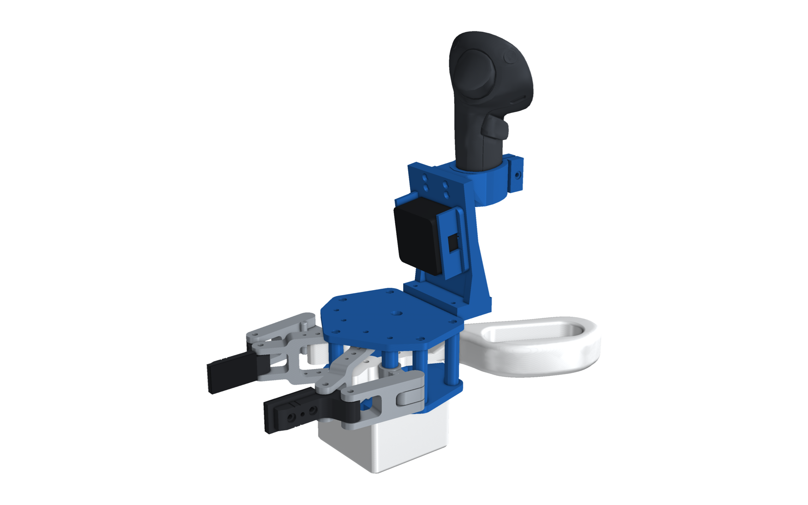

A scissor-handled data-collection gripper whose **jaws are printed copies of a Robotiq 2F-85's jaws**: its outer
knuckle and outer finger, inner knuckle, inner finger and pad. They are pinned at the 2F-85's own joint positions, so
they move exactly like the robot's. **The D405 sits where it sits on the robot**: the handheld carries an identical
copy of the tab of our UR camera plate, the plate that mounts the D405 on the real 2F-85. The handles are shaped like
a spring-action garden scissor (a palm bar and a four-finger loop). A **Feetech STS3215** on the scissor axle reads the
jaw opening, a **Raspberry Pi Pico 2** streams it ([`firmware/`](../firmware/README.md)), and the **Quest Touch Pro**
stands right behind the camera. On the robot you use the real 2F-85 with the camera plate and the D405 as they are.

Scissor handles drive meshed sector gears that keep the jaws symmetric, so you feel the grasp force through the
handles.

## Handheld and robot

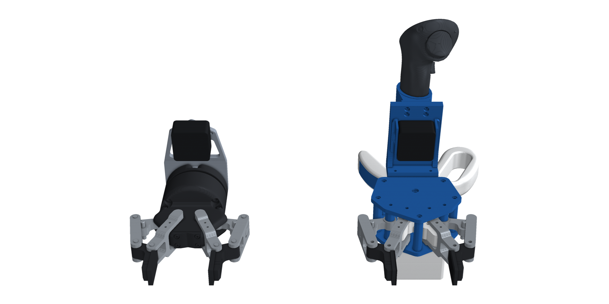

| Handheld | Robot (2F-85 + UR camera plate + D405) |
|---|---|
|  | 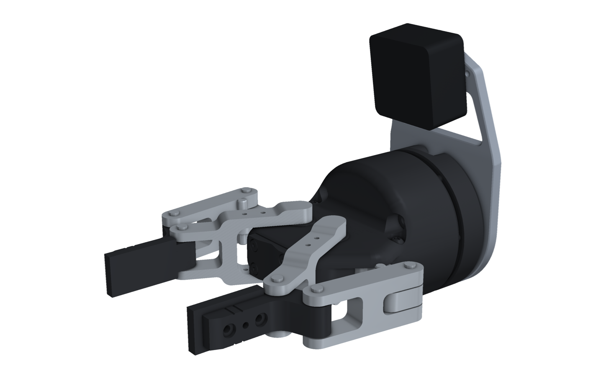 |

### What the D405 sees

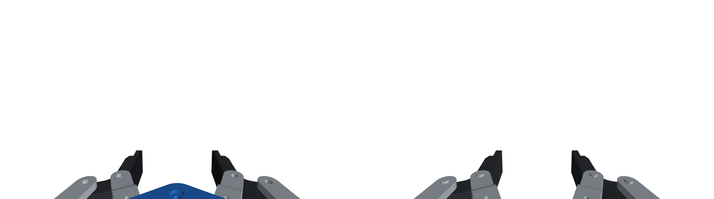

The D405 on the handheld (left) and on the robot (right), at the same q. The camera angles match. Measured from the
two STEP files, the handheld's tab face and the robot plate's tab face are 0.000° and 0.000 mm apart, and all six
holes coincide. The D405 sits 78 mm off the axis at the flange, looking forward and 8.0° in towards the axis. The jaws
and pads are identical; only what sits behind them at the bottom edge of the image differs.

## Assembly

Step-by-step IKEA-style assembly drawings, made from the CAD: [`assembly/ASSEMBLY.md`](assembly/ASSEMBLY.md) (all pages as one PDF: [`assembly/assembly.pdf`](assembly/assembly.pdf)).

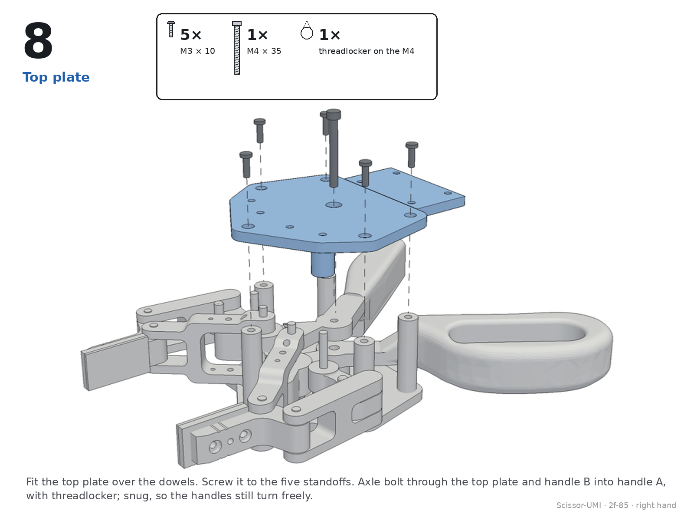

## Grip and electronics

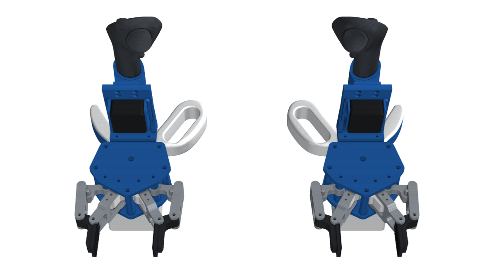

Left-hand build (left) and right-hand build (right): the grips and the Quest controller are mirrored, the mechanism,
camera and electronics are the same.

| Right hand | Left hand | Electronics (box cover hidden) |
|---|---|---|
| 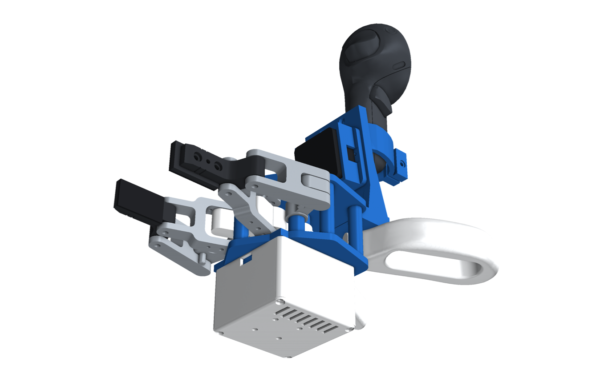 | 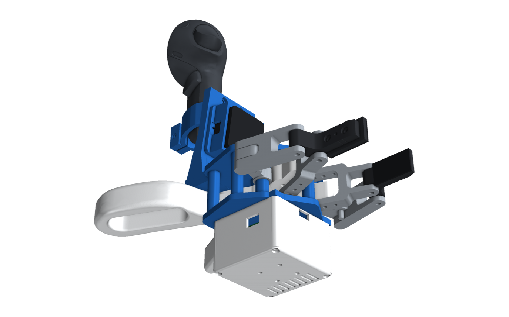 | 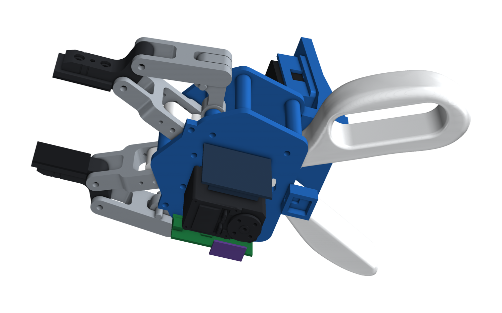 |

## Mechanism

| Open (q = 0) | Closed (q = 0.8) |
|---|---|
| 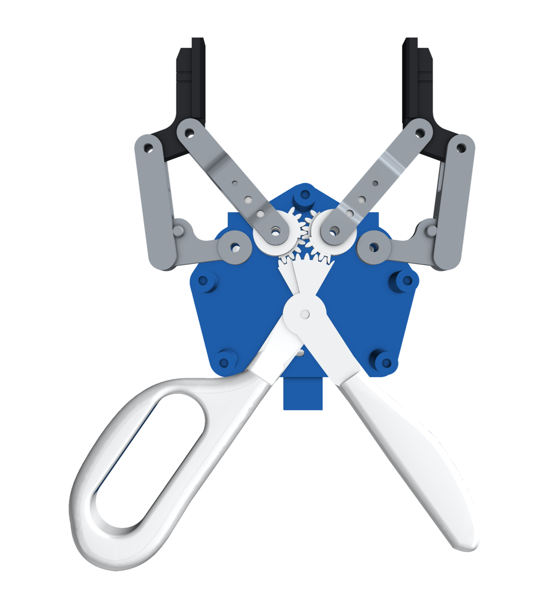 | 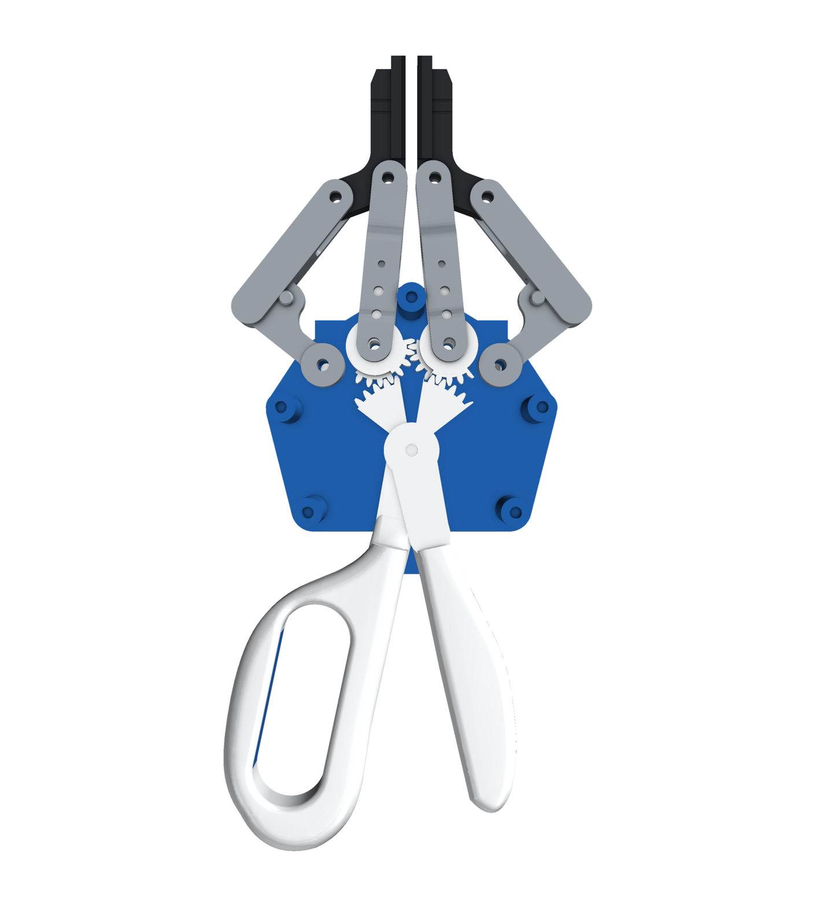 |

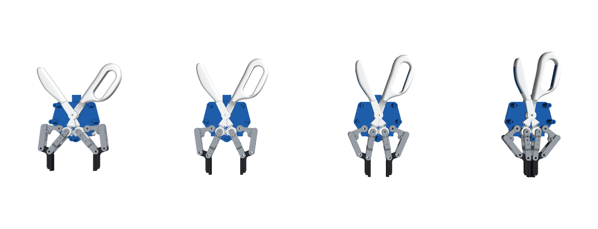

The parts are layered along x. The axis convention is the 2F-85's `robotiq_arg2f_base_link`: z is the approach
direction, y is the opening direction and x points up.

| Layer | x (mm) | What's there |
|---|---|---|
| electronics box | −71 … −25.5 | STS3215 (on the scissor axle), Pico 2, IMU, USB 3 hub |
| bottom plate | −25.5 … −20.5 | standoffs, pivot spacers, arc slot for the stop screw, record button pod |
| 2F-85 jaws | −19.5 … 19.5 | the replica parts at their own x, as on the gripper |
| L1 / L2 / L3 | −11.5 … 11.5 | handle A + left gear's drive teeth / the sync teeth / handle B + right gear's drive teeth |
| top plate | 20.5 … 25.5 | pivot spacers; the mast's foot |
| mast, hood, Quest arm | above | the camera tab copy, the D405, the Touch Pro |

* **Handles.** These are shaped like a spring-action garden scissor (Fiskars Easy Action).
  * One handle is a solid palm bar that swells to 23 mm in the middle.
  * The other is a long D-loop with a 70 × 24 mm window for four fingers.
  * Both are 26 mm tall and rounded on every edge: R 4 on the palm bar, R 6 on the loop, R 4 round the window.
  * Each has a soft TPU insert where the hand pushes and pulls: the palm bar's outer face, and the finger bar's
    inner face.
  * Hold it from below, palm up: the palm on the palm bar, the fingers up through the loop's window and round its
    outer bar. The index finger lands on the record button under the base.
  * The grip is handed. Your fingers point across the handheld from the palm bar to the loop, so the thumb and index
    finger only end up forward, at the button, if the loop is on the side your fingers point to:
    * **right hand** (`handle_a_rh`, `handle_b_rh`): loop on handle A (−y, your left), palm bar on handle B (+y);
    * **left hand** (`handle_a_lh`, `handle_b_lh`): the mirror, palm bar on A, loop on B.
  * Only the grips change. Handle A keeps the hub, the servo's hex drive and the stop screw in both builds, so the
    gears, the encoder reading and the firmware are identical.
  * The arms leave the gears as 14 mm webs and are lofted, rounded, into the grips, so they are thickest where the
    bending load is.
* **Jaws.** The 2F-85's parallelogram, built from replicas of its parts. The outer link (outer knuckle + outer
  finger, printed as one piece) and the inner knuckle pivot on Ø4 dowels through both plates. Their far ends pin to the
  inner finger, which carries the pad. The right jaw uses the same parts turned 180°, as on the gripper. Only hidden
  features differ from Robotiq's parts: bores, the modelled pins removed, 2 × M3 holes through one base prong to key
  the gear (the 2F-85's base fork is already open, ±12 mm), 0.3 mm joint clearance, and the 5 mm pad split into a
  3.5 mm PETG core (2 × M2 self-tapping from the finger's back) and a 1.5 mm TPU face. All these cuts are made on
  Robotiq's meshes (manifold3d) before they become solids.
* **Gears.** The two knuckle gears (20 teeth, m 1.27) sit in the inner knuckles' base clevis on the 2F-85's inner
  pivots and mesh with each other. Each handle has a 40-tooth sector on one shared axle (2:1). The flanks are thinned
  by 0.08 mm so printed teeth run free.
* **Encoder and Pico.** A Feetech STS3215 hangs under the bottom plate on the scissor axle, inside the electronics
  box. Its horn is screwed (4 × M2) to `servo_coupler`, which takes handle A's hex end. It runs with torque off, as on
  HandUMI, and is used only for its 12-bit magnetic encoder: about 261 counts over the stroke, roughly 0.35 mm of pad
  travel per count. The Pico 2 reads it on the servo bus and streams q, the pad width in mm and the record flag at
  100 Hz over the hub's USB. See [`firmware/`](../firmware/README.md); `tools/read_gripper.py` reads and calibrates
  it.
* **Stops.** An M3 screw in handle A runs in an arc slot in the bottom plate. The slot's ends are q = 0 and q = 0.8. The 2F-85's longer finger_joint range turns
  the handles 23° instead of 20°: their range sits 2.5° further open than on the 2F-140 build (so the grips clear each
  other when closed), and the two rear standoffs sit 2.5 mm further forward, at (±35, 4.5), where they clear the open
  grips by at least 1 mm.
* **Camera.** `tab_mast` stands on the top plate and puts a copy of the camera plate's tab face, with its six holes,
  at exactly the same pose in G. The D405 fixes to it the way it fixes to the robot plate. `d405_hood` is an open
  frame round the camera with no floor, so the camera sits straight on the tab. It is screwed from behind into the
  tab's two outer holes.
* **Quest.** `quest_arm` is a pad on the back of the mast, screwed from the mast's front (4 × M3). It carries a split
  collar bored to the Touch Pro's handle and clamped with one M3. The controller stands upright on the centre plane
  right behind the camera, above your hand, held the way a hand holds it: trigger and ring forward over the jaws,
  thumbstick face up and back towards you, its cameras clear. The right-hand build
  carries the right controller on `quest_arm_right`, the left-hand build the left controller on `quest_arm_left`.
* **Robot side.** The real 2F-85 on `ur_camera_plate` (our part, unchanged; it puts the coupling 7 mm further from
  the UR flange) with the D405 on its tab. There is no Quest on the robot.

## Verification

`python cad/verify.py` checks the following:

| Check | Result |
|---|---|
| Gear meshes over the whole stroke (sync, handle A, handle B), from sections of the real parts | engaged throughout, 0 tooth interference, backlash 1.8° (sync) and 0.9° (handles) |
| Handheld jaws vs Robotiq's 2F-85 meshes on the robot at q = 0, 0.4, 0.8 | median surface distance 0.00 mm for every part; pads within 0.00 mm |
| Camera: handheld tab (`tab_mast` STEP) vs the robot's camera plate tab (`ur_camera_plate` STEP) | faces 0.000° and 0.000 mm apart, all six holes within 0.000 mm, so the same D405 pose |
| Interference between every pair of parts over the stroke (handles, grips, gears, jaws, servo, Pico, hub, IMU, box, mast, hood, D405, Quest arm and controller), and the robot's plate and D405 vs the gripper | none, with every part checked as a closed volume; the pads stop 4.1 mm apart at q = 0.8 |

The 2F-85's pad faces (Robotiq's pad mesh, 20 × 35 × 5 mm) are 88.6 mm apart at q = 0 and 4.1 mm apart at its
`finger_joint` limit q = 0.8, in Robotiq's URDF; the handheld matches it, so its pads stop 4.1 mm apart too. The
gear train, handles, head, electronics and firmware are the 2F-140 build's: both grippers have the same base pivots.

## Files

| | |
|---|---|
| [`STEP/`](STEP/) | every part (STEP only). The `*_2f85` parts are the jaw replicas. `ur_camera_plate` is the robot's camera plate |
| [`bom.md`](bom.md) | printed and bought parts, handheld and robot |
| [`electronics.md`](electronics.md) | Pico 2, STS3215, IMU, button, USB hub |
| [`../firmware/`](../firmware/README.md), [`../tools/read_gripper.py`](../tools/read_gripper.py) | Pico firmware (STS3215 encoder → q, width, record flag) and the PC reader / calibration |
| [`urdf/scissor_umi_2f-85.urdf`](urdf/scissor_umi_2f-85.urdf) | handheld: jaws (`finger_joint` + mimics), pads, `d405_optical_frame`, `quest_ring_frame` |
| [`urdf/2f-85_camera.urdf.xacro`](urdf/2f-85_camera.urdf.xacro) | the same `d405_optical_frame` as a macro on the robot's `robotiq_arg2f_base_link` |
| [`NOTICE.md`](NOTICE.md) | where the jaw geometry and the reference models come from |

## Status

This version is for review and has not been printed yet. The jaw replicas come from Robotiq's ROS visual meshes, so
their STEP is faceted. They are dimensionally exact to those meshes, which may lack small fillets of the production
parts.
