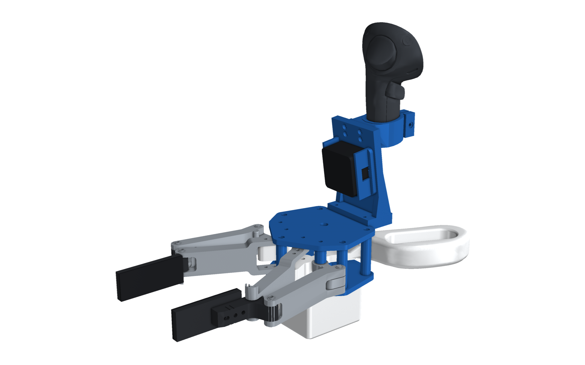
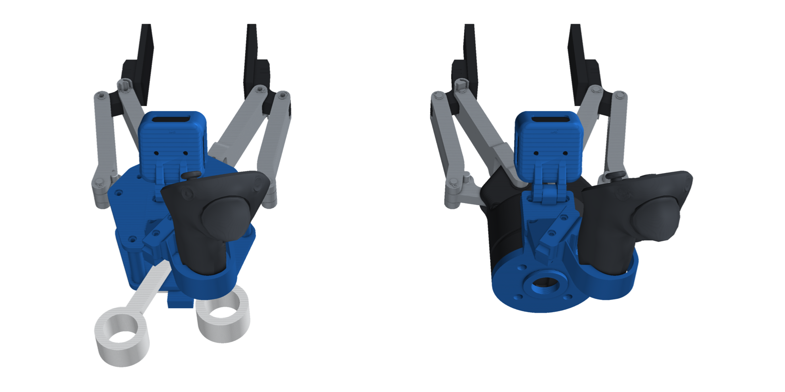
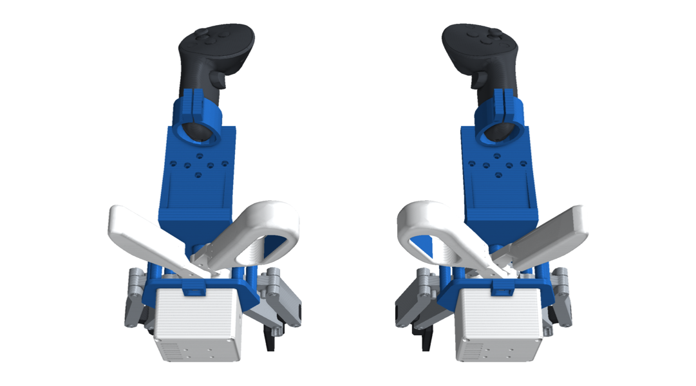
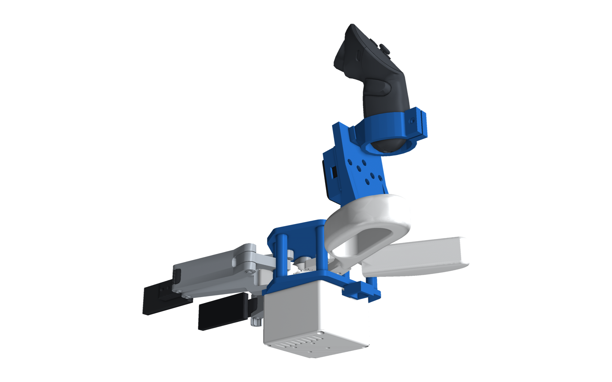
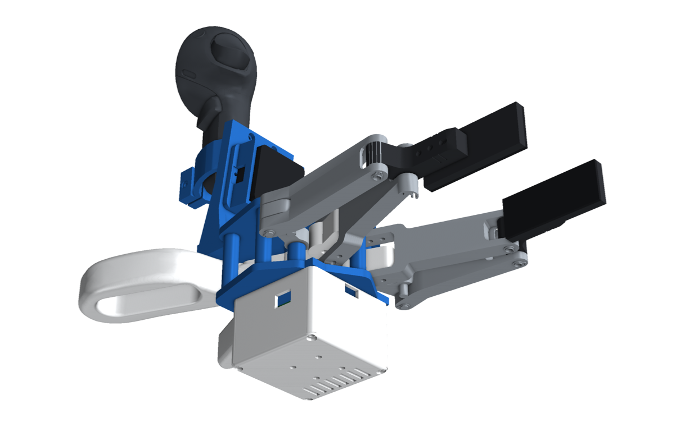
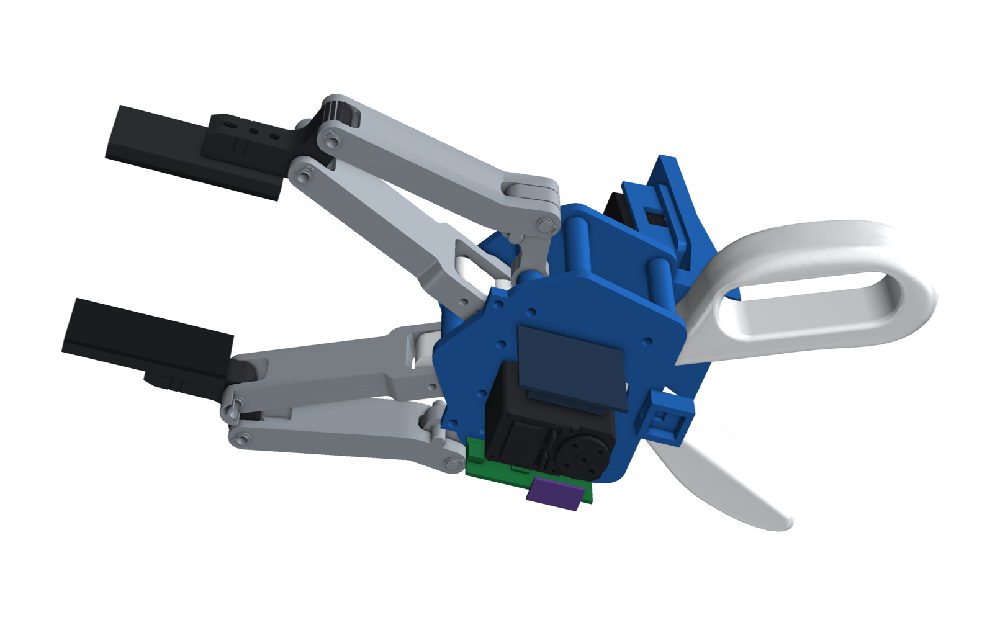
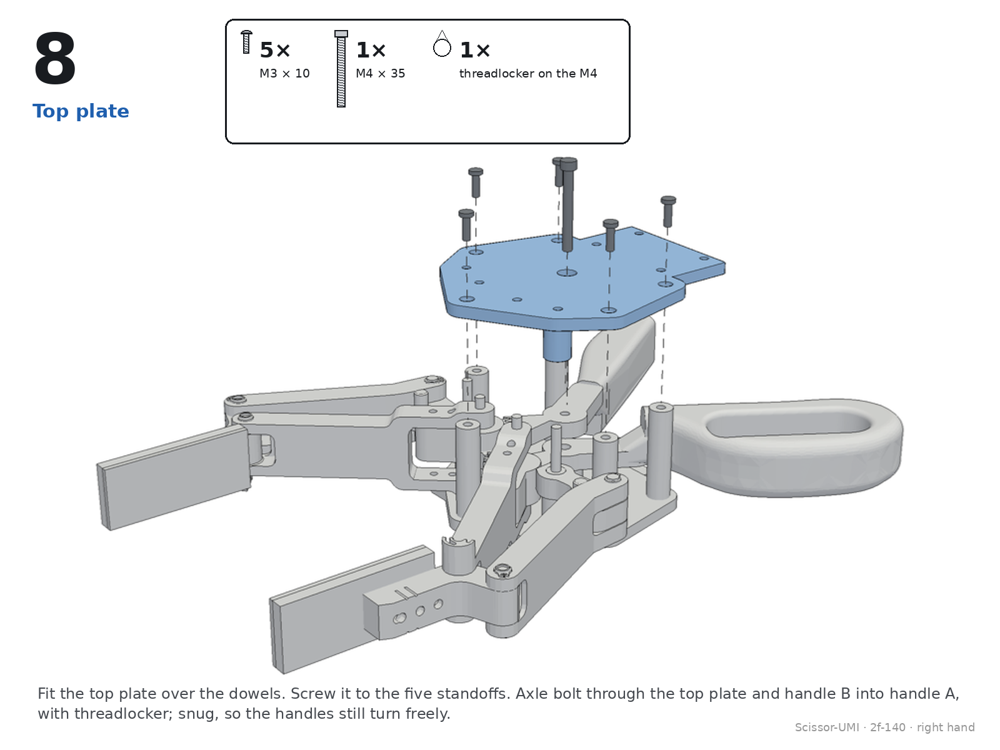

# Scissor-UMI

Scissor-handled grippers whose
jaws are printed copies of a real robot gripper's jaws. The D405 sits exactly where our camera plate puts it on the
robot, a Feetech STS3215 on the scissor axle reads the jaw angle, and a Meta Quest Touch Pro stands on top. On the robot:
the real gripper, our camera plate and the D405.

<p align="center"></p>

## Handheld and robot twin

<p align="center"></p>

| Handheld | Robot (real 2F-140, our camera plate, D405) |
|---|---|
|  |  |

## Same view on both

<p align="center"></p>

What the D405 sees on the handheld (left) and on the robot (right) at the same q: the jaws and pads are identical. The
handheld's camera tab and the robot plate's tab match to 0.000 mm and 0.000° (measured from the STEP files).

## Mechanism

| Open (q = 0) | Closed (q = 0.7) |
|---|---|
|  |  |

<p align="center"></p>

Garden-scissor grips (a palm bar and a four-finger loop, soft TPU inserts) drive two meshed 20-tooth knuckle gears
through 40-tooth sectors (2:1). The jaws are printed copies of the 2F-140's jaw parts on its own joint positions, so
they look and move exactly like the robot's. An STS3215 on the scissor axle reads the opening, and a Pico 2 streams it
([`firmware/`](firmware/README.md)).

<p align="center"></p>

There is a right-hand and a left-hand build: the grips (palm bar and finger loop swap sides) and the Quest controller
are mirrored; everything else is shared.

| Right hand | Left hand | Electronics |
|---|---|---|
|  |  |  |

## Assembly

Step-by-step IKEA-style assembly drawings, made from the CAD: [`2f-140/assembly/ASSEMBLY.md`](2f-140/assembly/ASSEMBLY.md) (all pages as one PDF: [`2f-140/assembly/assembly.pdf`](2f-140/assembly/assembly.pdf)).

<p align="center"></p>

Details, BOM and wiring are in
[`2f-140/README.md`](2f-140/README.md).

## Grippers

| Robot gripper | Folder | Status |
|---|---|---|
| Robotiq 2F-140 | [`2f-140/`](2f-140/README.md) | first version, for review |
| Robotiq 2F-85 | (next) | add its entry to `GRIPPERS` in `cad/kin.py` |

## Build

The code is in `cad/` (build123d, bd_warehouse, trimesh, pyvista; the same environment as PG Chopstick):

```
cd scissor-umi/cad
python package.py          # parts -> ../<gripper>/STEP, clearance check, URDFs, renders -> ../<gripper>/img
python verify.py           # gears over the stroke, jaws vs the robot's 2F-140, camera tab vs the robot plate, interference
```

The renders need two models that aren't in the repository. Put Meta's Touch Pro STL in `cad/source/quest/` and
Robotiq's 2F-140 visual meshes in `cad/source/robotiq_2f_140/`; each folder's README says where to get them.
HandUMI's D405 cup and Quest ring are read from `handumi/hardware/STEP/right/`.
