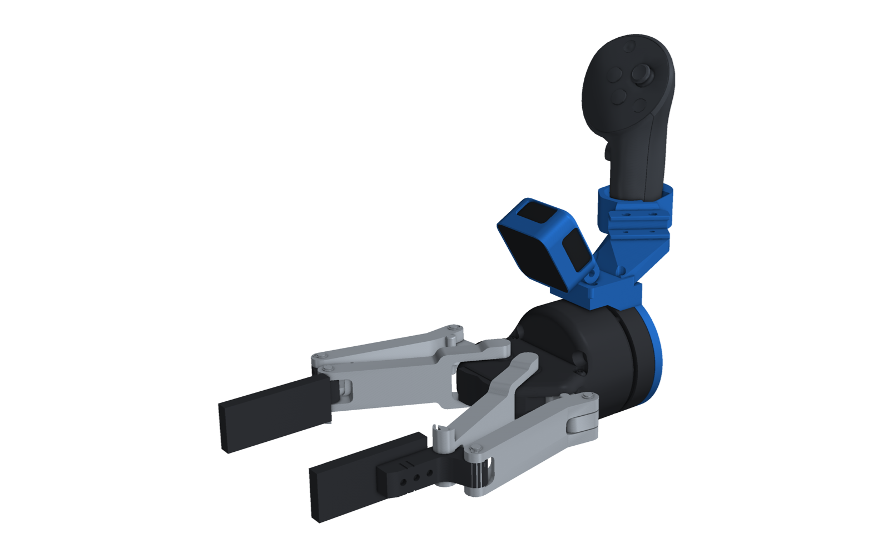
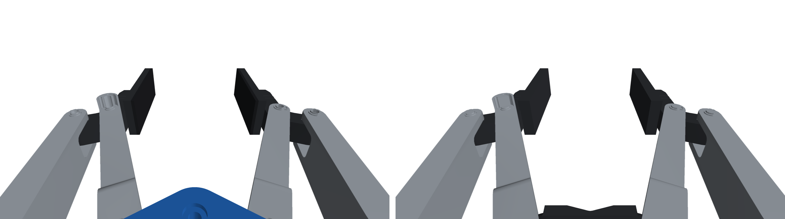
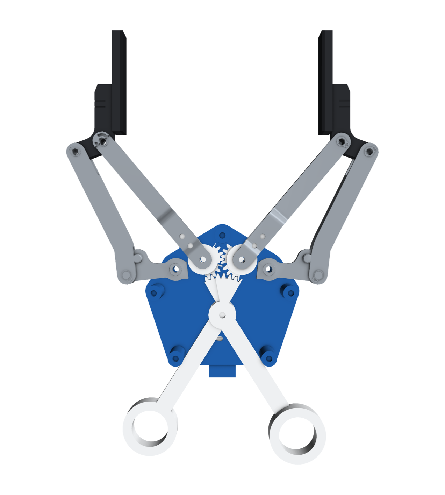
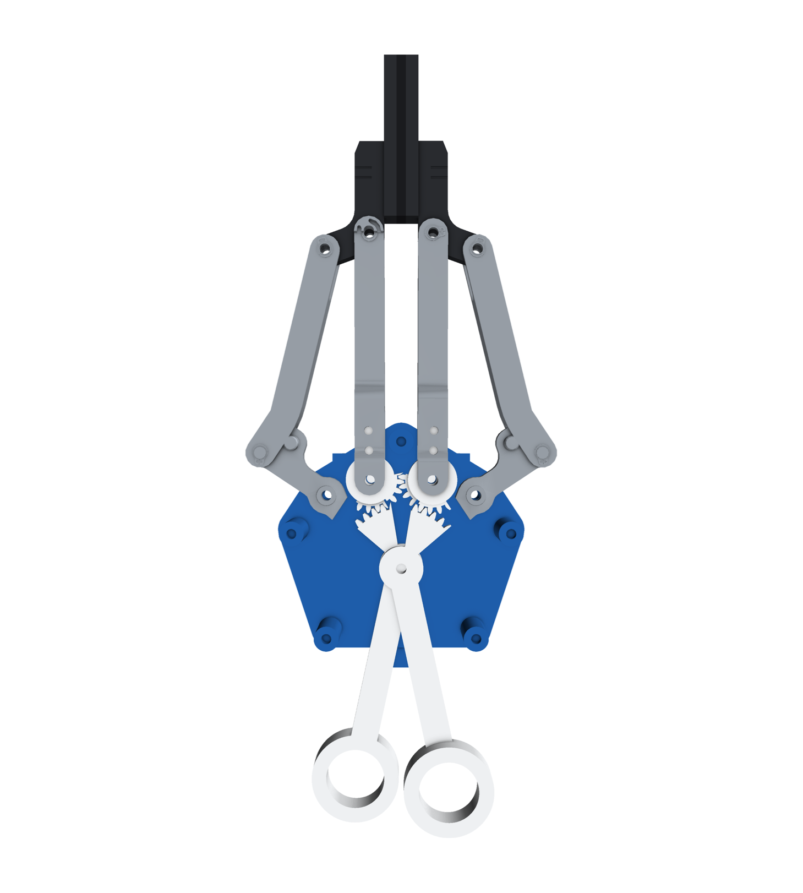
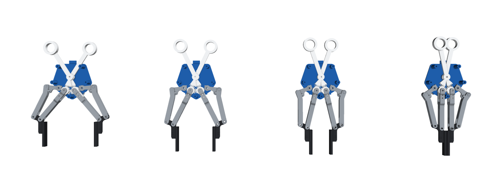

# Scissor-UMI

FOMI-style scissor grippers ([robbyant-research.github.io/FOMI](https://robbyant-research.github.io/FOMI/)) whose
jaws are printed copies of a real robot gripper's jaws, with a RealSense D405 and a Meta Quest Touch Pro controller on top. The
robot twin is the real gripper with the same head on a flange collar.

<p align="center"></p>

## Handheld and robot twin

<p align="center"></p>

| Handheld | Robot twin (real Robotiq 2F-140) |
|---|---|
|  |  |

## Same view on both

<p align="center"></p>

What the D405 sees on the handheld (left) and on the robot (right) at the same q: the jaws and pads are identical.

## Mechanism

| Open (q = 0) | Closed (q = 0.7) |
|---|---|
|  |  |

<p align="center"></p>

Scissor handles drive two meshed 20-tooth knuckle gears through 40-tooth sectors (2:1). The jaws are printed copies
of the 2F-140's jaw parts on its own joint positions, so they look and move exactly like the robot's. Details, BOM and wiring are in
[`2f-140/README.md`](2f-140/README.md).

## Grippers

| Robot gripper | Folder | Status |
|---|---|---|
| Robotiq 2F-140 | [`2f-140/`](2f-140/README.md) | first version, for review |
| Robotiq 2F-85 | (next) | add its entry to `GRIPPERS` in `cad/kin.py` |

## Build

The code is in `cad/` (build123d, bd_warehouse, trimesh, pyvista; the same environment as PG Chopstick):

```
cd scissor-umi/cad
python package.py          # parts -> ../<gripper>/STEP, clearance check, URDFs, renders -> ../<gripper>/img
python verify.py           # gears over the stroke, jaws vs the robot's 2F-140, interference
```

The renders need two models that aren't in the repository. Put Meta's Touch Pro STL in `cad/source/quest/` and
Robotiq's 2F-140 visual meshes in `cad/source/robotiq_2f_140/`; each folder's README says where to get them.
HandUMI's D405 cup and Quest ring are read from `handumi/hardware/STEP/right/`.
